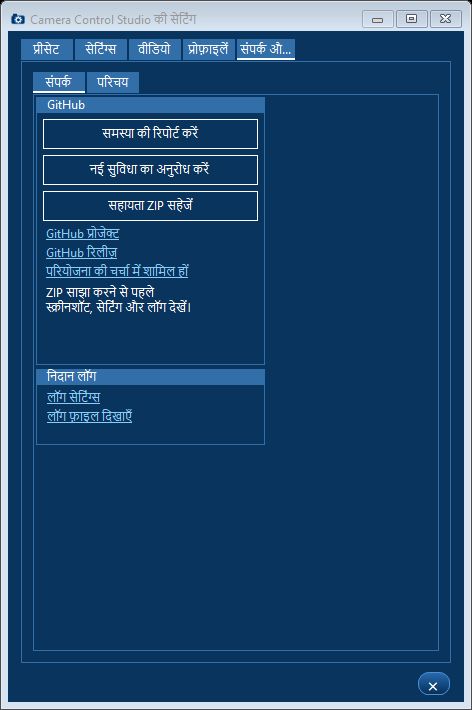

# समस्या की रिपोर्ट करें

1. सेटिंग खोलने के लिए नीचे गियर बटन पर क्लिक करें। **संपर्क और परिचय → संपर्क → समस्या की रिपोर्ट करें** चुनें।
2. नया संस्करण उपलब्ध हो तो डाउनलोड पेज खोलने के लिए **हाँ** चुनें। उसे इंस्टॉल करें और देखें कि समस्या फिर से होती है या नहीं। GitHub ड्राफ़्ट पर जाने के लिए **नहीं** चुनें।
3. ऐप सहायता ZIP सहेजने का विकल्प दे तो **हाँ** चुनकर स्थान बताएँ। बिना ZIP बनाए ड्राफ़्ट खोलने के लिए **नहीं** चुनें।

गाइड व्यूअर में भी वही GitHub बटन हैं।

## विवरण जोड़ें और ZIP संलग्न करें

बटन GitHub का **Bug report** टेम्पलेट खोलता है। बताएं कि आपको क्या उम्मीद थी, क्या हुआ और समस्या दोबारा कैसे देखें। ऐप और Windows के संस्करण लिखें। ज़रूरत हो तो कैमरा और कैप्चर ऐप भी बताएं। लाल तारांकन वाले सभी भाग भरें।

पैकेज सहेजने के लिए **संपर्क और परिचय → संपर्क → सहायता ZIP सहेजें** चुनें और स्थान बताएँ। ऐप फ़ाइल का पथ दिखाता है।

ZIP में ऐप का स्क्रीनशॉट, सहेजी गई `profiles.json`, विंडो लेआउट वाली `window.json` और `Logs` में उपलब्ध लॉग होते हैं।

साझा करने से पहले ZIP से प्रोफ़ाइल नाम, कैमरा ID और फ़ाइल पथ जैसी निजी जानकारी निकालें। ZIP या काम की फ़ाइलों को खुद ड्राफ़्ट के विवरण में खींचकर जोड़ें।

## प्रकार और लेबल जाँचें

टेम्पलेट **Type** में **Bug** और **Labels** में `bug` माँगता है। मान खाली हैं और फ़ील्ड बदल सकते हैं तो दाईं ओर के पैनल में उन्हें चुनें। अनुमति न हो तो ड्राफ़्ट भेजें। प्रोजेक्ट का रखरखाव करने वाला व्यक्ति बाद में इन्हें जोड़ सकता है।

**Preview** में विवरण और संलग्न फ़ाइलें देखें। फिर **Create** चुनें।
