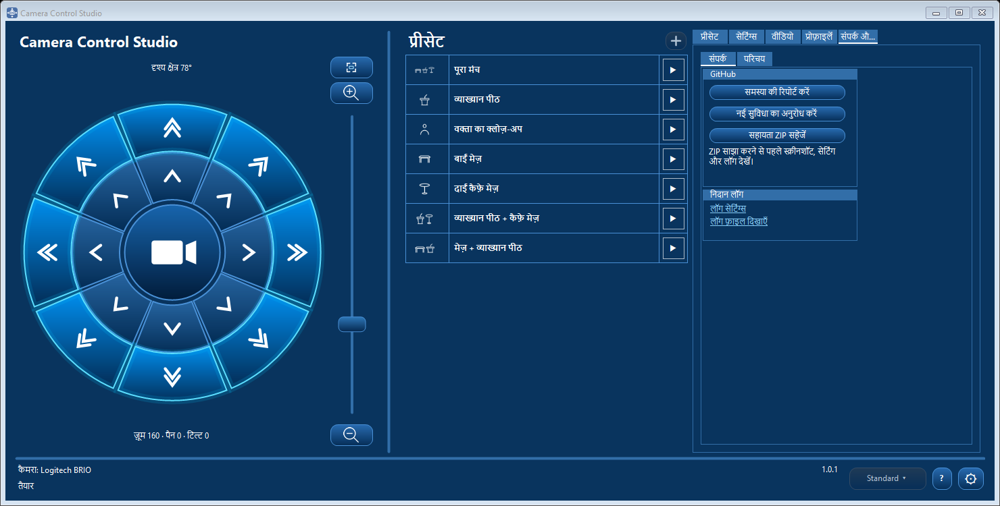

# नई सुविधा का अनुरोध करें

1. सेटिंग पैनल खोलें। **संपर्क और परिचय → संपर्क → नई सुविधा का अनुरोध करें** चुनें।
2. नया संस्करण उपलब्ध हो तो डाउनलोड पेज खोलने के लिए **हाँ** चुनें। उसे इंस्टॉल करें और देखें कि सुविधा उसमें पहले से मौजूद है या नहीं। GitHub ड्राफ़्ट पर जाने के लिए **नहीं** चुनें।
3. GitHub के **Feature request** टेम्पलेट में अपना काम, सुविधा से मिलने वाली मदद और वह नतीजा बताएं जिससे पता चले कि सुविधा काम कर रही है। लाल तारांकन वाले सभी भाग भरें।

## एक उदाहरण संलग्न करें

पैकेज सहेजने के लिए **संपर्क और परिचय → संपर्क → सहायता ZIP सहेजें** चुनें और स्थान बताएँ। ऐप फ़ाइल का पथ दिखाता है।

ZIP में ऐप का स्क्रीनशॉट, सहेजी गई `profiles.json`, विंडो लेआउट वाली `window.json` और `Logs` में उपलब्ध लॉग होते हैं।

साझा करने से पहले ZIP से प्रोफ़ाइल नाम, कैमरा ID और फ़ाइल पथ जैसी निजी जानकारी निकालें। ZIP या काम की फ़ाइलों को खुद ड्राफ़्ट के विवरण में खींचकर जोड़ें।

## प्रकार और लेबल जाँचें

टेम्पलेट **Type** में **Feature** और **Labels** में `enhancement` माँगता है। मान खाली हैं और फ़ील्ड बदल सकते हैं तो दाईं ओर के पैनल में उन्हें चुनें। अनुमति न हो तो ड्राफ़्ट भेजें। प्रोजेक्ट का रखरखाव करने वाला व्यक्ति बाद में इन्हें जोड़ सकता है।

**Preview** में विवरण और संलग्न फ़ाइलें देखें। फिर **Create** चुनें।
