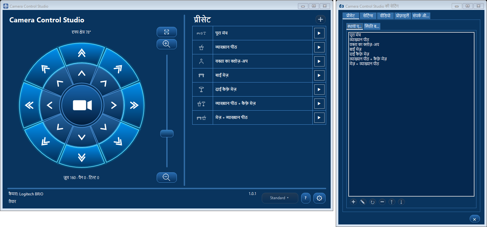
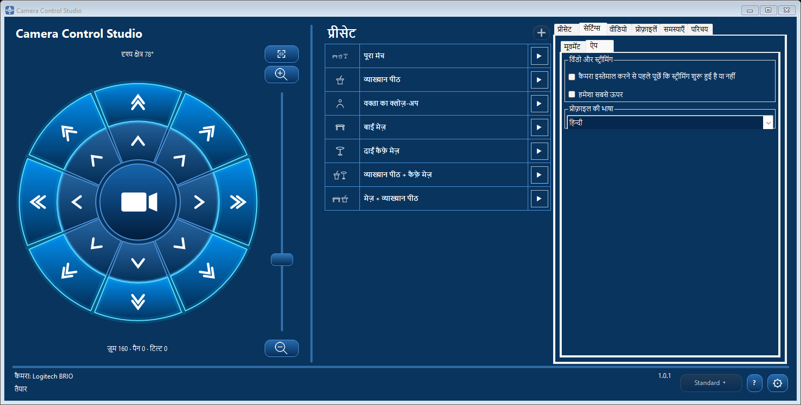
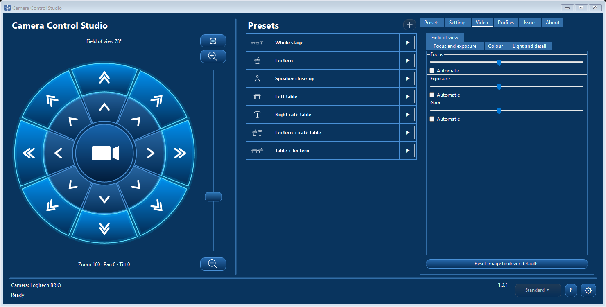
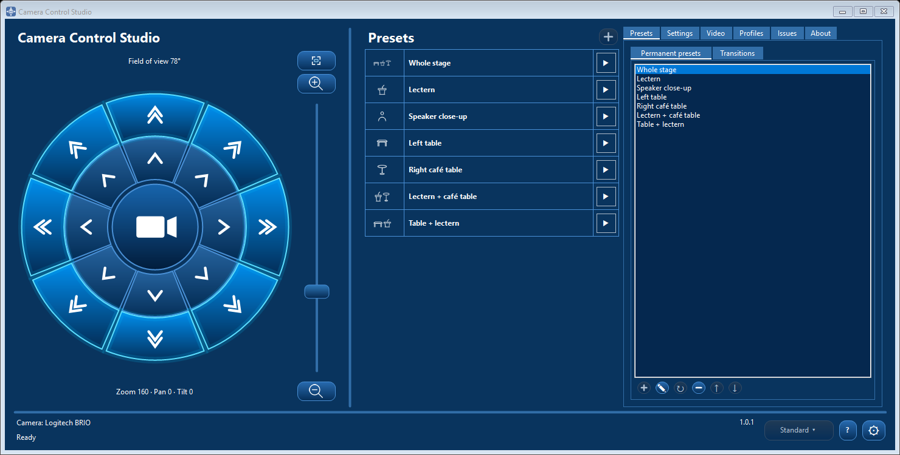
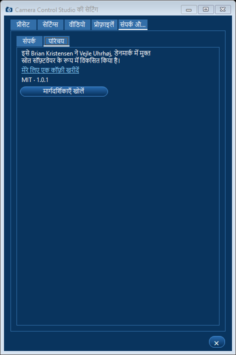
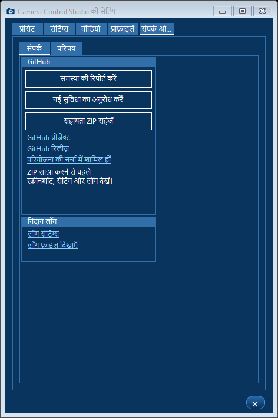

[English](../en/SETUP.md) · [Dansk](../da/SETUP.md) · [Deutsch](../de/SETUP.md) · [सभी गाइड भाषाएँ](USER-GUIDES.md)

# एप्लिकेशन सेट करें

*Camera Control Studio 1.0.1.* के लिए लिखा गया

[समस्या निवारण](TROUBLESHOOTING.md)

सेटिंग खोलने के लिए नीचे गियर बटन पर क्लिक करें। सेटिंग अलग विंडो में खुलती हैं। आप मुख्य विंडो का उपयोग जारी रख सकते हैं।

## इंस्टॉल करें और डाउनलोड सत्यापित करें

इंस्टॉलर या पोर्टेबल डाउनलोड करें ZIP प्रोजेक्ट से [GitHub रिलीज़](https://github.com/bkristensen/Camera-Ctrl-Pressets-Studio/releases). इंस्टॉलर चलाएँ या संपूर्ण निकालें ZIP ऐप लॉन्च करने से पहले. यदि ए SHA-256 चेकसम प्रकाशित हो गया है, इसकी तुलना करें `Get-FileHash -Algorithm SHA256` आपके डाउनलोड के लिए.

**आधिकारिक डाउनलोड**\
<https://github.com/bkristensen/Camera-Ctrl-Pressets-Studio/releases>\

Microsoft Defender SmartScreen एक नीली चेतावनी दिखा सकता है जब किसी डाउनलोड किए गए ऐप या उसके प्रकाशक की प्रतिष्ठा बहुत कम हो। इसे गंभीरता से लें. यदि आपने आधिकारिक रिलीज़ से अपेक्षित फ़ाइल प्राप्त की है और स्रोत पर भरोसा करते हैं, तो **अधिक जानकारी** चुनें और फ़ाइल नाम और प्रकाशक की समीक्षा करें। **Run को वैसे भी चुनें** केवल तभी चुनें जब आप उस फ़ाइल पर भरोसा करना चुनते हैं और विंडोज़ विकल्प प्रदान करता है। अन्यथा चेतावनी बंद करें. अपने संगठन की डिवाइस नीति का पालन करें. [Microsoft स्मार्टस्क्रीन मार्गदर्शन](https://learn.microsoft.com/windows/apps/package-and-deploy/smartscreen-reputation)

<https://learn.microsoft.com/windows/apps/package-and-deploy/smartscreen-reputation>

यदि गाइड व्यूअर को WebView2 की आवश्यकता है, तो Microsoft से रनटाइम डाउनलोड करें।\
<https://developer.microsoft.com/microsoft-edge/webview2/>

अधिक जानकारी के साथ 

## 1. एक प्रोफ़ाइल और कैमरा चुनें

किसी प्रोफ़ाइल का चयन करने के लिए पादलेख में प्रोफ़ाइल पिकर का उपयोग करें। एक बनाने के लिए, **सेटिंग्स → प्रोफ़ाइलें** खोलें। डिफ़ॉल्ट सेटिंग्स के लिए **New** चुनें या सक्रिय प्रोफ़ाइल की प्रतिलिपि के लिए **Copy** चुनें। इसे किसी व्यक्ति या सेटअप के नाम पर नाम दें. नई प्रोफ़ाइलें सक्रिय हो जाती हैं. **प्रोफ़ाइलें** में, एक प्रोफ़ाइल चुनें और उसका नाम बदलने के लिए **✎** पर क्लिक करें। मानक प्रोफ़ाइल का एक निश्चित नाम है.

कैमरा चुनने के लिए दिशा चक्र के केंद्र में कैमरा प्रतीक पर डबल-क्लिक करें। कार्यक्रम इसे याद रखता है. यदि वह कैमरा गायब है, तो कोई अन्य स्रोत चुनें। स्थितियाँ प्रोफ़ाइल के भीतर एक कैमरे से संबंधित होती हैं।

प्रोफ़ाइल सूची और क्रियाओं के साथ 

## 2. तय करें कि कैमरा नियंत्रण कब शुरू हो सकता है

**सेटिंग्स → ऐप** के अंतर्गत, यदि आपका कैप्चर प्रोग्राम पहले शुरू होना चाहिए तो **कैमरा इस्तेमाल करने से पहले पूछें कि स्ट्रीमिंग शुरू हुई है या नहीं** सक्षम करें। यह विकल्प डिफ़ॉल्ट रूप से बंद है.

विकल्प सक्षम होने पर, पहला कैमरा एक्शन पूछता है कि क्या स्ट्रीमिंग शुरू हो गई है। **yes** तभी चुनें जब उसके पास हो। कैमरा नियंत्रण को डिस्कनेक्ट रखने के लिए **No** चुनें। हाँ के बाद, आगे की कार्रवाई तब तक दोबारा न पूछें जब तक कि आप प्रोफ़ाइल न बदल लें, इस विकल्प को न बदल लें या ऐप को पुनरारंभ न कर दें। ऐप आपके लिए स्ट्रीमिंग सत्र का पता नहीं लगाता या शुरू नहीं करता है।

यदि आपको पहले उपयोग पर इस ऑर्डर की आवश्यकता है, तो अपने अगले सत्र से पहले विकल्प सेट करें। डिफ़ॉल्ट ऐप को स्टार्टअप पर कनेक्ट करने की अनुमति देता है।

## 3. मूवमेंट और ज़ूम सेट करें

पैन और झुकाव के चरणों को सेट करने, दिशाओं को उलटने और कैमरा बटन कैसे काम करता है यह चुनने के लिए **सेटिंग्स → पैनिंग** खोलें। छोटे कदमों से शुरुआत करें. अपने कैप्चर प्रोग्राम में परिणाम का परीक्षण करें।

| सेटिंग | यह क्या बदलता है | डिफ़ॉल्ट |
| --- | --- | --- |
| ठीक गति (सामान्य का%) | Ctrl और एक तीर कुंजी दबाए रखते हुए रेट करें | 50% |
| सामान्य पैन चरण | मध्य तीर वलय | 1 |
| तेज़ पैन चरण | बाहरी तीर का घेरा | 4 |

एक कदम का मतलब कैमरा ड्राइवर द्वारा समर्थित एक कदम है। यह कोई निश्चित दूरी या प्रतिशत नहीं है. ड्राइवर गति और सुगमता को सीमित कर देता है।

उल्टे कैमरे के लिए, **कैमरे की ऊपर/नीचे गति उलटें** सक्षम करें और परीक्षण करें। **कैमरे की बाएँ/दाएँ गति उलटें** को केवल तभी सक्षम करें जब बायां गलत दिशा में आगे बढ़े। ये सेटिंग्स नियंत्रण बदल देती हैं. वे वीडियो को घुमाते नहीं हैं.

### ज़ूम चरण सेट करें

यह चुनने के लिए **सेटिंग्स → ज़ूम** खोलें कि प्लस और माइनस बटन एक चरण में कितनी दूर तक चलते हैं। डिफ़ॉल्ट एक ड्राइवर चरण है. [ज़ूम टैब](../images/screenshots/settings-tabs/en/zoom.png) देखें।

### प्रीसेट ट्रांज़िशन सेट करें

सहेजी गई स्थितियों के बीच कैमरा कैसे चलता है यह चुनने के लिए **प्रीसेट → स्थिति बदलना** खोलें। [ट्रांज़िशन टैब](../images/screenshots/settings-tabs/en/transitions.png) देखें।

| सेटिंग | यह क्या बदलता है | डिफ़ॉल्ट |
| --- | --- | --- |
| पूर्व निर्धारित ट्रांज़िशन के लिए गति का उपयोग करें | यात्रा की दूरी को अवधि निर्धारित करने दें | बंद |
| संक्रमण गति (%/s) | प्रति सेकंड नियंत्रित अक्ष की सीमा के प्रतिशत के रूप में क्रूज़ दर | 30% |
| संक्रमण (सेक.) | निश्चित अवधि मोड में प्रत्येक पूर्व निर्धारित परिवर्तन के लिए समय | 1.0 |

गति-आधारित बदलावों के साथ, एक छोटी चाल में लंबी चाल की तुलना में कम समय लगता है। ऐप गति बढ़ाता है और ब्रेक लगाता है, और सभी गतिमान अक्ष समान प्रगति साझा करते हैं ताकि वे एक साथ लक्ष्य तक पहुंच सकें।

### देखने का क्षेत्र सेट करें

**वीडियो → दृश्य क्षेत्र** खोलें। **शुरू होने पर दृश्य क्षेत्र** के अंतर्गत, **सबसे चौड़ा उपलब्ध**, कैमरा ड्राइवर द्वारा रिपोर्ट किया गया कोण, या वर्तमान दृश्य बनाए रखने के लिए **जैसा है वैसा रखें** चुनें। ऐप पहली बार कनेक्ट होने पर इस विकल्प का उपयोग करता है। दिशा पहिये के नीचे रिपोर्ट किए गए कोणों में से चुनने के लिए **दृश्य क्षेत्र मैन्युअल रूप से बदलने दें** चालू करें। यदि ड्राइवर कोई चयन योग्य कोण नहीं बताता है, तो FOV नियंत्रण अक्षम हो जाते हैं। यदि कैमरा इसका समर्थन करता है तो आप अभी भी ज़ूम का उपयोग कर सकते हैं। [दृश्य क्षेत्र टैब](../images/screenshots/settings-tabs/en/field-of-view.png) देखें।

**ज़ूम और पैन की सीमा पर दृश्य क्षेत्र बदलें** डिफ़ॉल्ट रूप से चालू है। आप इसे मैन्युअल पिकर के साथ छिपाकर उपयोग कर सकते हैं। यह तब काम करता है जब ड्राइवर FOV को सपोर्ट करता है।

- **ज़ूम आउट:** ब्रियो पर न्यूनतम ज़ूम 65° पर सेट करें, 78° पर स्विच करने के लिए फिर से ज़ूम आउट दबाएँ। वह प्रेस FOV को बदल देता है और शॉट को पास रखने के लिए ज़ूम को समायोजित करता है। अगला प्रेस सामान्य रूप से ज़ूम आउट हो जाता है। वही चरण आपको 78° से 90° तक ले जाते हैं। बटन 90° और न्यूनतम ज़ूम पर रुक जाता है।
- **ज़ूम इन:** अधिकतम ज़ूम पर, एक संकीर्ण FOV की ओर जाने के लिए फिर से दबाएँ। यदि ड्राइवर 90°, 78° और 65° रिपोर्ट करता है, तो ऐप उन्हें उसी क्रम में उपयोग करता है। बटन न्यूनतम उपलब्ध कोण और अधिकतम ज़ूम पर रुकता है।
- **पैन बाएँ या दाएँ:** किनारे पर, ऐप पहले व्यापक दृश्य का प्रयास करता है। यह क्रॉप को पास रखने के लिए ज़ूम को समायोजित करता है। यदि ज़ूम इसकी अनुमति देता है तो यह एक संकीर्ण दृश्य का भी प्रयास कर सकता है। यदि कोई दृश्य इसे आगे बढ़ने नहीं देता है, तो यह पिछले शॉट को पुनर्स्थापित कर देता है। ड्राइवर नियंत्रित करता है कि मैच कितना करीबी है।

सबसे चौड़े FOV और न्यूनतम ज़ूम पर सीधे जाने के लिए फ़्रेम प्रतीक के साथ वर्गाकार बटन का उपयोग करें। स्लाइडर अभी भी वर्तमान FOV के भीतर ज़ूम सेट करता है। वर्तमान दृश्य में ज़ूम और पैन बनाए रखने के लिए स्वचालित FOV बंद करें।

प्रीसेट पैन, टिल्ट, ज़ूम और ड्राइवर द्वारा रिपोर्ट किए गए FOV को सेव करते हैं। पुराने प्रीसेट वर्तमान FOV को बनाए रखते हैं। यदि ज़ूम, लॉजिटेक ब्रियो कंट्रोल, या कोई अन्य ऐप क्रॉप को नियंत्रित करता है तो लाइव छवि की जाँच करें। [ब्रियो और ज़ूम परीक्षण चरण](VALIDATION.md#%E0%A4%A6%E0%A4%B6%E0%A4%AF-%E0%A4%94%E0%A4%B0-%E0%A4%9C%E0%A4%AE-%E0%A4%95-%E0%A4%AC%E0%A4%B0%E0%A4%AF-%E0%A4%95%E0%A4%B7%E0%A4%A4%E0%A4%B0)

## 4. छवि को समायोजित करें और स्थायी स्थिति सहेजें

 में फ़ोकस और एक्सपोज़र नियंत्रण

[वीडियो नियंत्रण लोड करने से पहले](../images/screenshots/settings-tabs/en/video.png) · [रंग](../images/screenshots/1.0.1/en/video-colour.png) · [प्रकाश और विवरण](../images/screenshots/1.0.1/en/video-light-detail.png)

सेटिंग फलक में **वीडियो** खोलें, फिर यदि आवश्यक हो तो छवि नियंत्रण लोड करें। **फ़ोकस और एक्सपोज़र**, **रंग**, या **रोशनी और विवरण** जैसे समूह चुनें। केवल ड्राइवर द्वारा उजागर किए गए नियंत्रण ही दिखाई देते हैं। उपलब्ध होने पर चमक, कंट्रास्ट, रंग संतृप्ति, फोकस या सफेद संतुलन समायोजित करें। मैन्युअल समायोजन से पहले स्वचालित मोड बंद करें। छवि मान प्रति कैमरा और प्रोफ़ाइल सहेजे जाते हैं। रीसेट बटन ड्राइवर के डिफ़ॉल्ट को पुनर्स्थापित करता है।

पहले कैमरा हिलाओ. सेटिंग फलक में **प्रीसेट** खोलें। स्थायी प्रीसेट जोड़ने के लिए **+** पर क्लिक करें। शीर्ष पर एक आइकन चुनें, नाम जांचें, फिर सहेजें। यदि नाम रिक्त और अप्रयुक्त है, तो एक आइकन चुनने से उसका नाम सुझाया जाता है। संयुक्त प्रतीक अपने विषयों को बाएँ से दाएँ दिखाते हैं।

**स्थायी प्रीसेट** के अंतर्गत, एक स्थिति चुनें. किसी प्रतीक की क्रिया के लिए उस पर होवर करें। इसके नाम और प्रतीक को संपादित करने के लिए **✎** का उपयोग करें, वर्तमान कैमरा स्थिति को उसके स्थान पर सहेजने के लिए **↻** और इसे हटाने के लिए **−** का उपयोग करें। दोनों सूचियों में क्रम बदलने के लिए **↑** और **↓** का उपयोग करें। स्थायी पद बोल्ड में मुख्य सूची के शीर्ष पर रहते हैं।

मुख्य सूची में एक स्थायी पंक्ति का चयन करने से सेटिंग्स में वह प्रीसेट भी चुन लिया जाता है। सेटिंग्स में एक नया सहेजा गया प्रीसेट चुना गया है।

स्थायी प्रीसेट सूची और क्रियाओं के साथ 

## 5. लेआउट और भाषा सेट करें

कैमरा नियंत्रण और प्रीसेट सूची के बीच विभाजक को खींचें। आपकी प्रोफ़ाइल विभाजक की जगह सहेजती है। प्रारंभिक आकार 900 × 500 है, और न्यूनतम 670 × 450 है। सेटिंग्स बंद होने लगती हैं। जब आप लॉन्च के बाद पहली बार उन्हें खोलते हैं, तो पहला टैब चुना जाता है। यदि कुछ फ़ील्ड विंडो के नीचे हैं तो **पैनिंग** या **ऐप** में नीचे स्क्रॉल करें। आपकी प्रोफ़ाइल दोनों विंडो का आकार और स्थान सहेजती है।

पादलेख में प्रोफ़ाइल का चयन करते समय, उस प्रोफ़ाइल के लेआउट को पुनर्स्थापित करने के लिए **मौजूदा स्थिति और लेआउट बनाए रखें** को अनचेक छोड़ दें। वर्तमान लेआउट को चयनित प्रोफ़ाइल में ले जाने के लिए इसकी जाँच करें। आपके द्वारा छोड़ी गई प्रोफ़ाइल में विकल्प याद रखा जाता है; ले जाया गया लेआउट गंतव्य प्रोफ़ाइल में सहेजा गया है।

**सेटिंग्स → ऐप → प्रोफ़ाइल की भाषा** के अंतर्गत एक भाषा चुनें, फिर इसे लागू करने के लिए पुनः आरंभ करें। **स्वचालित** समर्थित होने पर विंडोज़ डिस्प्ले भाषा का उपयोग करता है और अन्यथा अंग्रेजी का उपयोग करता है। प्रोफ़ाइल स्विच करने से चयनित प्रोफ़ाइल की भाषा के साथ एप्लिकेशन पुनः आरंभ होता है। अस्थायी प्रीसेट पुनरारंभ पर समाप्त हो जाते हैं।

## 6. संस्करण और परियोजना की जानकारी

ऐप का संस्करण और प्रोजेक्ट लिंक देखने के लिए **संपर्क और परिचय → परिचय** खोलें। पूरा बिल्ड ID देखने के लिए संस्करण पर पॉइंटर रखें। समस्या किसी खास बिल्ड में हो तो उसका ID दें।

## 7. डायग्नोस्टिक लॉग और समस्या रिपोर्टिंग

लॉग फ़ोल्डर, अधिकतम आकार और मौजूदा फ़ाइल समेत कुल फ़ाइलों की संख्या चुनने के लिए **संपर्क और परिचय → संपर्क** खोलें। ऐप सामान्यतः अपना फ़ोल्डर या ज़रूरत पड़ने पर `%LOCALAPPDATA%\CamPressets\Logs` इस्तेमाल करता है।

GitHub का सही ड्राफ़्ट खोलने के लिए **समस्या की रिपोर्ट करें** या **नई सुविधा का अनुरोध करें** चुनें। समस्या भेजते समय ऐप सहायता ZIP देने का विकल्प दिखाता है। उसे जाँचकर खुद संलग्न करें। [समस्या दर्ज करें या उसका अनुसरण करें](ISSUES.md)

**बग की रिपोर्ट करें या एक सुविधा का सुझाव दें**\
<https://github.com/bkristensen/Camera-Ctrl-Pressets-Studio/issues?q=is%3Aissue>\

अगला: [दैनिक उपयोग](DAILY-USE.md)। बैकअप के लिए, ऐप बंद करें और `%LOCALAPPDATA%\CamPressets` कॉपी करें। अस्थायी पद बैकअप का हिस्सा नहीं हैं.
