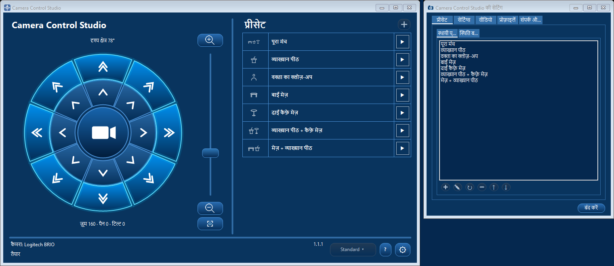
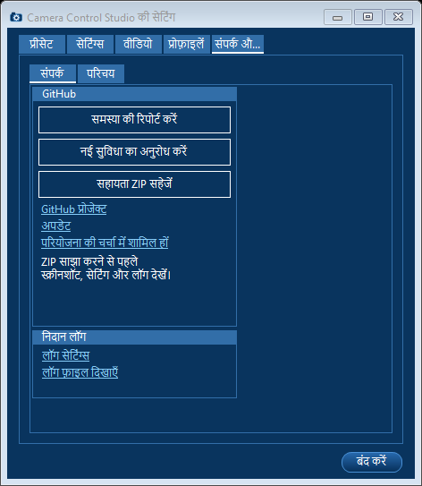

[English](../en/SETUP.md) · [Dansk](../da/SETUP.md) · [Deutsch](../de/SETUP.md) · [सभी गाइड भाषाएँ](USER-GUIDES.md)

# एप्लिकेशन सेट करें

*Camera Control Studio 1.1.1.* के लिए लिखा गया

[समस्या निवारण](TROUBLESHOOTING.md)

सेटिंग खोलने के लिए नीचे गियर बटन पर क्लिक करें। सेटिंग अलग विंडो में खुलती हैं। आप मुख्य विंडो का उपयोग जारी रख सकते हैं।

## इंस्टॉल करें और डाउनलोड सत्यापित करें

**Camera Control Studio** जब Microsoft Store में उपलब्ध हो, तो वहीं से डाउनलोड करें। Store में ऐप का नाम खोजें। Microsoft Store पैकेज पर हस्ताक्षर करता है और उसके अपडेट देता है।

ऐप अभी Microsoft Store में उपलब्ध न हो, तो [GitHub रिलीज़](https://github.com/bkristensen/Camera-Ctrl-Pressets-Studio/releases) से इंस्टॉलर या पोर्टेबल ZIP डाउनलोड करें। ऐप खोलने से पहले इंस्टॉलर चलाएँ या पूरी ZIP निकालें। रिलीज़ में SHA-256 चेकसम दिया हो, तो उसे `Get-FileHash -Algorithm SHA256` के नतीजे से मिलाएँ।

Microsoft Defender SmartScreen एक नीली चेतावनी दिखा सकता है जब किसी डाउनलोड किए गए ऐप या उसके प्रकाशक की प्रतिष्ठा बहुत कम हो। इसे गंभीरता से लें. यदि आपने आधिकारिक रिलीज़ से अपेक्षित फ़ाइल प्राप्त की है और स्रोत पर भरोसा करते हैं, तो **अधिक जानकारी** चुनें और फ़ाइल नाम और प्रकाशक की समीक्षा करें। **Run को वैसे भी चुनें** केवल तभी चुनें जब आप उस फ़ाइल पर भरोसा करना चुनते हैं और विंडोज़ विकल्प प्रदान करता है। अन्यथा चेतावनी बंद करें. अपने संगठन की डिवाइस नीति का पालन करें. [Microsoft स्मार्टस्क्रीन मार्गदर्शन](https://learn.microsoft.com/windows/apps/package-and-deploy/smartscreen-reputation)

<https://learn.microsoft.com/windows/apps/package-and-deploy/smartscreen-reputation>

यदि गाइड व्यूअर को WebView2 की आवश्यकता है, तो Microsoft से रनटाइम डाउनलोड करें।\
<https://developer.microsoft.com/microsoft-edge/webview2/>

अधिक जानकारी के साथ 

मुख्य विंडो के नीचे अपना प्रोफ़ाइल चुनें। सामान्य सेटिंग में कैमरा स्रोत चुनने के लिए दिशा-चक्र के बीच का कैमरा बटन दो बार क्लिक करें। प्रोफ़ाइल कैमरा याद रखती है। वह न मिले तो दूसरा स्रोत चुनें।

नीचे का क्रम सेटिंग विंडो के टैब जैसा है। कोई बटन धुंधला हो, तो पहले सूची में कुछ चुनना पड़ सकता है। वीडियो में ड्राइवर तय करता है कि कौन-से विकल्प दिखेंगे। बदलाव अपने कैप्चर ऐप में देखें।

**बंद करें**. दोनों विंडो का आकार या जगह बदलें, या मुख्य विंडो का विभाजक खींचें। प्रोफ़ाइल ये मान याद रखती है। नीचे का बंद करें बटन सेटिंग बंद करता है। मुख्य विंडो खुली रहती है।

## प्रीसेट

### स्थायी प्रीसेट

पहले कैमरा सही जगह पर लाएँ। स्थायी प्रीसेट कैमरे के उपलब्ध पैन, झुकाव और ज़ूम की स्थिति सहेजता है। कैमरा बताए तो देखने का कोण भी सहेजता है। यह एक प्रोफ़ाइल के एक कैमरे के लिए है।

- **+ स्थायी प्रीसेट जोड़ें**. मौजूदा फ़्रेम सहेजें। एक चिह्न चुनें और अलग नाम दें। फ़ील्ड खाली हो तो चिह्न नाम सुझा सकता है। सहेजने के लिए नाम चाहिए। रद्द करने पर सूची वैसी ही रहती है।
- **✎ नाम और आइकन बदलें**. चुने हुए प्रीसेट का नाम या चिह्न बदलें। फ़्रेम वैसा ही रहता है।
- **↻ मौजूदा स्थिति से बदलें**. चुने हुए प्रीसेट का फ़्रेम कैमरे की मौजूदा स्थिति से बदलें। बदलाव की पुष्टि करें। नाम और चिह्न वही रहते हैं।
- **− स्थायी प्रीसेट हटाएँ**. पुष्टि करने के बाद चुना हुआ प्रीसेट हटाएँ।
- **↑ / ↓ चुने हुए प्रीसेट को ऊपर ले जाएँ · चुने हुए प्रीसेट को नीचे ले जाएँ**. प्रीसेट को दोनों सूचियों में एक पंक्ति ऊपर या नीचे करें। पहली पंक्ति में ऊपर का तीर धुंधला है। आखिरी पंक्ति में नीचे का तीर धुंधला है।

संपादित करने, बदलने, हटाने या खिसकाने से पहले प्रीसेट चुनें। नया जोड़ने और बदलने के लिए खुली प्रोफ़ाइल चाहिए। कैमरे में पैन, झुकाव या ज़ूम में से कम से कम एक नियंत्रण चाहिए। कैमरा जुड़ा न हो तो ऐप जोड़ने की कोशिश कर सकता है।

### प्रीसेट ट्रांज़िशन सेट करें

- **प्रीसेट बदलने के लिए गति का उपयोग करें**. बंद होने पर समय तय रहता है। चालू होने पर गति तय होती है। कम दूरी जल्दी तय होती है। चलने वाले सभी अक्ष साथ लक्ष्य पर पहुँचते हैं।
- **बदलाव की अवधि (सेकंड)**. प्रीसेट बदलने का समय तय करें। शुरू में 1 सेकंड है। गति वाले मोड में यह फ़ील्ड धुंधला है।
- **बदलाव की गति (%/सेकंड)**. प्रति सेकंड गति को उस अक्ष की पूरी सीमा के प्रतिशत में तय करें जो गति निर्धारित करता है। शुरू में 30% है। तय समय वाले मोड में फ़ील्ड धुंधला है।

## सेटिंग्स

### पैनिंग

- **सूक्ष्म गति (सामान्य का %)**. बारीक बदलाव के लिए Ctrl दबाकर तीर वाली कुंजी दबाएँ। शुरू की दर सामान्य गति की 50% है।
- **सामान्य पैन के चरण**. भीतरी घेरे के सामान्य तीरों के कदम तय करें। शुरू में 1 कदम है।
- **तेज़ पैन के चरण**. बाहरी घेरे के तेज़ तीरों के कदम तय करें। शुरू में 4 कदम हैं। इससे कैमरा बटन खींचने की गति भी बदलती है।
- **कैमरे की बाएँ/दाएँ गति उलटें**. कैमरा गलत दिशा में घूमे तो बायाँ और दायाँ बदलें।
- **कैमरे की ऊपर/नीचे गति उलटें**. ऊपर और नीचे बदलें, जैसे कैमरा उल्टा लगा हो। दोनों विकल्प नियंत्रण की दिशा बदलते हैं। वीडियो की दिशा वही रहती है।
- **कैमरा घुमाने के लिए कैमरा बटन खींचें**. दिशा-चक्र के बीच का बटन खींचकर कैमरा घुमाएँ। तीरों से चलाने के लिए इस विकल्प को बंद कर सकते हैं।
- **स्रोत चुनने के लिए कैमरा बटन पर डबल-क्लिक करें**. चालू होने पर डबल-क्लिक से कैमरा सूची खुलती है। बंद होने पर एक क्लिक काफी है।

कैमरा जोड़ने से पहले गति विकल्प बदल सकते हैं। ड्राइवर कदम का आकार, उपलब्ध दिशाएँ और उनकी सीमा तय करता है।

### ज़ूम चरण सेट करें

- **ज़ूम के चरण**. तय करें कि + या − दबाने पर ज़ूम कितने कदम बदले। शुरू में ड्राइवर का 1 कदम है। इसे पहले बदल सकते हैं। असर के लिए कैमरे में ज़ूम होना चाहिए। स्लाइडर मौजूदा देखने के कोण के अंदर ज़ूम चुनता है।

### ऐप

- **कैमरा इस्तेमाल करने से पहले पूछें कि स्ट्रीमिंग शुरू हुई है या नहीं**. अगर कैप्चर ऐप को पहले स्ट्रीम शुरू करनी हो, तो इसे चालू करें। अगली कैमरा क्रिया पुष्टि माँगेगी। तैयार हों तो हाँ चुनें। नहीं चुनने पर कैमरा नहीं जुड़ेगा। रीस्टार्ट, प्रोफ़ाइल बदलने या यह विकल्प बदलने पर ऐप फिर पूछता है। बंद होने पर ऐप शुरू में कैमरा जोड़ सकता है।
- **हमेशा सबसे ऊपर**. मुख्य विंडो को दूसरे ऐप के ऊपर रखें। बंद करने पर अन्य विंडो इसे ढक सकती हैं।
- **प्रोफ़ाइल की भाषा · स्वचालित**. 12 में से एक भाषा चुनें। स्वचालित विकल्प समर्थित होने पर Windows की भाषा लेता है, वरना अंग्रेज़ी। लागू करने के लिए ऐप फिर खोलें। हर प्रोफ़ाइल अपनी भाषा रखती है।

## वीडियो

- **छवि नियंत्रण लोड करें**. चित्र नियंत्रण दिखाने के लिए कैमरा जोड़ें। कैमरा अलग होने पर बटन दिखता है। यदि ड्राइवर चित्र नियंत्रण न दे, तो केवल देखने के क्षेत्र वाला टैब रहता है।
- **स्वचालित**. ड्राइवर तय करता है कि कौन-से टैब और स्लाइडर दिखेंगे। स्वचालित में कैमरा मान तय करता है। स्लाइडर के लिए इसे बंद करें। केवल स्वचालित मोड हो तो स्लाइडर धुंधला रहता है और बॉक्स लॉक हो सकता है। केवल मैनुअल मोड हो तो बॉक्स नहीं दिखता।
- **छवि के डिफ़ॉल्ट ड्राइवर मान बहाल करें**. सभी समर्थित चित्र नियंत्रण ड्राइवर के मूल मान पर लौटाएँ। बटन चित्र वाले टैब में दिखता है और देखने के क्षेत्र वाले टैब में छिपता है। चित्र के मान कैमरे और प्रोफ़ाइल के हिसाब से सहेजे जाते हैं।

### फ़ोकस और एक्सपोज़र

- **गेन**. सिग्नल बढ़ाकर चित्र चमकीला करें। अधिक गेन पर दाने दिख सकते हैं।
- **एक्सपोज़र**. तय करें कि सेंसर कितनी देर रोशनी ले। अधिक समय से चित्र चमकता है, लेकिन गति धुंधली हो सकती है।
- **फ़ोकस**. साफ़ दिखने की दूरी चुनें। विषय की साफ़ तस्वीर कैप्चर ऐप में देखें।

### रंग

- **व्हाइट बैलेंस**. रोशनी से आया रंग हटाएँ ताकि सफ़ेद सही दिखे।
- **संतृप्ति**. रंग गहरे या हल्के करें।
- **गामा**. मध्यम टोन की चमक बदलें।
- **रंगत**. रंग-चक्र पर रंगों की जगह बदलें।

### रोशनी और विवरण

- **कंट्रास्ट**. उजले और गहरे हिस्सों का अंतर बदलें।
- **चमक**. पूरे चित्र को चमकीला या गहरा करें।
- **बैकलाइट की भरपाई**. पीछे तेज़ रोशनी हो तो विषय को चमकीला करें।
- **तीक्ष्णता**. किनारों को अधिक साफ़ या नरम करें।

### देखने का क्षेत्र सेट करें

देखने का क्षेत्र (FOV) बताता है कि फ़्रेम में दृश्य कितना है। बड़ा कोण ज़्यादा दिखाता है। ज़ूम उसी कोण में काट-छाँट बदलता है।

- **शुरू होने पर दृश्य क्षेत्र · सबसे चौड़ा उपलब्ध · जैसा है वैसा रखें**. सबसे बड़ा कोण चुनें, मौजूदा कोण रखें, या ड्राइवर का बताया कोण चुनें। ऐप इस सत्र में पहली बार जुड़ते समय इसे आज़माता है। जुड़ा कैमरा कम से कम एक कोण बताए, तभी सूची चालू होती है।
- **दृश्य क्षेत्र मैन्युअल रूप से बदलने दें**. चक्र के नीचे कोण की सूची दिखाएँ। विकल्प बंद हो तो ऐप मौजूदा कोण दिखाता है, अगर उसे पढ़ सके। दो से कम कोण हों तो विकल्प धुंधला है।
- **ज़ूम और पैन की सीमा पर दृश्य क्षेत्र बदलें**. ज़ूम की सीमा पर फिर दबाएँ। ज़ूम आउट पर ऐप चौड़ा कोण आज़माता है। ज़ूम इन पर वह संकरा कोण आज़माता है। बाएँ या दाएँ की सीमा पर वह अधिक जगह वाला कोण खोजता है। ऐप फ़्रेम को करीब रखने की कोशिश करता है। आगे न बढ़ सके तो पुराना फ़्रेम लौटाता है। मैनुअल चयन बंद हो तब भी यह चलता है। दो से कम कोण हों तो विकल्प धुंधला है।

उदाहरण के लिए, Brio 65° और सबसे कम ज़ूम पर हो, तो − दबाने से 78° आज़माया जाता है। नए कोण में ज़ूम आउट करने के लिए फिर दबाएँ। फ़्रेम बटन सबसे बड़ा कोण और सबसे कम ज़ूम साथ में आज़माता है। दूसरा ऐप भी कैमरा चलाए तो नतीजा देखें।

## प्रोफ़ाइलें

- **+ नई प्रोफ़ाइल**. शुरू की सेटिंग से नई प्रोफ़ाइल बनाएँ और उसे सक्रिय करें। अलग नाम दें।
- **⧉ सक्रिय प्रोफ़ाइल की प्रतिलिपि बनाएँ**. सक्रिय प्रोफ़ाइल की सेटिंग और प्रीसेट कॉपी करें। ऐप कॉपी पर जाता है। किसी और पंक्ति को चुनने से कॉपी का स्रोत नहीं बदलता।
- **✎ चुनी हुई प्रोफ़ाइल का नाम बदलें**. चुनी हुई प्रोफ़ाइल का नाम बदलें। कुछ न चुना हो या Standard चुना हो, तो बटन धुंधला है। नई और कॉपी के लिए खुली प्रोफ़ाइल चाहिए। तीनों नाम वाले संवाद में पुष्टि के लिए नाम देना होता है।
- **मौजूदा स्थिति और लेआउट बनाए रखें**. बदलने के लिए प्रोफ़ाइल पर डबल-क्लिक करें। लेआउट विकल्प से विंडो की जगह, आकार और विभाजक साथ ले जाएँ। विकल्प बंद हो तो चुनी गई प्रोफ़ाइल का सहेजा हुआ लेआउट लगता है। बदलाव ऐप फिर खोलता है और अस्थायी प्रीसेट हट जाते हैं।

## संपर्क और परिचय

### संपर्क

- **समस्या की रिपोर्ट करें**. GitHub का त्रुटि टेम्पलेट खोलें। नया संस्करण हो तो ऐप पहले उसे खोलने का विकल्प देता है। आगे बढ़ने पर ड्राफ़्ट से पहले सपोर्ट ZIP का विकल्प मिलता है।
- **नई सुविधा का अनुरोध करें**. फ़ीचर का टेम्पलेट खोलें। नया संस्करण हो तो पहले उसे आज़माएँ। सुविधा शायद उसमें हो।
- **सहायता ZIP सहेजें**. स्क्रीनशॉट, उपलब्ध लॉग, प्रोफ़ाइल डेटा और विंडो लेआउट एक ZIP में सहेजें। निजी जानकारी जाँचें। फ़ाइल खुद GitHub के ड्राफ़्ट में लगाएँ। काम के दौरान तीनों बटन कुछ देर धुंधले रहते हैं।
- **GitHub प्रोजेक्ट · GitHub रिलीज़ · परियोजना की चर्चा में शामिल हों**. तीन GitHub लिंक प्रोजेक्ट कोड, रिलीज़ डाउनलोड और चर्चाएँ खोलते हैं।

[समस्या की रिपोर्ट करें](Report%20a%20bug.md) · [नई सुविधा का अनुरोध करें](Request%20a%20feature.md)

### निदान लॉग

- **लॉग सेटिंग्स**. लॉग की सेटिंग खोलें। ये सभी प्रोफ़ाइल पर लागू होती हैं। सहेजने से बदलाव लागू होते हैं। रद्द करने से पुराने मान रहते हैं।
- **फ़ोल्डर चुनें · स्वचालित**. फ़ोल्डर चुनें या स्वचालित रखें। पथ के खाने में सीधे लिख नहीं सकते। स्वचालित में ऐप का फ़ोल्डर लगता है। ज़रूरत पड़ने पर `%LOCALAPPDATA%\CamPressets\Logs` लगता है।
- **अधिकतम फ़ाइल आकार (MiB)**. नई लॉग फ़ाइल शुरू करने की सीमा तय करें। शुरू में हर फ़ाइल के लिए 1 MiB है।
- **अधिकतम लॉग फ़ाइलें (मौजूदा सहित)**. बताएँ कि मौजूदा फ़ाइल समेत कितने लॉग रखने हैं। शुरू में 2 हैं।
- **लॉग फ़ाइल दिखाएँ**. फ़ाइल एक्सप्लोरर में नया लॉग चुनें। कोई लॉग न हो तो ऐप बता देता है।

### परिचय

- **मेरे लिए एक कॉफ़ी खरीदें**. इंस्टॉल किया संस्करण और डेवलपर का नाम देखें। पूरे बिल्ड आईडी के लिए संस्करण पर माउस रखें। सहयोग लिंक डेवलपर का सहयोग पेज खोलता है।
- **मार्गदर्शिकाएँ खोलें**. इस टैब से गाइड खोलें। मुख्य विंडो का मदद बटन भी गाइड खोलता है।

बैकअप के लिए ऐप बंद करें और `%LOCALAPPDATA%\CamPressets` कॉपी करें। अस्थायी प्रीसेट इस सत्र तक रहते हैं।

[दैनिक उपयोग](DAILY-USE.md)

## त्रुटि संवाद

अगर कोई अप्रत्याशित त्रुटि किसी काम को रोक दे, तो संवाद बंद करके फिर कोशिश करें। अगर संदेश में ऐप बंद होने की सूचना है, तो ऐप फिर खोलें।

लॉग उपलब्ध होने पर **लॉग फ़ाइल दिखाएँ** फ़ाइल एक्सप्लोरर में निदान लॉग चुनता है। **GitHub पर रिपोर्ट करें** सहायता ZIP सहेजने का विकल्प देता है, फिर GitHub का बग टेम्पलेट खोलता है। ZIP में संवाद का स्क्रीनशॉट, लॉग, प्रोफ़ाइल और विंडो सेटिंग, और सिस्टम रिपोर्ट हो सकती है। ZIP की जाँच करें और उसे खुद ड्राफ़्ट में जोड़ें।
