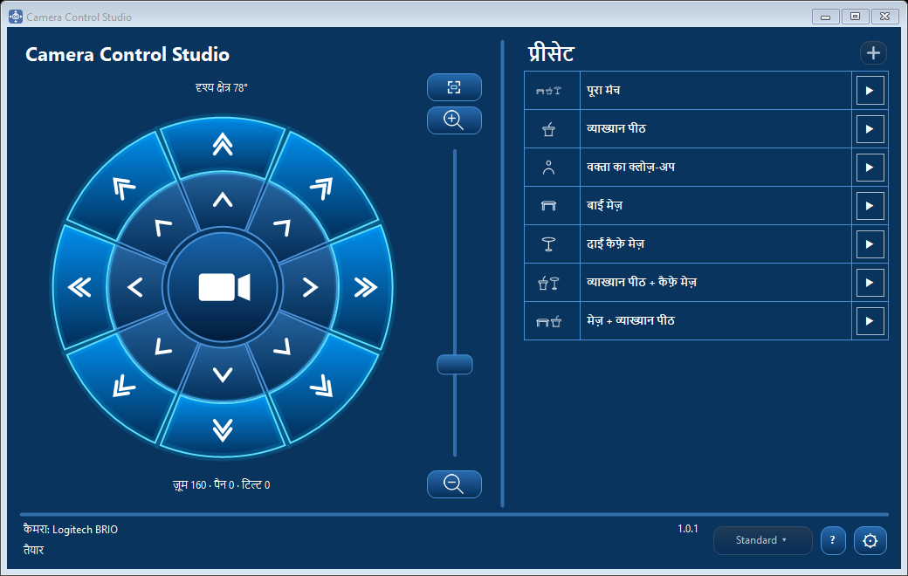
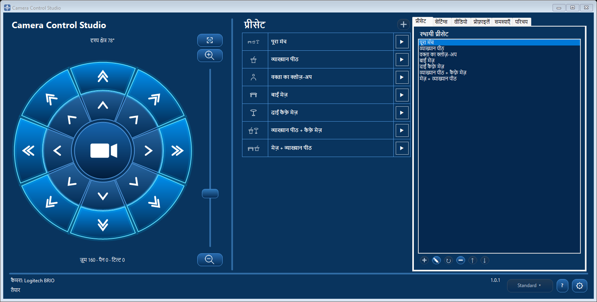
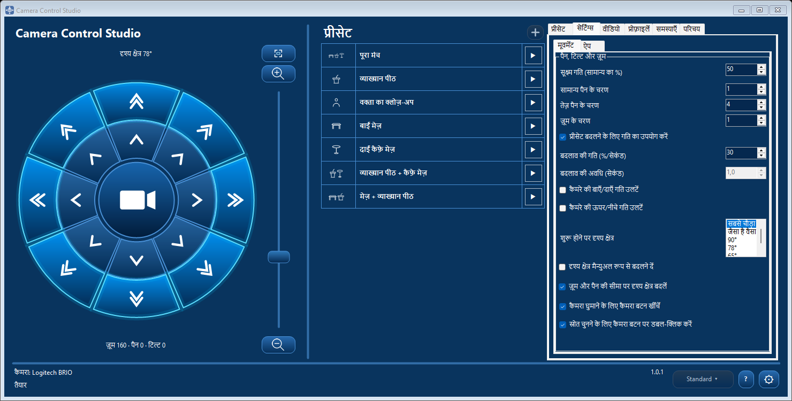
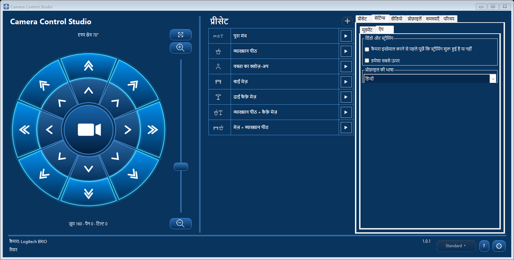

# इस्तेमाल और सेटिंग्स

*यह गाइड Camera Control Studio 1.0.1 के लिए लिखी गई है।*

[समस्या निवारण](TROUBLESHOOTING.md)

[हिन्दी · Camera Control Studio](../USER-GUIDES.md)

पहले Zoom जैसे ऐप में वह मीटिंग शुरू करें जिसे आप स्ट्रीम करना चाहते हैं। फिर **Camera Control Studio** खोलें।

मदद के लिए **?** दबाएँ। बटन का काम जानने के लिए उस पर माउस रखें। कैमरा किसी दिशा में और न बढ़ सके तो उस दिशा का बटन बंद हो जाता है।

1. **प्रीसेट सक्रिय करें**

   प्रीसेट सूची की पंक्ति में ▶ दबाएँ, नाम पर डबल-क्लिक करें या पंक्ति चुनकर Enter दबाएँ।

   | रंग | मतलब |
   | --- | --- |
   | पीला | कैमरा सहेजी हुई स्थिति की ओर जा रहा है। |
   | हरा | कैमरा ड्राइवर ने सहेजे गए निर्देशांकों तक पहुँचने की सूचना दी है। |
   | नीला | प्रीसेट सक्रिय के रूप में चिह्नित नहीं है। |

   हरा रंग ड्राइवर से मिले निर्देशांकों की पुष्टि करता है। असली तस्वीर अपनी स्ट्रीम में देखें। अगर ड्राइवर समय पर स्थिति तक पहुँचने की सूचना नहीं देता, तो पंक्ति नीली हो जाती है और स्थिति क्षेत्र में संदेश दिखता है। आइकन पूरे समय दिखाई देते हैं।

2. **फ़्रेमिंग ठीक करें**

   **पैन करना**

   सामान्य चाल के लिए भीतरी घेरा और तेज़ चाल के लिए बाहरी घेरा इस्तेमाल करें। तिरछे तीर कैमरे को 45° की दिशा में घुमाते हैं। हर अक्ष पर घेरे की गति का 45% लगता है। चलते रहने के लिए तीर दबाए रखें। रोकने के लिए छोड़ें।

   

   **दिशा चक्र के बीच का कैमरा बटन**

   - **कैमरा चुनने के लिए डबल-क्लिक करें।** कैमरों की सूची खुलती है।
   - **दबाकर रखें और खींचें।** कैमरा चिह्न से शुरू करें। कैमरे को घुमाने के लिए बाएँ या दाएँ खींचें। झुकाने के लिए ऊपर या नीचे खींचें। थोड़ा खींचने पर गति कम रहती है। अधिक खींचने पर गति बढ़ती है, तेज़ चाल की दोगुनी तक। रोकने के लिए बटन छोड़ें या पॉइंटर को शुरुआती जगह पर लौटाएँ।

   **सेटिंग्स → मूवमेंट** में आप खींचकर कैमरा घुमाना बंद कर सकते हैं या कैमरा चुनने के लिए एक क्लिक चुन सकते हैं। दोनों विकल्प सक्रिय प्रोफ़ाइल में सहेजे जाते हैं।

   **ज़ूम**

   आवर्धक बटनों से ज़ूम करें। दोहराने के लिए बटन दबाए रखें। स्लाइडर खींचते समय ज़ूम बदलता है।

   **पूरा फ़्रेम वापस लाएँ**

   आवर्धक बटनों के ऊपर फ़्रेम चिह्न वाला चौकोर बटन क्लिक करें। कैमरा जहाँ तक हो सके ज़ूम आउट करता है और सुविधा होने पर अपना सबसे चौड़ा दृश्य क्षेत्र चुनता है। कैमरे का फ़्रेम बदलता है। ऐप की विंडो का आकार वही रहता है।

   **पैन रोकना**

   चलता हुआ पैन रोकने के लिए Esc दबाएँ।

   > हाथ से पैन, टिल्ट या ज़ूम करने पर प्रीसेट बदलना रुक जाता है और सक्रिय प्रीसेट का रंग हट जाता है।

   **तीर कुंजियाँ**

   दिशा चक्र पर फ़ोकस होने पर तीर कुंजियाँ इस्तेमाल करें। तेज़ चरणों के लिए Shift दबाए रखें।

3. **अस्थायी प्रीसेट सहेजें**

   प्रीसेट सूची के ऊपर **+** दबाएँ, नाम लिखें और सहेजें। मौजूदा स्थिति स्थायी प्रीसेट के नीचे दिखती है। अस्थायी प्रीसेट का कोई आइकन नहीं होता। ये ऐप बंद होने तक रहते हैं और हर प्रोफ़ाइल और कैमरे के लिए अलग रखे जाते हैं।

   अस्थायी प्रीसेट हटाने के लिए उसकी पंक्ति चुनें और सूची के ऊपर **×** दबाएँ। ऐप बंद होने पर सभी अस्थायी प्रीसेट हट जाते हैं। किसी स्थिति को बाद में इस्तेमाल करने के लिए **सेटिंग्स → प्रीसेट** में सहेजें। मुख्य सूची में स्थायी प्रीसेट न तो बदले जा सकते हैं, न हटाए जा सकते हैं।

4. **ऐप बंद करें**

   अगर कोई नियंत्रण काम न करे, तो नीचे स्थिति क्षेत्र में संदेश पढ़ें। हो सकता है कैमरा उस सुविधा का समर्थन न करता हो या उपलब्ध न हो।

   ऐप सामान्य तरीके से बंद करें। सक्रिय प्रोफ़ाइल और विंडो का लेआउट याद रखा जाता है।

   **समस्या की रिपोर्ट करें**

   किसी समस्या या अनुपलब्ध सुविधा की रिपोर्ट **सेटिंग्स → समस्याएँ** में करें।

5. **सेटिंग्स**

   नीचे से प्रोफ़ाइल चुनें। कैमरा चुनने के लिए दिशा चक्र के बीच का कैमरा आइकन पर डबल-क्लिक करें।

   स्थायी प्रीसेट के लिए नीचे गियर खोलें और **प्रीसेट → स्थायी प्रीसेट जोड़ें** चुनें। नाम और आइकन चुनकर सहेजें।

   

   सेटिंग्स में सामान्य और तेज़ चरण, संक्रमण का समय और दिशाएँ सेट करें। **वीडियो** में ड्राइवर के उपलब्ध नियंत्रण मिलते हैं। **प्रोफ़ाइलें** में नई प्रोफ़ाइल बनाएँ या मौजूदा प्रोफ़ाइल की प्रतिलिपि बनाएँ। अगर कैप्चर सॉफ़्टवेयर पहले जुड़ना चाहिए, तो कैमरा इस्तेमाल करने से पहले स्ट्रीमिंग की पुष्टि वाला विकल्प चालू करें।

   

   

6. दोनों हिस्सों की चौड़ाई बदलने के लिए लंबवत विभाजक खींचें। ऐप शुरू होने पर सेटिंग्स पैनल बंद रहता है। **सेटिंग्स → ऐप → प्रोफ़ाइल की भाषा** में भाषा चुनें और ऐप फिर से शुरू करें। छोटे बटनों पर माउस ले जाने से उनका काम दिखता है।

## कैमरा चलाते समय दृश्य क्षेत्र

**ज़ूम और पैन की सीमा पर दृश्य क्षेत्र बदलें**

यह विकल्प शुरू से चालू रहता है। Brio पर ज़ूम की सीमा आने के बाद फिर दबाएँ। ज़ूम आउट करते समय दृश्य क्षेत्र 65° से 78° और फिर 90° होता है। ज़ूम इन करते समय क्रम उलट जाता है। हर बदलाव के बाद ज़ूम फिर सामान्य चरणों में चलता है। पैन की सीमा पर ऐप चौड़ा दृश्य आज़माता है और फ़्रेम बनाए रखने के लिए ज़ूम बदलता है। मौजूदा दृश्य क्षेत्र रखने के लिए विकल्प बंद करें।

ड्राइवर दृश्य क्षेत्र पढ़ सके तो प्रीसेट उसे सहेजते हैं।

[इंस्टॉल करना और SmartScreen (अंग्रेज़ी)](../en/SETUP.md)

<https://github.com/bkristensen/Camera-Ctrl-Pressets-Studio/blob/main/Source/docs/en/SETUP.md>

## डाउनलोड और सहायता

**आधिकारिक डाउनलोड**\
<https://github.com/bkristensen/Camera-Ctrl-Pressets-Studio/releases>\

**समस्या बताएँ या नई सुविधा सुझाएँ**\
<https://github.com/bkristensen/Camera-Ctrl-Pressets-Studio/issues?q=is%3Aissue>\

