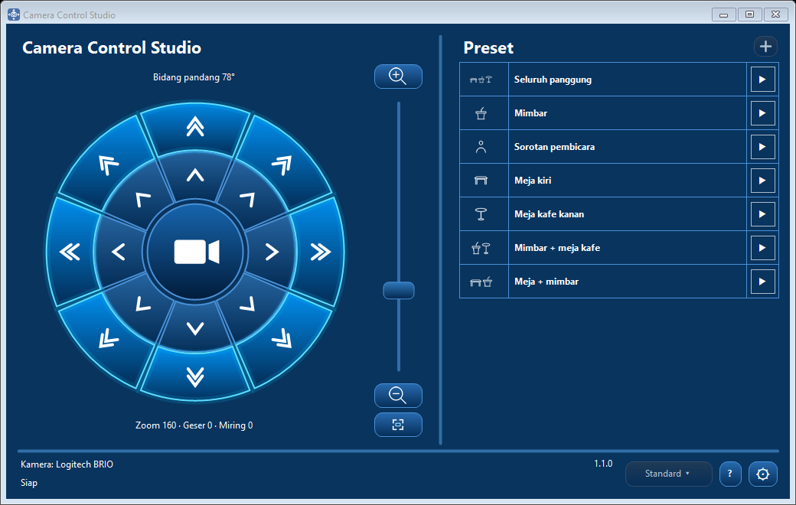
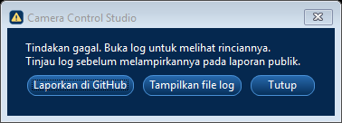

[English](../en/DAILY-USE.md) · [Dansk](../da/DAILY-USE.md) · [Deutsch](../de/DAILY-USE.md) · [ASemua bahasa panduan](USER-GUIDES.md)

# Penggunaan sehari-hari

*Ditulis untuk Camera Control Studio 1.1.0.*

[Pemecahan Masalah](TROUBLESHOOTING.md)

Mulai rapat streaming Anda di aplikasi seperti Zoom. Kemudian buka **Camera Control Studio**.

## Umum

Klik **?** untuk bantuan. Arahkan kursor ke tombol untuk melihat nama dan tindakannya. Arah terkunci pada batas terakhir yang dapat dijangkau kamera. [Cara kerja FOV otomatis](SETUP.md#atur-bidang-pandang)

## 1. Aktifkan preset

Klik ▶ pada baris dalam daftar preset atau klik dua kali namanya.
Anda juga dapat memilih baris dan tekan Enter.

| Warna | Artinya |
| --- | --- |
| Kuning | Aplikasi ini menggerakkan kamera ke arah preset. |
| Hijau | Pengemudi kamera melaporkan bahwa koordinat yang disimpan telah tercapai. |
| Biru | Prasetel tidak ditandai sebagai aktif. |

Hijau berarti driver melaporkan posisi yang disimpan dan FOV, jika disimpan. Periksa gambar di aliran Anda. Jika driver tidak dapat mengkonfirmasi tembakan tepat waktu, baris akan berubah menjadi biru. Baca pesan status untuk melihat apa yang terjadi.

## 2. Sempurnakan pembingkaiannya

### Pan

Gunakan ring bagian dalam untuk gerakan normal dan ring bagian luar untuk gerakan cepat. Setiap cincin memiliki delapan anak panah. Diagonalnya bergerak geser dan miring bersama-sama pada 45°, dengan 45% kecepatan cincin pada setiap sumbu. Sebuah klik memindahkan setidaknya satu langkah driver per sumbu yang tersedia. Pegang panah untuk terus bergerak. Lepaskan untuk berhenti.

### Tombol kamera di tengah kemudi

- **Klik dua kali untuk memilih kamera.** Daftar kamera terbuka.
- **Tahan dan seret.** Mulai pada ikon kamera. Seret ke samping untuk menggeser atau ke atas dan ke bawah untuk memiringkan. Tarik sedikit untuk gerakan lambat atau lebih jauh untuk gerakan lebih cepat, hingga dua kali kecepatan cepat. Lepaskan tombol atau pindahkan penunjuk kembali ke tempat Anda mulai berhenti.

Di bawah **Pengaturan → Geser kamera**, Anda dapat menonaktifkan menyeret atau beralih ke satu klik untuk pemilihan kamera. Kedua opsi disimpan di profil aktif.

### Perbesar

Gunakan tombol kaca pembesar untuk memperbesar. Tahan tombol untuk mengulangi tindakan tersebut.
Seret penggeser untuk menyesuaikan zoom saat Anda memindahkannya.

### Kembalikan bingkai penuh

Klik tombol persegi dengan ikon bingkai di atas tombol kaca pembesar. Kamera memperkecil sejauh mungkin dan memilih bidang pandang terluasnya jika mendukung pengaturan tersebut. Ini mengubah gambar kamera. Jendela aplikasi mempertahankan ukurannya.

### Berhenti menggeser

Tekan Esc untuk menghentikan proses menggeser.

> Geser, miringkan, atau zoom secara manual membatalkan perpindahan ke preset dan menghapus warna aktif.

### Tombol panah

Gunakan tombol panah saat roda sudah fokus. Tahan Ctrl untuk gerakan halus atau Shift untuk gerakan cepat.

## 3. Simpan preset sementara

Klik **+** di atas daftar preset, masukkan nama dan simpan. Posisi saat ini muncul di bawah preset permanen.
Preset sementara tidak memiliki ikon. Mereka bertahan hingga Anda menutup aplikasi dan disimpan secara terpisah untuk setiap profil dan kamera.

Pilih baris sementara dan klik **×** di atas daftar preset untuk menghapusnya. Semua preset sementara dihapus saat aplikasi ditutup.
Untuk menggunakan posisi nanti, buatlah di bawah **Pengaturan → Preset**. Anda tidak dapat mengedit atau menghapus preset permanen di daftar utama.

## 4. Keluar

Jika kontrol gagal, baca pesan di area status di bagian bawah. Kamera mungkin tidak mendukung fitur tersebut atau mungkin tidak tersedia.

Tutup aplikasi secara normal. Aplikasi ini mengingat profil aktif dan tata letak jendela.

## 5. Laporkan masalah

Jika **Versi baru tersedia** muncul di footer, pilih untuk membuka rilis di GitHub dan melihat unduhannya.

<https://github.com/bkristensen/Camera-Ctrl-Pressets-Studio/releases>

Laporkan masalah atau usulkan fitur melalui **Kontak dan Tentang → Kontak**.

Lihat [Setup](SETUP.md) untuk arah kamera, preset permanen, pengaturan gambar, profil dan langkah pergerakan.

## Dialog kesalahan

Jika kesalahan tak terduga menghentikan tindakan, tutup dialog dan coba lagi. Jika dialog menyatakan aplikasi akan ditutup, buka kembali aplikasi.

**Tampilkan file log** memilih log diagnostik di File Explorer jika tersedia. **Laporkan di GitHub** menawarkan untuk menyimpan ZIP dukungan, lalu membuka templat laporan bug di GitHub. ZIP dapat berisi tangkapan layar dialog, log, pengaturan profil dan jendela, serta laporan sistem. Periksa ZIP lalu lampirkan sendiri ke draf.
