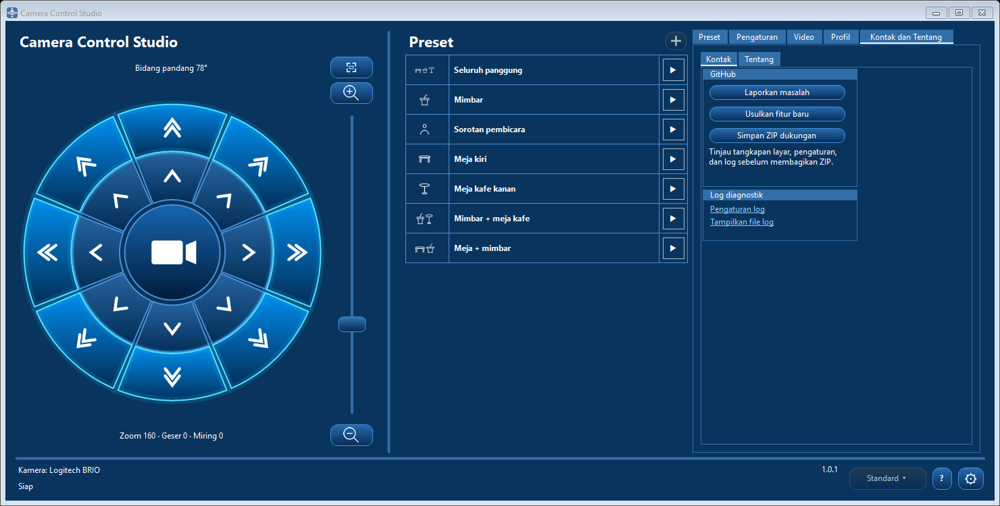

# Usulkan fitur baru

1. Buka panel pengaturan. Pilih **Kontak dan Tentang → Kontak → Usulkan fitur baru**.
2. Jika ada versi yang lebih baru, pilih **Ya** untuk membuka halaman unduh. Instal versi itu dan periksa apakah fitur itu sudah tersedia. Pilih **Tidak** untuk melanjutkan ke draf GitHub.
3. Di templat **Feature request** GitHub, jelaskan tugas yang ingin Anda lakukan, manfaat fitur, dan hasil yang menunjukkan bahwa fitur itu berfungsi. Isi setiap bagian yang ditandai dengan tanda bintang merah.

## Lampirkan contoh

Pilih **Kontak dan Tentang → Kontak → Simpan ZIP dukungan** dan tentukan lokasi penyimpanan. Aplikasi menampilkan jalur berkas.

ZIP berisi tangkapan layar aplikasi, `profiles.json` yang tersimpan, tata letak jendela dalam `window.json`, dan log yang tersedia di `Logs`.

Periksa dan singkirkan informasi pribadi, seperti nama profil, ID kamera, dan jalur berkas. Seret sendiri ZIP atau berkas yang relevan ke kolom deskripsi draf.

## Periksa jenis dan label

Templat meminta **Feature** di **Type** dan `enhancement` di **Labels**. Jika belum terisi dan dapat diedit, pilih nilainya di bilah sisi kanan. Jika tidak dapat mengubahnya, kirim draf. Pengelola proyek dapat mengisinya nanti.

Periksa deskripsi dan lampiran di **Preview**, lalu pilih **Create**.
