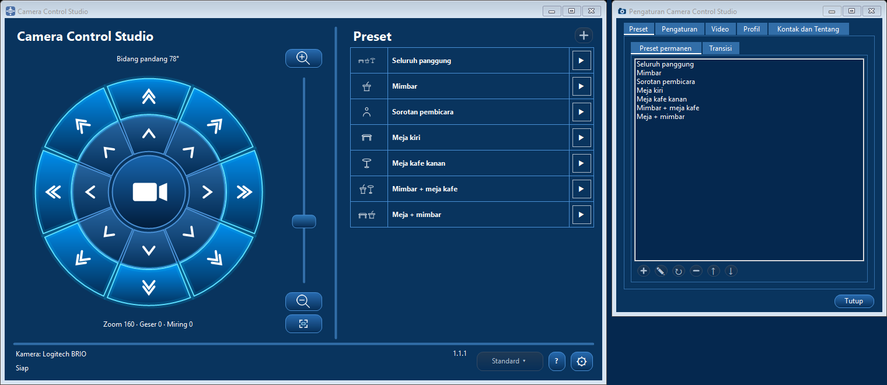
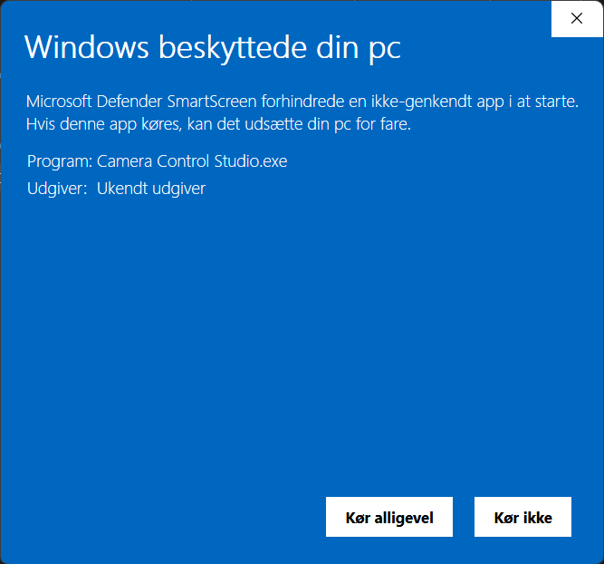
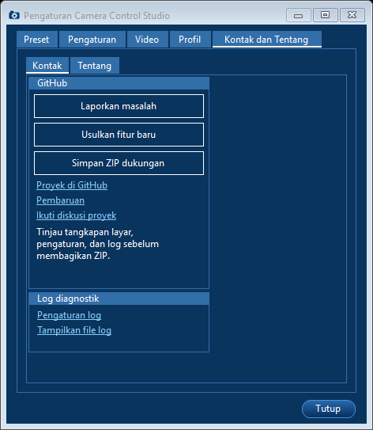
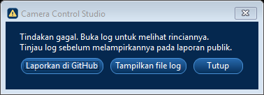

[English](../en/SETUP.md) · [Dansk](../da/SETUP.md) · [Deutsch](../de/SETUP.md) · [ASemua bahasa panduan](USER-GUIDES.md)

# Siapkan aplikasi

*Ditulis untuk Camera Control Studio 1.1.1.*

[Pemecahan Masalah](TROUBLESHOOTING.md)

Klik roda gigi di bagian bawah untuk membuka Pengaturan. Pengaturan terbuka di jendela terpisah. Anda tetap dapat menggunakan jendela utama.

## Instal dan verifikasi unduhan

Unduh **Camera Control Studio** dari Microsoft Store saat aplikasi tersedia di sana. Cari nama aplikasi di Store. Microsoft menandatangani paket Store dan menyediakan pembaruannya.

Jika aplikasi belum tersedia di Microsoft Store, unduh penginstal atau ZIP portabel dari [rilis GitHub](https://github.com/bkristensen/Camera-Ctrl-Pressets-Studio/releases). Jalankan penginstal atau ekstrak seluruh ZIP sebelum membuka aplikasi. Jika rilis menyertakan checksum SHA-256, bandingkan dengan hasil dari `Get-FileHash -Algorithm SHA256`.

Microsoft Defender SmartScreen dapat menampilkan peringatan biru ketika aplikasi yang diunduh atau penerbitnya memiliki reputasi yang buruk. Tanggapi dengan serius. Jika Anda memperoleh file yang diharapkan dari rilis resmi dan memercayai sumbernya, pilih **Info selengkapnya** dan tinjau nama file dan penerbit. Pilih **Lagi pula** hanya jika Anda memilih untuk memercayai file tersebut dan Windows menawarkan opsi tersebut. Jika tidak, tutup peringatannya. Ikuti kebijakan perangkat organisasi Anda. [Panduan Microsoft SmartScreen](https://learn.microsoft.com/windows/apps/package-and-deploy/smartscreen-reputation)

<https://learn.microsoft.com/windows/apps/package-and-deploy/smartscreen-reputation>

Jika penampil panduan memerlukan WebView2, unduh runtime dari Microsoft.\
<https://developer.microsoft.com/microsoft-edge/webview2/>

Peringatan 

Pilih profil di bagian bawah jendela utama. Secara bawaan, klik dua kali tombol kamera di tengah roda untuk memilih sumber. Profil mengingat kamera. Pilih sumber lain jika kamera itu tidak ada.

Urutan bagian mengikuti tab di jendela Pengaturan. Tombol yang redup sering kali perlu pilihan lebih dulu. Di Video, driver menentukan pengaturan yang muncul. Periksa perubahan di aplikasi perekaman.

**Tutup**. Atur ukuran dan posisi kedua jendela atau seret pemisah jendela utama. Profil mengingat semua nilai ini. Klik Tutup di bagian bawah untuk menutup Pengaturan. Jendela utama tetap terbuka.

## Preset

### Preset permanen

Arahkan kamera. Prasetel permanen menyimpan nilai geser, miring dan zoom yang didukung. Bidang pandang ikut tersimpan jika dilaporkan kamera. Prasetel berlaku untuk satu kamera dalam satu profil.

- **+ Tambah preset permanen**. Simpan tampilan saat ini. Pilih simbol dan masukkan nama unik. Simbol dapat menyarankan nama jika kolom kosong. Tombol Simpan perlu nama. Batal membiarkan daftar seperti semula.
- **✎ Ubah nama dan ikon**. Ubah nama atau simbol prasetel yang dipilih. Tampilan yang tersimpan tetap sama.
- **↻ Ganti dengan posisi saat ini**. Ganti tampilan prasetel dengan posisi kamera saat ini. Konfirmasikan perubahan. Nama dan simbol tetap sama.
- **− Hapus preset permanen**. Hapus prasetel yang dipilih setelah mengonfirmasi.
- **↑ / ↓ Pindahkan preset terpilih ke atas · Pindahkan preset terpilih ke bawah**. Pindahkan prasetel satu baris di kedua daftar. Panah atas redup di baris pertama. Panah bawah redup di baris terakhir.

Pilih prasetel sebelum mengedit, mengganti, menghapus, atau memindahkan. Tambah dan Ganti perlu profil yang dimuat serta satu fungsi geser, miring atau zoom yang bisa diatur. Jika kamera terputus, tindakan ini dapat mencoba menyambungkannya.

### Atur transisi yang telah ditetapkan

- **Gunakan kecepatan untuk transisi**. Nonaktif memakai durasi tetap. Aktif memakai laju, sehingga gerakan pendek selesai lebih cepat. Sumbu yang bergerak tiba bersamaan.
- **Transisi (dtk)**. Atur waktu perpindahan. Bawaannya 1 detik. Kolom redup saat mode laju aktif.
- **Kecepatan transisi (%/d)**. Atur laju sebagai persentase rentang sumbu penentu per detik. Bawaannya 30%. Kolom redup saat durasi tetap digunakan.

## Pengaturan

### Geser kamera

- **Kecepatan halus (% dari normal)**. Tahan Ctrl dan tekan tombol panah untuk gerakan halus. Laju bawaan adalah 50% dari normal.
- **Langkah putar normal**. Atur jumlah langkah panah biasa di cincin dalam. Bawaannya 1.
- **Langkah putar cepat**. Atur jumlah langkah panah cepat di cincin luar. Bawaannya 4. Ini juga mengubah laju saat tombol kamera diseret.
- **Balik gerakan kamera kiri/kanan**. Tukar kiri dan kanan jika kamera bergerak ke arah yang salah.
- **Balik gerakan kamera atas/bawah**. Tukar atas dan bawah, misalnya jika kamera dipasang terbalik. Kedua pilihan hanya mengubah arah kendali. Gambar tetap sama.
- **Seret tombol kamera untuk mengubah arah kamera**. Seret tombol di tengah roda untuk mengarahkan kamera. Matikan pilihan ini jika ingin memakai panah.
- **Klik dua kali tombol kamera untuk memilih sumber**. Aktif membuka daftar kamera dengan klik ganda. Nonaktif membukanya dengan satu klik.

Anda dapat mengatur gerakan sebelum tersambung. Driver menentukan ukuran langkah, arah yang tersedia dan batasnya.

### Atur langkah zoom

- **Langkah zoom**. Atur langkah zoom saat menekan + atau −. Bawaannya satu langkah driver. Nilainya dapat diatur sebelum tersambung. Kamera harus mendukung zoom. Penggeser memilih nilai dalam bidang pandang saat ini.

### Aplikasi

- **Tanyakan apakah siaran sudah dimulai sebelum kamera digunakan**. Aktifkan jika aplikasi perekaman harus memulai siaran lebih dulu. Tindakan kamera berikutnya akan meminta konfirmasi. Pilih Ya saat siap atau Tidak agar kamera tetap terputus. Pertanyaan muncul lagi setelah mulai ulang, ganti profil, atau perubahan opsi ini. Saat nonaktif, aplikasi dapat tersambung ketika dibuka.
- **Selalu di atas**. Pertahankan jendela utama di atas aplikasi lain. Matikan agar jendela lain dapat menutupinya.
- **Bahasa profil · Otomatis**. Pilih satu dari 12 bahasa. Otomatis memakai bahasa tampilan Windows jika didukung, atau bahasa Inggris. Mulai ulang untuk menerapkan. Setiap profil menyimpan pilihan bahasa.

## Video

- **Muat kontrol gambar**. Sambungkan kamera untuk memuat pengaturan gambar. Tombol muncul saat kamera terputus. Jika driver tidak menyediakan pengaturan gambar, hanya tab bidang pandang yang tersisa.
- **Otomatis**. Driver menentukan penggeser dan tab yang tersedia. Otomatis membiarkan kamera mengatur nilai. Matikan untuk memakai penggeser. Jika hanya ada mode otomatis, penggeser redup dan kotak bisa terkunci. Jika hanya ada mode manual, kotak Otomatis disembunyikan.
- **Pulihkan pengaturan gambar bawaan driver**. Kembalikan semua pengaturan gambar yang didukung ke bawaan driver. Tombol muncul di tab gambar dan disembunyikan di tab bidang pandang. Nilai disimpan per kamera dan profil.

### Fokus dan pencahayaan

- **Penguatan**. Perkuat sinyal agar gambar lebih terang. Nilai tinggi dapat menambah bintik.
- **Pencahayaan**. Atur lama sensor menangkap cahaya. Waktu lebih lama mencerahkan gambar, tetapi gerakan bisa kabur.
- **Fokus**. Atur jarak fokus. Periksa ketajaman subjek di aplikasi perekaman.

### Warna

- **Keseimbangan putih**. Koreksi warna cahaya agar putih terlihat putih.
- **Saturasi**. Buat warna lebih pekat atau lebih pucat.
- **Gama**. Terangkan atau gelapkan nada tengah.
- **Rona**. Geser warna pada roda warna.

### Cahaya dan detail

- **Kontras**. Ubah selisih antara bagian terang dan gelap.
- **Kecerahan**. Terangkan atau gelapkan seluruh gambar.
- **Kompensasi cahaya latar**. Terangkan subjek ketika cahaya kuat datang dari belakangnya.
- **Ketajaman**. Buat tepi terlihat lebih tegas atau lebih lembut.

### Atur bidang pandang

Bidang pandang (FOV) menunjukkan seberapa banyak pemandangan yang masuk ke gambar. Sudut lebih besar menunjukkan lebih banyak. Zoom mengubah potongan dalam sudut saat ini.

- **Bidang pandang saat mulai · Terlebar yang tersedia · Jangan ubah**. Pilih sudut terlebar, pertahankan sudut saat ini, atau pilih sudut dari driver. Aplikasi mencobanya saat koneksi pertama dalam sesi. Daftar redup hingga kamera yang terhubung melaporkan setidaknya satu sudut.
- **Izinkan perubahan bidang pandang manual**. Tampilkan pemilih sudut di bawah roda. Saat nonaktif, aplikasi menunjukkan sudut saat ini jika dapat membacanya. Opsi redup jika jumlah sudut kurang dari dua.
- **Ubah bidang pandang pada batas zoom dan geser**. Tekan lagi di batas zoom untuk mencoba sudut lebih lebar saat memperkecil atau lebih sempit saat memperbesar. Pada batas geser kiri atau kanan, aplikasi mencoba sudut yang memberi ruang. Aplikasi menjaga komposisi sebisa mungkin dan memulihkannya jika gerakan tetap terhalang. Ini dapat berjalan saat pilihan manual mati. Opsi redup jika sudut kurang dari dua.

Contoh pada Brio dengan sudut 65° dan zoom minimum. Tekan − untuk mencoba 78°. Tekan lagi untuk memperkecil pada sudut baru. Tombol bingkai mencoba sudut terlebar dan zoom minimum sekaligus. Periksa hasilnya jika aplikasi lain juga mengendalikan kamera.

## Profil

- **+ Profil baru**. Buat profil baru dengan pengaturan bawaan dan aktifkan. Beri nama yang unik.
- **⧉ Salin profil aktif**. Salin pengaturan dan prasetel profil aktif, lalu beralih ke salinan. Baris lain yang dipilih tidak mengubah profil sumber.
- **✎ Ubah nama profil terpilih**. Ubah nama profil yang dipilih. Tombol redup jika belum ada pilihan atau jika memilih Standard. Baru dan Salin perlu profil yang dimuat. Masukkan nama di ketiga dialog untuk mengaktifkan konfirmasi.
- **Pertahankan posisi dan tata letak saat ini**. Klik dua kali profil untuk membuka dialog perpindahan. Aktifkan opsi tata letak untuk membawa posisi, ukuran dan pemisah ke profil tujuan. Matikan untuk memakai tata letak profil tujuan. Peralihan memulai ulang aplikasi dan menghapus prasetel sementara.

## Kontak dan Tentang

### Kontak

- **Laporkan masalah**. Buka templat bug GitHub. Jika ada versi baru, aplikasi menawarkan untuk membukanya lebih dulu. Jika dilanjutkan, aplikasi menawarkan ZIP sebelum membuka draf.
- **Usulkan fitur baru**. Buka templat permintaan fitur. Jika ada versi baru, coba lebih dulu. Fitur mungkin sudah ada.
- **Simpan ZIP dukungan**. Simpan tangkapan layar, log yang tersedia, data profil dan tata letak jendela ke ZIP. Periksa data pribadi. Lampirkan ZIP sendiri ke draf. Ketiga tombol redup saat tindakan berlangsung.
- **Proyek di GitHub · Rilis GitHub · Ikuti diskusi proyek**. Tiga tautan GitHub membuka kode sumber, unduhan rilis, atau diskusi proyek.

[Laporkan masalah](Report%20a%20bug.md) · [Usulkan fitur baru](Request%20a%20feature.md)

### Log diagnostik

- **Pengaturan log**. Buka pengaturan log. Pengaturan berlaku untuk semua profil. Simpan menerapkan perubahan. Batal membiarkan nilai tetap.
- **Pilih folder · Otomatis**. Pilih folder atau gunakan Otomatis. Kolom lokasi hanya dapat dibaca. Otomatis memakai folder aplikasi. Jika gagal, aplikasi memakai `%LOCALAPPDATA%\CamPressets\Logs`.
- **Ukuran maksimum per file (MiB)**. Atur kapan berkas log baru dibuat. Bawaannya 1 MiB per berkas.
- **Jumlah log maksimum (termasuk log aktif)**. Atur jumlah berkas yang disimpan, termasuk yang sedang dipakai. Bawaannya 2.
- **Tampilkan file log**. Pilih log terbaru di File Explorer. Jika belum ada log, aplikasi menampilkan pesan.

### Tentang

- **Traktir saya kopi**. Lihat versi yang terpasang dan nama pengembang. Arahkan kursor ke versi untuk melihat ID build lengkap. Tautan dukungan membuka halaman pengembang.
- **Buka panduan**. Buka panduan di tab ini. Tombol bantuan pada jendela utama juga membukanya.

Untuk membuat cadangan, tutup aplikasi dan salin `%LOCALAPPDATA%\CamPressets`. Prasetel sementara hanya berlaku selama satu sesi.

[Penggunaan sehari-hari](DAILY-USE.md)

## Dialog kesalahan

Jika kesalahan tak terduga menghentikan tindakan, tutup dialog dan coba lagi. Jika dialog menyatakan aplikasi akan ditutup, buka kembali aplikasi.

**Tampilkan file log** memilih log diagnostik di File Explorer jika tersedia. **Laporkan di GitHub** menawarkan untuk menyimpan ZIP dukungan, lalu membuka templat laporan bug di GitHub. ZIP dapat berisi tangkapan layar dialog, log, pengaturan profil dan jendela, serta laporan sistem. Periksa ZIP lalu lampirkan sendiri ke draf.
