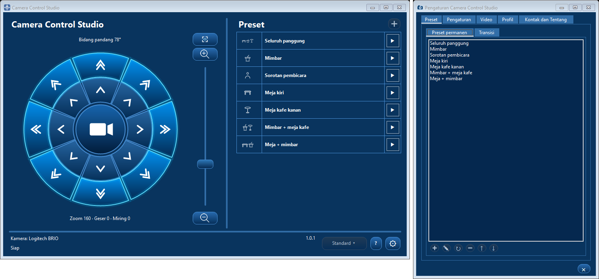
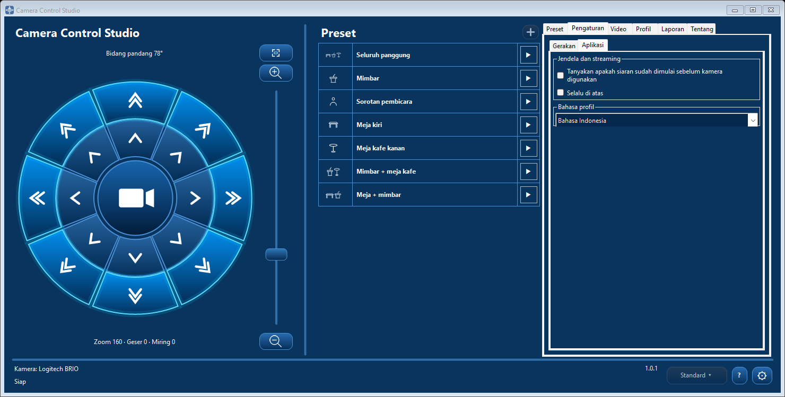
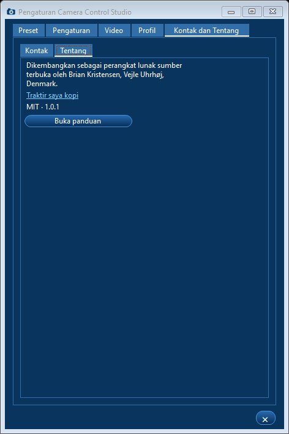
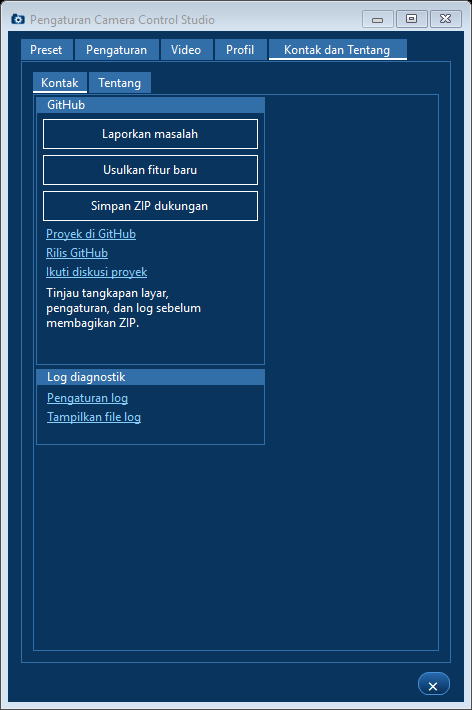

[English](../en/SETUP.md) · [Dansk](../da/SETUP.md) · [Deutsch](../de/SETUP.md) · [ASemua bahasa panduan](USER-GUIDES.md)

# Siapkan aplikasi

*Ditulis untuk Camera Control Studio 1.0.1.*

[Pemecahan Masalah](TROUBLESHOOTING.md)

Klik roda gigi di bagian bawah untuk membuka Pengaturan. Pengaturan terbuka di jendela terpisah. Anda tetap dapat menggunakan jendela utama.

## Instal dan verifikasi unduhan

Unduh penginstal atau ZIP portabel dari rilis proyek [GitHub](https://github.com/bkristensen/Camera-Ctrl-Pressets-Studio/releases). Jalankan penginstal atau ekstrak seluruh ZIP sebelum meluncurkan aplikasi. Jika checksum SHA-256 diterbitkan, bandingkan dengan `Get-FileHash -Algorithm SHA256` untuk unduhan Anda.

**Unduhan resmi**\
<https://github.com/bkristensen/Camera-Ctrl-Pressets-Studio/releases>\

Microsoft Defender SmartScreen dapat menampilkan peringatan biru ketika aplikasi yang diunduh atau penerbitnya memiliki reputasi yang buruk. Tanggapi dengan serius. Jika Anda memperoleh file yang diharapkan dari rilis resmi dan memercayai sumbernya, pilih **Info selengkapnya** dan tinjau nama file dan penerbit. Pilih **Lagi pula** hanya jika Anda memilih untuk memercayai file tersebut dan Windows menawarkan opsi tersebut. Jika tidak, tutup peringatannya. Ikuti kebijakan perangkat organisasi Anda. [Panduan Microsoft SmartScreen](https://learn.microsoft.com/windows/apps/package-and-deploy/smartscreen-reputation)

<https://learn.microsoft.com/windows/apps/package-and-deploy/smartscreen-reputation>

Jika penampil panduan memerlukan WebView2, unduh runtime dari Microsoft.\
<https://developer.microsoft.com/microsoft-edge/webview2/>

Peringatan 

## 1. Pilih profil dan kamera

Gunakan pemilih profil di footer untuk memilih profil. Untuk membuatnya, buka **Pengaturan → Profil**. Pilih **New** untuk pengaturan default atau **Copy** untuk salinan profil aktif. Beri nama setelah orang atau pengaturan. Profil baru menjadi aktif. Di **Profil**, pilih profil dan klik **✎** untuk mengganti namanya. Profil Standar memiliki nama tetap.

Klik dua kali simbol kamera di tengah roda arah untuk memilih kamera. Program ini mengingatnya. Jika kamera itu hilang, pilih sumber lain. Posisi milik kamera dalam profil.

## 2. Putuskan kapan kontrol kamera dapat dimulai

Di bawah **Pengaturan → Aplikasi**, aktifkan **Tanyakan apakah siaran sudah dimulai sebelum kamera digunakan** jika program pengambilan Anda harus dimulai terlebih dahulu. Opsi ini tidak aktif secara default.

Dengan opsi diaktifkan, tindakan kamera pertama menanyakan apakah streaming telah dimulai. Pilih **Yes** hanya jika sudah. Pilih **No** agar kontrol kamera tetap terputus. Setelah Ya, tindakan lebih lanjut jangan tanya lagi sampai Anda mengubah profil, mengubah opsi ini, atau memulai ulang aplikasi. Aplikasi tidak mendeteksi atau memulai sesi streaming untuk Anda.

Jika Anda memerlukan pesanan ini pada penggunaan pertama, atur opsi sebelum sesi berikutnya. Defaultnya memungkinkan aplikasi untuk terhubung saat startup.

## 3. Atur gerakan dan zoom

Buka **Pengaturan → Geser kamera** untuk mengatur langkah geser dan miring, membalikkan arah, dan memilih cara kerja tombol kamera. Mulailah dengan langkah kecil. Uji hasilnya dalam program pengambilan Anda.

| Pengaturan | Apa yang diubahnya | Bawaan |
| --- | --- | --- |
| Kecepatan halus (% dari Normal) | Nilai sambil menahan Ctrl dan tombol panah | 50% |
| Langkah panci normal | Cincin panah tengah | 1 |
| Langkah panci cepat | Cincin panah luar | 4 |

Satu langkah berarti satu langkah yang didukung oleh driver kamera. Ini bukan jarak atau persentase yang tetap. Pengemudi membatasi pergerakan dan kelancaran.

Untuk kamera terbalik, aktifkan **Balik gerakan kamera atas/bawah** dan uji Up. Aktifkan **Balik gerakan kamera kiri/kanan** hanya jika Kiri bergerak ke arah yang salah. Pengaturan ini mengubah kontrol. Mereka tidak memutar videonya.

### Atur langkah zoom

Buka **Pengaturan → Zoom** untuk memilih seberapa jauh tombol plus dan minus bergerak dalam satu langkah. Standarnya adalah satu langkah driver. [Lihat tab Zoom](../images/screenshots/settings-tabs/en/zoom.png).

### Atur transisi yang telah ditetapkan

Buka **Preset → Transisi** untuk memilih cara kamera berpindah di antara posisi yang disimpan. [Lihat tab Transisi](../images/screenshots/settings-tabs/en/transitions.png).

| Pengaturan | Apa yang diubahnya | Bawaan |
| --- | --- | --- |
| Gunakan kecepatan untuk transisi preset | Biarkan jarak perjalanan menentukan durasinya | Mati |
| Kecepatan transisi (%/s) | Kecepatan jelajah sebagai persentase jangkauan sumbu pengendali per detik | 30% |
| Transisi (detik) | Waktu untuk setiap perubahan preset dalam mode durasi tetap | 1.0 |

Dengan transisi berbasis kecepatan, gerakan pendek membutuhkan waktu lebih sedikit dibandingkan gerakan panjang. Aplikasi ini mempercepat dan mengerem, dan semua sumbu yang bergerak berbagi kemajuan yang sama sehingga mereka dapat mencapai target bersama-sama.

### Atur bidang pandang

Buka **Video → Bidang pandang**. Di bawah **Bidang pandang saat mulai**, pilih **Terlebar yang tersedia**, sudut yang dilaporkan oleh driver kamera, atau **Jangan ubah** untuk mempertahankan tampilan saat ini. Aplikasi menggunakan pilihan ini saat pertama kali terhubung. Aktifkan **Izinkan perubahan bidang pandang manual** untuk memilih di antara sudut yang dilaporkan di bawah roda arah. Jika driver melaporkan tidak ada sudut yang dapat dipilih, kontrol FOV dinonaktifkan. Anda tetap dapat menggunakan zoom jika kamera mendukungnya. [Lihat tab Bidang pandang](../images/screenshots/settings-tabs/en/field-of-view.png).

**Ubah bidang pandang pada batas zoom dan geser** diaktifkan secara default. Anda dapat menggunakannya dengan pemilih manual tersembunyi. Ini berfungsi ketika driver mendukung FOV.

- **Perkecil:** Pada zoom minimum pada Brio yang disetel ke 65°, tekan zoom out lagi untuk beralih ke 78°. Pers itu akan mengubah FOV dan menyesuaikan zoom agar bidikan tetap dekat. Penekanan selanjutnya akan memperkecil tampilan secara normal. Langkah yang sama membawa Anda dari 78° ke 90°. Tombol berhenti pada 90° dan zoom minimum.
- **Memperbesar:** Pada zoom maksimum, tekan lagi untuk beralih ke FOV yang lebih sempit. Jika driver melaporkan 90°, 78°, dan 65°, aplikasi akan menggunakannya dalam urutan tersebut. Tombol berhenti pada sudut tersempit yang tersedia dan zoom maksimum.
- **Pan kiri atau kanan:** Di bagian tepi, aplikasi mencoba tampilan yang lebih luas terlebih dahulu. Ini menyesuaikan zoom agar potongan tetap dekat. Ia juga dapat mencoba tampilan yang lebih sempit jika zoom memungkinkannya. Jika tidak ada tampilan yang memungkinkannya menggeser lebih jauh, maka gambar sebelumnya akan dikembalikan. Pengemudi mengontrol seberapa dekat pertandingannya.

Gunakan tombol persegi dengan simbol bingkai untuk langsung menuju FOV terluas dan zoom minimum. Penggeser masih menyetel zoom dalam FOV saat ini. Matikan FOV otomatis untuk menjaga zoom dan menggeser dalam tampilan saat ini.

Preset menyimpan pan, tilt, zoom dan FOV yang dilaporkan oleh driver. Preset lama mempertahankan FOV saat ini. Periksa gambar langsung apakah Zoom, Logitech Brio Control, atau aplikasi lain mengontrol pemotongan. [Langkah pengujian Brio dan Zoom](VALIDATION.md#bidang-pandang-brio-dan-zoom)

## 4. Sesuaikan gambar dan simpan posisi permanen

[Sebelum memuat kontrol video](../images/screenshots/settings-tabs/en/video.png) · [Warna](../images/screenshots/1.0.1/en/video-colour.png) · [Cahaya dan detail](../images/screenshots/1.0.1/en/video-light-detail.png)

Buka **Video** di panel pengaturan, lalu muat kontrol gambar jika diperlukan. Pilih grup seperti **Fokus dan pencahayaan**, **Warna**, atau **Cahaya dan detail**. Hanya kontrol yang diekspos oleh driver yang muncul. Sesuaikan kecerahan, kontras, saturasi warna, fokus, atau keseimbangan putih bila tersedia. Matikan mode otomatis sebelum penyesuaian manual. Nilai gambar disimpan per kamera dan profil. Tombol reset mengembalikan default driver.

Gerakkan kamera terlebih dahulu. Buka **Preset** di panel pengaturan. Klik **+** untuk menambahkan preset permanen. Pilih ikon di bagian atas, centang namanya, lalu simpan. Jika nama tersebut kosong dan tidak digunakan, memilih ikon akan menyarankan namanya. Simbol gabungan menunjukkan subjeknya dari kiri ke kanan.

Di bawah **Preset permanen**, pilih posisi. Arahkan kursor ke simbol untuk tindakannya. Gunakan **✎** untuk mengedit nama dan simbolnya, **↻** untuk menyimpan posisi kamera saat ini pada tempatnya, dan **−** untuk menghapusnya. Gunakan **↑** dan **↓** untuk mengubah urutan di kedua daftar. Posisi permanen tetap berada di bagian atas daftar utama yang dicetak tebal.

Memilih baris permanen di daftar utama juga memilih preset tersebut di Pengaturan. Prasetel yang baru disimpan dipilih di Pengaturan.

## 5. Atur tata letak dan bahasa

Seret pemisah antara kontrol kamera dan daftar prasetel. Profil Anda menyimpan posisi pemisah. Ukuran awal adalah 900×500, dan minimum 670×450. Pengaturan mulai ditutup. Saat Anda pertama kali membukanya setelah peluncuran, tab pertama dipilih. Gulir ke bawah di **Geser kamera** atau **Aplikasi** jika beberapa bidang berada di bawah jendela. Profil Anda menyimpan ukuran dan posisi kedua jendela.

Saat memilih profil di footer, biarkan **Pertahankan posisi dan tata letak saat ini** tidak dicentang untuk memulihkan tata letak profil tersebut. Centang untuk membawa tata letak saat ini ke profil yang dipilih. Pilihannya diingat di profil yang Anda tinggalkan; tata letak yang dibawa disimpan di profil tujuan.

Pilih bahasa di bawah **Pengaturan → Aplikasi → Bahasa profil**, lalu mulai ulang untuk menerapkannya. **Otomatis** menggunakan bahasa tampilan Windows jika didukung dan bahasa Inggris jika didukung. Beralih profil akan memulai ulang aplikasi dengan bahasa profil yang dipilih. Preset sementara berakhir saat restart.

## 6. Versi dan informasi proyek

Buka **Kontak dan Tentang → Tentang** untuk melihat versi dan tautan proyek. Arahkan penunjuk ke versi untuk melihat ID build lengkap. Sertakan ID jika masalah terjadi pada build tersebut.

## 7. Log diagnostik dan pelaporan masalah

Buka **Kontak dan Tentang → Kontak** untuk memilih folder log, ukuran maksimum, dan jumlah berkas termasuk log saat ini. Aplikasi memakai folder program atau `%LOCALAPPDATA%\CamPressets\Logs` jika folder program tidak dapat dipakai.

Pilih **Laporkan masalah** atau **Usulkan fitur baru** untuk membuka draf GitHub yang sesuai. Saat melaporkan masalah, aplikasi menawarkan ZIP dukungan. Tinjau dan lampirkan sendiri ke draf. [Laporkan atau ikuti masalah](ISSUES.md)

**Laporkan bug atau sarankan fitur**\
<https://github.com/bkristensen/Camera-Ctrl-Pressets-Studio/issues?q=is%3Aissue>\
Kode 

Berikutnya: [Penggunaan sehari-hari](DAILY-USE.md). Untuk cadangan, tutup aplikasi dan salin `%LOCALAPPDATA%\CamPressets`. Posisi sementara bukan bagian dari cadangan.
