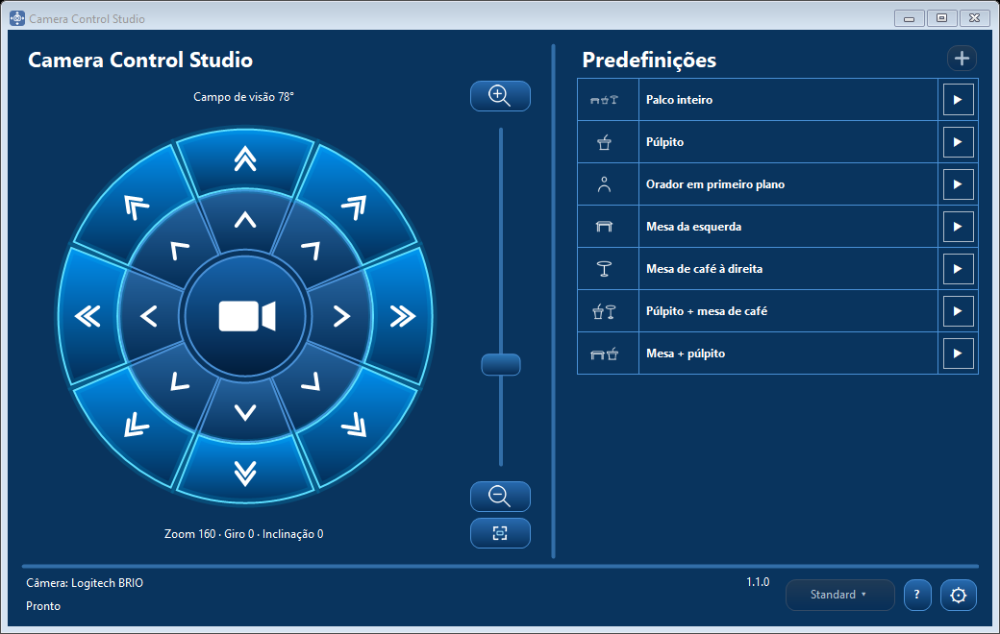
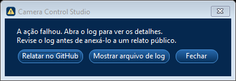

[English](../en/DAILY-USE.md) · [Dansk](../da/DAILY-USE.md) · [Deutsch](../de/DAILY-USE.md) · [Todos os idiomas do guia](USER-GUIDES.md)

# Uso diário

*Escrito para Camera Control Studio 1.1.0.*

[Solução de problemas](TROUBLESHOOTING.md)

Inicie sua reunião de streaming em um aplicativo como o Zoom. Em seguida, abra **Camera Control Studio**.

## Geral

Clique em **?** para obter ajuda. Passe o mouse sobre um botão para ver seu nome e ação. Uma direção é bloqueada no último limite que a câmera pode alcançar. [Como funciona o FOV automático](SETUP.md#defina-o-campo-de-vis%C3%A3o)

## 1. Ative uma predefinição

Clique em ▶ em uma linha na lista de predefinições ou clique duas vezes no nome.
Você também pode selecionar a linha e pressionar Enter.

| Cor | Significado |
| --- | --- |
| Amarelo | O aplicativo está movendo a câmera em direção à predefinição. |
| Verde | O driver da câmera informa que as coordenadas salvas foram alcançadas. |
| Azul | A predefinição não está marcada como ativa. |

Verde significa que o driver informa a posição salva e FOV, se salva. Verifique a imagem em seu stream. Se o piloto não conseguir confirmar o tiro a tempo, a linha fica azul. Leia a mensagem de status para ver o que aconteceu.

## 2. Ajuste o enquadramento

### Panela

Use o anel interno para movimentos normais e o anel externo para movimentos rápidos. Cada anel possui oito flechas. As diagonais movem panorâmica e inclinação juntas a 45°, com 45% da velocidade do anel em cada eixo. Um clique move pelo menos uma etapa do driver por eixo disponível. Segure uma flecha para continuar se movendo. Solte para parar.

### Botão da câmera no centro da roda

- **Clique duas vezes para escolher uma câmera.** A lista de câmeras é aberta.
- **Segure e arraste.** Comece no ícone da câmera. Arraste para os lados para deslocar ou para cima e para baixo para inclinar. Arraste um pouco para movimentos lentos ou mais para movimentos mais rápidos, até o dobro da velocidade rápida. Solte o botão ou mova o ponteiro de volta para onde você começou a parar.

Em **Configurações → Panorâmica**, você pode desativar o arrasto ou alternar para um único clique para seleção da câmera. Ambas as opções são salvas no perfil ativo.

### Zoom

Use os botões da lupa para ampliar. Mantenha um botão pressionado para repetir a ação.
Arraste o controle deslizante para ajustar o zoom conforme você o move.

### Restaurar quadro completo

Clique no botão quadrado com o ícone de moldura acima dos botões da lupa. A câmera diminui o zoom o máximo que pode e seleciona seu campo de visão mais amplo, se suportar essa configuração. Isso altera a imagem da câmera. A janela do aplicativo mantém seu tamanho.

### Pare de panoramizar

Pressione Esc para interromper uma panorâmica em andamento.

> Pan, tilt ou zoom manual cancela o movimento para a predefinição e limpa a cor ativa.

### Teclas de seta

Use as teclas de seta quando a roda estiver em foco. Segure Ctrl para movimentos finos ou Shift para movimentos rápidos.

## 3. Salve uma predefinição temporária

Clique em **+** acima da lista predefinida, insira um nome e salve. A posição atual aparece abaixo das predefinições permanentes.
As predefinições temporárias não têm ícone. Eles duram até você fechar o aplicativo e são mantidos separadamente para cada perfil e câmera.

Selecione uma linha temporária e clique em **×** acima da lista predefinida para removê-la. Todas as predefinições temporárias são removidas quando o aplicativo é fechado.
Para usar uma posição posteriormente, crie-a em **Configurações → Predefinições**. Você não pode editar ou excluir predefinições permanentes na lista principal.

## 4. Sair

Se um controle falhar, leia a mensagem na área de status na parte inferior. A câmera pode não suportar o recurso ou pode estar indisponível.

Feche o aplicativo normalmente. O aplicativo lembra o perfil ativo e o layout da janela.

## 5. Relatar problemas

Se **Nova versão disponível** aparecer no rodapé, selecione-o para abrir o release no GitHub e ver os downloads.

<https://github.com/bkristensen/Camera-Ctrl-Pressets-Studio/releases>

Relate problemas ou solicite recursos em **Contato e sobre → Contato**.

Consulte [Setup](SETUP.md) para direção da câmera, predefinições permanentes, configurações de imagem, perfis e etapas de movimento.

## Caixa de diálogo de erro

Se um erro inesperado interromper uma ação, feche a caixa e tente de novo. Se a mensagem indicar que o aplicativo será fechado, abra-o novamente.

**Mostrar arquivo de log** seleciona o registro de diagnóstico no Explorador de Arquivos, quando disponível. **Relatar no GitHub** oferece a opção de salvar um ZIP de suporte e depois abre o modelo de relatório de erro no GitHub. O ZIP pode incluir uma captura da caixa de diálogo, logs, configurações de perfil e janela e um relatório do sistema. Revise o ZIP e anexe-o ao rascunho.
