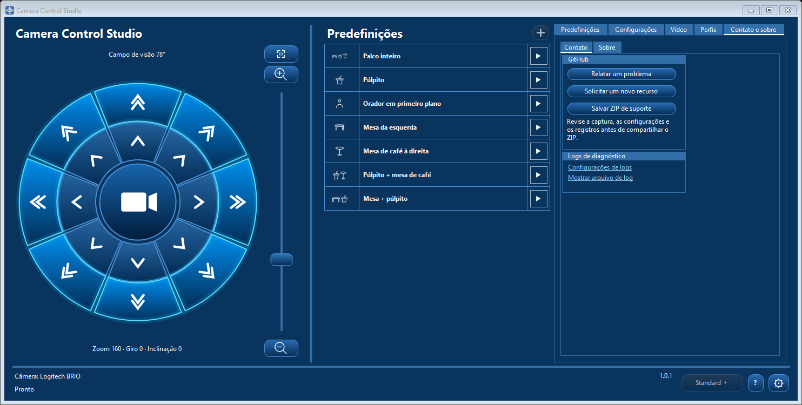

# Solicitar um novo recurso

1. Abra o painel de configurações. Selecione **Contato e sobre → Contato → Solicitar um novo recurso**.
2. Se houver uma versão mais recente, escolha **Sim** para abrir a página de download. Instale-a e verifique se ela já inclui o recurso. Escolha **Não** para continuar no rascunho do GitHub.
3. No modelo **Feature request** do GitHub, descreva a tarefa, como o recurso ajudaria e qual resultado mostraria que ele funciona. Preencha todas as seções marcadas com um asterisco vermelho.

## Anexe um exemplo

Selecione **Contato e sobre → Contato → Salvar ZIP de suporte** e escolha onde salvar o pacote. O aplicativo mostra o caminho do arquivo.

O ZIP inclui uma captura do aplicativo, o arquivo salvo `profiles.json`, o layout da janela em `window.json` e os registros disponíveis em `Logs`.

Revise o ZIP para retirar dados privados, como nomes de perfis, IDs de câmeras e caminhos de arquivos. Arraste você mesmo o ZIP ou os arquivos úteis para a descrição do rascunho.

## Confira o tipo e os rótulos

O modelo solicita **Feature** em **Type** e `enhancement` em **Labels**. Se faltarem e os campos estiverem disponíveis, selecione os valores na barra lateral direita. Se não puder editar os campos, envie o rascunho. Alguém da equipe do projeto poderá preenchê-los.

Confira a descrição e os anexos em **Preview** e escolha **Create**.
