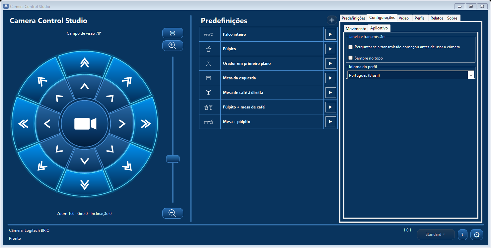
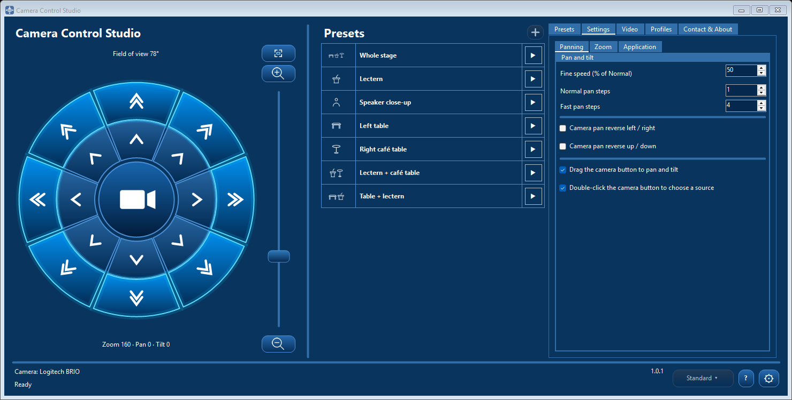
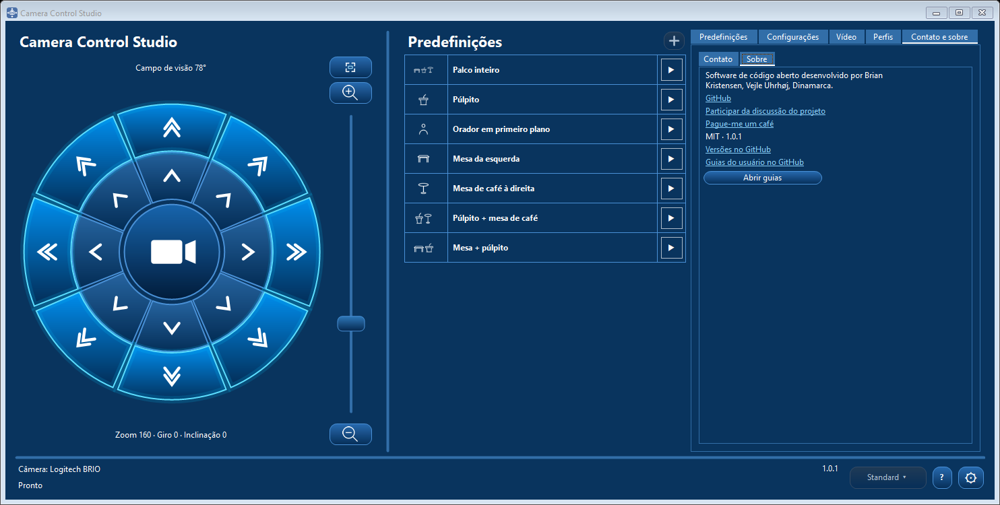
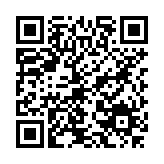

[English](../en/SETUP.md) · [Dansk](../da/SETUP.md) · [Deutsch](../de/SETUP.md) · [Todos os idiomas do guia](USER-GUIDES.md)

# Configure o aplicativo

*Escrito para Camera Control Studio 1.0.1.*

[Solução de problemas](TROUBLESHOOTING.md)

Abra a engrenagem no rodapé. Configurações abertas à direita. Sua lista de posições permanece visível.

## Instale e verifique o download

Baixe o instalador ou portátil ZIP das versões [GitHub do projeto](https://github.com/bkristensen/Camera-Ctrl-Pressets-Studio/releases). Execute o instalador ou extraia todo o ZIP antes de iniciar o aplicativo. Se uma soma de verificação SHA-256 for publicada, compare-a com `Get-FileHash -Algorithm SHA256` para download.

**Download oficial**\
<https://github.com/bkristensen/Camera-Ctrl-Pressets-Studio/releases>\
Código 

Microsoft Defender SmartScreen pode mostrar um aviso azul quando um aplicativo baixado ou seu editor tem pouca reputação estabelecida. Leve isso a sério. Se você obteve o arquivo esperado do lançamento oficial e confia na fonte, selecione **Mais informações** e revise o nome do arquivo e o editor. Selecione **Executar mesmo assim** somente se você optar por confiar nesse arquivo e o Windows oferecer a opção. Caso contrário, feche o aviso. Siga a política de dispositivos da sua organização. [Orientação do Microsoft SmartScreen](https://learn.microsoft.com/windows/apps/package-and-deploy/smartscreen-reputation)

<https://learn.microsoft.com/windows/apps/package-and-deploy/smartscreen-reputation>

Se o visualizador do guia precisar de WebView2, baixe o tempo de execução da Microsoft.\
<https://developer.microsoft.com/microsoft-edge/webview2/>

Aviso 

## 1. Escolha um perfil e câmera

Use o seletor de perfil no rodapé para selecionar um perfil. Para criar um, abra **Configurações → Perfis**. Escolha **New** para configurações padrão ou **Copy** para uma cópia do perfil ativo. Nomeie-o com o nome de uma pessoa ou configuração. Novos perfis ficam ativos. Em **Perfis**, selecione um perfil e clique em **✎** para renomeá-lo. O perfil Padrão possui um nome fixo.

Clique duas vezes no símbolo da câmera no centro da roda de direção para selecionar uma câmera. O programa se lembra disso. Se essa câmera estiver faltando, escolha outra fonte. As posições pertencem a uma câmera dentro de um perfil.

Guia 

## 2. Decida quando o controle da câmera pode começar

Em **Configurações → Aplicativo**, habilite **Perguntar se a transmissão começou antes de usar a câmera** se seu programa de captura precisar ser iniciado primeiro. Esta opção está desativada por padrão.

Com a opção habilitada, a primeira ação da câmera pergunta se o streaming foi iniciado. Escolha **Sim** somente quando tiver. Escolha **No** para manter o controle da câmera desconectado. Depois de Sim, outras ações não serão solicitadas novamente até que você altere o perfil, altere esta opção ou reinicie o aplicativo. O aplicativo não detecta nem inicia uma sessão de streaming para você.

Se você precisar deste pedido na primeira utilização, defina a opção antes da próxima sessão. O padrão permite que o aplicativo se conecte na inicialização.

## 3. Defina movimento e zoom

Abra **Configurações → Panorâmica** para definir etapas de panorâmica e inclinação, inverter direções e escolher como o botão da câmera funciona. Comece com pequenos passos. Teste o resultado em seu programa de captura.

| Configuração | O que isso muda | Padrão |
| --- | --- | --- |
| Velocidade fina (% do normal) | Avalie enquanto segura Ctrl e uma tecla de seta | 50% |
| Etapas normais de panorâmica | Anel de flecha do meio | 1 |
| Etapas rápidas de panorâmica | Anel de flecha externo | 4 |

Uma etapa significa uma etapa suportada pelo driver da câmera. Não é uma distância ou porcentagem fixa. O driver limita o movimento e a suavidade.

Para uma câmera invertida, habilite **Inverter movimento da câmera para cima/baixo** e teste Up. Habilite **Inverter movimento da câmera esquerda/direita** somente se a esquerda se mover na direção errada. Essas configurações alteram os controles. Eles não giram o vídeo.

### Definir etapas de zoom

Abra **Configurações → Zoom** para escolher até que ponto os botões de mais e menos se movem em uma única etapa. O padrão é uma etapa do driver. [Veja a guia Zoom](../images/screenshots/settings-tabs/en/zoom.png).

### Definir transições predefinidas

Abra **Predefinições → Transições** para escolher como a câmera se move entre as posições salvas. [Veja a guia Transições](../images/screenshots/settings-tabs/en/transitions.png).

| Configuração | O que isso muda | Padrão |
| --- | --- | --- |
| Use a velocidade para transições predefinidas | Deixe a distância da viagem determinar a duração | Desligado |
| Velocidade de transição (%/s) | Taxa de cruzeiro como porcentagem do alcance do eixo de controle por segundo | 30% |
| Transição (seg.) | Tempo para cada alteração predefinida no modo de duração fixa | 1.0 |

Com transições baseadas em velocidade, um movimento curto leva menos tempo do que um movimento longo. O aplicativo acelera e freia, e todos os eixos móveis compartilham o mesmo progresso para que possam atingir a meta juntos.

### Defina o campo de visão

Abra **Vídeo → Campo de visão**. Em **Campo de visão ao iniciar**, escolha **Mais amplo disponível**, um ângulo relatado pelo driver da câmera, ou **Manter como está** para manter a visualização atual. O aplicativo usa essa opção na primeira vez que se conecta. Ative **Permitir ajuste manual do campo de visão** para escolher entre os ângulos relatados abaixo da roda de direção. Se o driver não reportar ângulos selecionáveis, os controles FOV serão desabilitados. Você ainda pode usar o zoom se a câmera suportar. [Consulte a guia Campo de visão](../images/screenshots/settings-tabs/en/field-of-view.png).

**Mudar o campo de visão nos limites de zoom e giro** está ativado por padrão. Você pode usá-lo com o seletor manual oculto. Funciona quando o driver suporta FOV.

- **Zoom out:** No zoom mínimo em um Brio definido para 65°, pressione zoom out novamente para mudar para 78°. Esse toque altera o FOV e ajusta o zoom para manter a foto próxima. A próxima pressão diminui o zoom normalmente. As mesmas etapas levam você de 78° a 90°. O botão para em 90° e zoom mínimo.
- **ZAumentar:** No zoom máximo, pressione novamente para mover em direção a um FOV mais estreito. Se o driver informar 90°, 78° e 65°, o aplicativo os utiliza nessa ordem. O botão para no ângulo mais estreito disponível e no zoom máximo.
- **Deslocar para a esquerda ou para a direita:** Na borda, o aplicativo tenta primeiro uma visão mais ampla. Ele ajusta o zoom para manter o corte próximo. Também pode tentar uma visão mais estreita se o zoom permitir. Se nenhuma visualização permitir uma panorâmica mais ampla, a imagem anterior será restaurada. O driver controla o quão próxima está a partida.

Use o botão quadrado com o símbolo do quadro para ir direto para o FOV mais amplo e zoom mínimo. O controle deslizante ainda define o zoom no FOV atual. Desative o FOV automático para manter o zoom e a panorâmica na visualização atual.

As predefinições salvam panorâmica, inclinação, zoom e o FOV relatado pelo driver. As predefinições mais antigas mantêm o FOV atual. Verifique a imagem ao vivo se Zoom, Logitech Brio Control ou outro aplicativo controla o corte. [Etapas de teste Brio e Zoom](VALIDATION.md#campo-de-vis%C3%A3o-e-zoom-brio)

## 4. Ajuste a imagem e salve posições permanentes

[Antes de carregar os controles de vídeo](../images/screenshots/settings-tabs/en/video.png) · [Cor](../images/screenshots/1.0.1/en/video-colour.png) · [Luz e detalhes](../images/screenshots/1.0.1/en/video-light-detail.png)

Abra **Vídeo** no painel de configurações e carregue os controles de imagem, se necessário. Escolha um grupo como **Foco e exposição**, **Cor** ou **Luz e detalhes**. Somente os controles expostos pelo driver aparecem. Ajuste brilho, contraste, saturação de cor, foco ou equilíbrio de branco quando disponível. Desligue o modo automático antes do ajuste manual. Os valores da imagem são salvos por câmera e perfil. O botão reset restaura os padrões do driver.

Mova a câmera primeiro. Abra **Predefinições** no painel de configurações. Clique em **+** para adicionar uma predefinição permanente. Selecione um ícone na parte superior, verifique o nome e salve. Se o nome estiver em branco e não for utilizado, a escolha de um ícone sugere seu nome. Os símbolos combinados mostram seus assuntos da esquerda para a direita.

Em **Predefinições permanentes**, selecione uma posição. Passe o mouse sobre um símbolo para ver sua ação. Use **✎** para editar seu nome e símbolo, **↻** para salvar a posição atual da câmera em seu lugar e **−** para excluí-la. Use **↑** e **↓** para alterar a ordem em ambas as listas. As posições permanentes ficam no topo da lista principal em negrito.

Selecionar uma linha permanente na lista principal também seleciona essa predefinição em Configurações. Uma predefinição recém-salva é selecionada em Configurações.

## 5. Defina layout e idioma

Arraste o divisor entre os controles da câmera e a lista de predefinições. Seu perfil salva a divisória e o tamanho e posição da janela. O tamanho inicial é 900 × 500 e o mínimo é 670 × 450. As configurações começam fechadas. Quando você os abre pela primeira vez após o lançamento, a primeira guia é selecionada. Role para baixo em **Panorâmica** ou **Aplicativo** se alguns campos estiverem abaixo da janela. O aplicativo salva a largura da janela com as configurações fechadas.

Ao selecionar um perfil no rodapé, deixe **Manter a posição e o layout atuais** desmarcado para restaurar o layout desse perfil. Marque para transportar o layout atual para o perfil selecionado. A escolha fica lembrada no perfil que você sai; o layout transportado é salvo no perfil de destino.

Escolha um idioma em **Configurações → Aplicativo → Idioma do perfil** e reinicie para aplicá-lo. **Automático** usa o idioma de exibição do Windows se for compatível e o inglês caso contrário. A troca de perfis reinicia o aplicativo com o idioma do perfil selecionado. As predefinições temporárias terminam na reinicialização.

## 6. Versão e informações do projeto

Abra **Contato e sobre → Sobre** para ver a versão e os links do projeto. Passe o ponteiro sobre a versão para ver o identificador completo da compilação. Inclua-o se o problema afetar essa compilação.

## 7. Logs de diagnóstico e relatórios de problemas

Abra **Contato e sobre → Contato** para escolher a pasta de registros, o tamanho máximo e a quantidade de arquivos, incluindo o atual. O padrão é a pasta do aplicativo ou, se ela estiver indisponível, `%LOCALAPPDATA%\CamPressets\Logs`.

Selecione **Relatar um problema** ou **Solicitar um novo recurso** para abrir o rascunho correto no GitHub. Para problemas, o aplicativo oferece salvar um ZIP de suporte. Revise o arquivo e anexe-o ao rascunho. [Relatar ou acompanhar um problema](ISSUES.md)

**Relate um bug ou sugira um recurso**\
<https://github.com/bkristensen/Camera-Ctrl-Pressets-Studio/issues?q=is%3Aissue>\
Código 

Próximo: [Uso diário](DAILY-USE.md). Para fazer um backup, feche o aplicativo e copie `%LOCALAPPDATA%\CamPressets`. Posições temporárias não fazem parte do backup.
