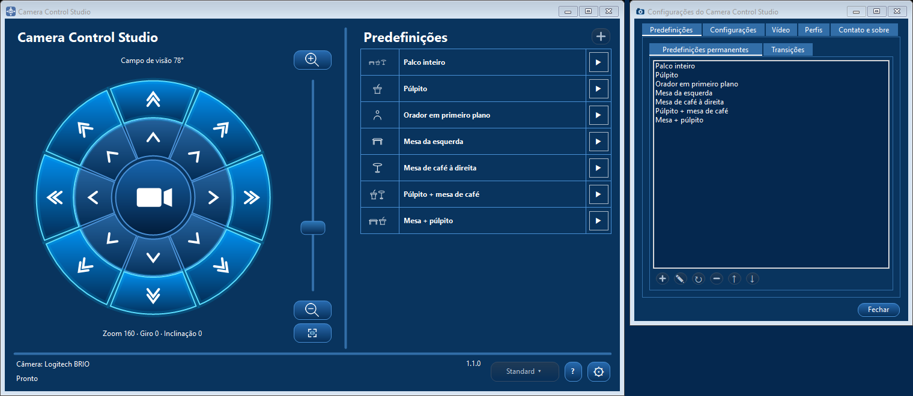
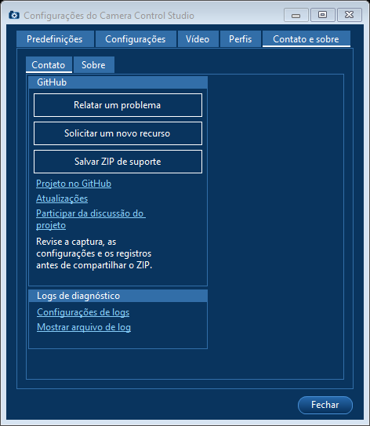
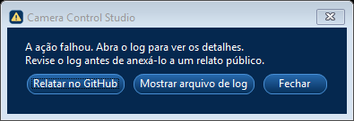

[English](../en/SETUP.md) · [Dansk](../da/SETUP.md) · [Deutsch](../de/SETUP.md) · [Todos os idiomas do guia](USER-GUIDES.md)

# Configure o aplicativo

*Escrito para Camera Control Studio 1.1.0.*

[Solução de problemas](TROUBLESHOOTING.md)

Clique na engrenagem na parte inferior para abrir as configurações. As configurações abrem em uma janela separada. Você pode continuar usando a janela principal.

## Instale e verifique o download

Baixe o **Camera Control Studio** da Microsoft Store quando o aplicativo estiver disponível lá. Procure pelo nome na loja. A Microsoft assina o pacote da loja e fornece as atualizações.

Se o aplicativo ainda estiver indisponível na Microsoft Store, baixe o instalador ou o ZIP portátil nas [versões do GitHub](https://github.com/bkristensen/Camera-Ctrl-Pressets-Studio/releases). Execute o instalador ou extraia o ZIP inteiro antes de abrir o aplicativo. Se a versão incluir uma soma SHA-256, compare-a com o resultado de `Get-FileHash -Algorithm SHA256`.

Microsoft Defender SmartScreen pode mostrar um aviso azul quando um aplicativo baixado ou seu editor tem pouca reputação estabelecida. Leve isso a sério. Se você obteve o arquivo esperado do lançamento oficial e confia na fonte, selecione **Mais informações** e revise o nome do arquivo e o editor. Selecione **Executar mesmo assim** somente se você optar por confiar nesse arquivo e o Windows oferecer a opção. Caso contrário, feche o aviso. Siga a política de dispositivos da sua organização. [Orientação do Microsoft SmartScreen](https://learn.microsoft.com/windows/apps/package-and-deploy/smartscreen-reputation)

<https://learn.microsoft.com/windows/apps/package-and-deploy/smartscreen-reputation>

Se o visualizador do guia precisar de WebView2, baixe o tempo de execução da Microsoft.\
<https://developer.microsoft.com/microsoft-edge/webview2/>

Aviso 

Escolha o perfil no rodapé da janela principal. Por padrão, clique duas vezes no botão da câmera, no centro da roda, para escolher a fonte. O perfil memoriza a câmera. Se ela não estiver disponível, escolha outra.

As seções seguem a ordem das abas. Um botão cinza costuma pedir uma seleção. Em Vídeo, o driver decide quais controles aparecem. Confira o resultado no aplicativo de captura.

**Fechar**. Mova e redimensione as duas janelas ou arraste o divisor da janela principal. O perfil guarda esses valores. Clique em Fechar na parte inferior para fechar as configurações. A janela principal continua aberta.

## Predefinições

### Predefinições permanentes

Aponte a câmera. Uma posição permanente guarda os valores disponíveis de movimento horizontal, inclinação e zoom. Também guarda o campo de visão informado pela câmera. A posição pertence a uma câmera em um perfil.

- **+ Adicionar predefinição permanente**. Salve o enquadramento atual. Escolha um símbolo e digite um nome exclusivo. Se o campo estiver vazio, o símbolo pode sugerir um nome. O botão Salvar exige um nome. Cancelar deixa a lista como estava.
- **✎ Editar nome e ícone**. Mude o nome ou o símbolo da posição selecionada. O enquadramento continua igual.
- **↻ Substituir pela posição atual**. Substitua o enquadramento selecionado pela posição atual da câmera. Confirme. O nome e o símbolo continuam iguais.
- **− Excluir predefinição permanente**. Exclua a posição selecionada após confirmar.
- **↑ / ↓ Mover a predefinição selecionada para cima · Mover a predefinição selecionada para baixo**. Mova a posição uma linha nas duas listas. A seta para cima fica cinza na primeira linha. A seta para baixo fica cinza na última.

Selecione uma posição para editar, substituir, excluir ou mover. Para adicionar e substituir, carregue um perfil. A câmera deve permitir controlar pelo menos um eixo de movimento ou zoom. Se estiver desconectada, o aplicativo pode tentar conectá-la.

### Definir transições predefinidas

- **Usar velocidade nas transições**. Desligado usa tempo fixo. Ligado usa uma velocidade e os trajetos curtos acabam antes. Os eixos em movimento chegam juntos.
- **Transição (s)**. Defina o tempo de uma transição. O padrão é 1 segundo. O campo fica cinza no modo de velocidade.
- **Velocidade de transição (%/s)**. Defina a velocidade em porcentagem do alcance do eixo que determina o movimento, por segundo. O padrão é 30%. O campo fica cinza no modo de tempo fixo.

## Configurações

### Panorâmica

- **Velocidade fina (% da normal)**. Segure Ctrl e pressione uma seta para fazer o ajuste fino. O padrão é 50% da velocidade normal.
- **Passos de giro normal**. Defina quantos passos as setas do anel interno movem. O padrão é 1.
- **Passos de giro rápido**. Defina quantos passos as setas do anel externo movem. O padrão é 4. O valor muda também a velocidade ao arrastar o botão da câmera.
- **Inverter movimento da câmera esquerda/direita**. Troque esquerda e direita se a câmera se mover no sentido errado.
- **Inverter movimento da câmera para cima/baixo**. Troque cima e baixo se a câmera estiver montada de cabeça para baixo. As duas opções mudam os comandos. A imagem mantém a orientação.
- **Arrastar o botão da câmera para girar e inclinar**. Arraste o botão no centro da roda para apontar a câmera. Desative a opção para usar as setas.
- **Clicar duas vezes no botão da câmera para escolher a fonte**. Ligado abre a lista de câmeras com clique duplo. Desligado abre com um clique.

Você pode mudar esses ajustes antes de conectar. O driver define o tamanho do passo, os eixos disponíveis e os limites.

### Definir etapas de zoom

- **Passos de zoom**. Defina quantos passos o zoom muda ao pressionar + ou −. O padrão é 1 passo do driver. Você pode ajustar antes da conexão. O efeito depende do suporte a zoom. O controle deslizante escolhe um valor no campo de visão atual.

### Aplicativo

- **Perguntar se a transmissão começou antes de usar a câmera**. Ative se o aplicativo de captura precisar iniciar a transmissão primeiro. A próxima ação de câmera pede confirmação. Escolha Sim quando estiver pronto ou Não para manter a câmera desconectada. A pergunta volta após reiniciar, trocar de perfil ou mudar esta opção. Desativar permite conectar ao iniciar.
- **Sempre no topo**. Mantenha a janela principal acima de outros aplicativos. Desative para permitir que outras janelas a cubram.
- **Idioma do perfil · Automático**. Escolha um dos 12 idiomas. Automático usa o idioma de exibição do Windows se houver suporte. Caso contrário, usa inglês. Reinicie para aplicar. Cada perfil guarda seu idioma.

## Vídeo

- **Carregar controles de imagem**. Conecte a câmera para carregar os ajustes de imagem. O botão aparece enquanto ela está desconectada. Se o driver não oferecer ajustes de imagem, só a aba de campo de visão permanece.
- **Automático**. O driver define os controles e abas. Automático deixa a câmera ajustar o valor. Desative para usar o controle manual. Se só houver ajuste automático, o controle fica cinza e a caixa pode ficar travada. Se só houver ajuste manual, a caixa fica oculta.
- **Restaurar padrões de imagem do driver**. Restaure todos os ajustes de imagem compatíveis para os padrões do driver. O botão aparece nas abas de imagem e fica oculto na aba de campo de visão. Os valores são salvos por câmera e perfil.

### Foco e exposição

- **Ganho**. Amplifique o sinal para clarear a imagem. Ganho alto pode aumentar o ruído.
- **Exposição**. Defina quanto tempo o sensor recebe luz. Mais tempo clareia a imagem, mas pode borrar o movimento.
- **Foco**. Ajuste a distância em foco. Veja se o assunto está nítido no aplicativo de captura.

### Cor

- **Balanço de branco**. Corrija a cor da luz para que o branco pareça branco.
- **Saturação**. Torne as cores mais fortes ou suaves.
- **Gama**. Clareie ou escureça os tons médios.
- **Matiz**. Desloque as cores no círculo cromático.

### Luz e detalhes

- **Contraste**. Mude a diferença entre as áreas claras e escuras.
- **Brilho**. Clareie ou escureça toda a imagem.
- **Compensação de contraluz**. Clareie o assunto quando houver luz forte atrás dele.
- **Nitidez**. Deixe os contornos mais marcados ou suaves.

### Defina o campo de visão

O campo de visão (FOV) diz quanto da cena entra no quadro. Um ângulo maior mostra mais. O zoom muda o recorte dentro desse ângulo.

- **Campo de visão ao iniciar · Mais amplo disponível · Manter como está**. Escolha o ângulo mais amplo, mantenha o atual ou selecione um ângulo do driver. O aplicativo tenta aplicá-lo na primeira conexão da sessão. A lista fica cinza até a câmera conectada informar pelo menos um ângulo.
- **Permitir ajuste manual do campo de visão**. Mostre um seletor de ângulo abaixo da roda. Se a opção estiver desativada, o aplicativo mostra o ângulo atual quando consegue ler. A opção fica cinza quando há menos de dois ângulos.
- **Mudar o campo de visão nos limites de zoom e giro**. No limite do zoom, pressione de novo para tentar um ângulo mais amplo ao afastar ou mais estreito ao aproximar. No limite horizontal, o aplicativo tenta outro ângulo que dê mais espaço. Ele preserva o enquadramento se possível e o restaura se o movimento continuar bloqueado. Funciona com a escolha manual desligada. A opção fica cinza com menos de dois ângulos.

Por exemplo, numa Brio a 65° e com zoom mínimo, pressione − para tentar mudar para 78°. Pressione novamente para afastar no novo ângulo. O botão de moldura tenta definir o maior ângulo e o menor zoom de uma vez. Confira a imagem se outro aplicativo também controlar a câmera.

## Perfis

- **+ Novo perfil**. Crie um perfil com os ajustes padrão e ative-o. Dê um nome exclusivo.
- **⧉ Copiar o perfil ativo**. Copie as configurações e posições do perfil ativo. O aplicativo troca para a cópia. Selecionar outra linha não troca a origem da cópia.
- **✎ Renomear o perfil selecionado**. Renomeie o perfil selecionado. O botão fica cinza sem uma seleção ou ao escolher Standard. Novo e Copiar precisam de um perfil carregado. Digite um nome para liberar a confirmação nos três diálogos.
- **Manter a posição e o layout atuais**. Clique duas vezes em um perfil para abrir a troca. Ative a opção de layout para levar as posições, os tamanhos e o divisor atuais. Desative para usar o layout salvo no perfil escolhido. A troca reinicia o aplicativo e apaga as posições temporárias.

## Contato e sobre

### Contato

- **Relatar um problema**. Abra o modelo de erro no GitHub. Se houver uma versão nova, o aplicativo oferece abri-la primeiro. Se você continuar, ele oferece um ZIP antes de abrir o rascunho.
- **Solicitar um novo recurso**. Abra o modelo de sugestão. Se houver uma versão mais recente, teste primeiro. Ela talvez já inclua o recurso.
- **Salvar ZIP de suporte**. Salve uma captura, os logs disponíveis, os dados de perfil e o layout da janela em um ZIP. Confira os dados privados. Anexe o arquivo ao rascunho. Os três botões ficam cinza durante uma ação.
- **Projeto no GitHub · Versões no GitHub · Participar da discussão do projeto**. Os três links do GitHub abrem o código, os downloads das versões e as discussões.

[Relatar um problema](Report%20a%20bug.md) · [Solicitar um novo recurso](Request%20a%20feature.md)

### Logs de diagnóstico

- **Configurações de logs**. Abra as configurações do log. Elas valem para todos os perfis. Salvar aplica a mudança. Cancelar mantém a anterior.
- **Escolher pasta · Automático**. Escolha uma pasta ou use Automático. O caminho é só para leitura. Automático usa a pasta do aplicativo ou, se necessário, `%LOCALAPPDATA%\CamPressets\Logs`.
- **Tamanho máximo por arquivo (MiB)**. Defina quando o aplicativo inicia outro arquivo. O padrão é 1 MiB por arquivo.
- **Máximo de logs (incluindo o atual)**. Defina quantos arquivos guardar, incluindo o atual. O padrão é 2.
- **Mostrar arquivo de log**. Selecione o log mais recente no Explorador de Arquivos. Se não houver log, o aplicativo avisa.

### Sobre

- **Pague-me um café**. Veja a versão instalada e o crédito do desenvolvedor. Passe o cursor sobre a versão para ver o identificador de compilação completo. O link de apoio abre a página do desenvolvedor.
- **Abrir guias**. Abra os guias nesta aba. O botão de ajuda da janela principal também abre os guias.

Para fazer backup, feche o aplicativo e copie `%LOCALAPPDATA%\CamPressets`. As posições temporárias duram uma sessão.

[Uso diário](DAILY-USE.md)

## Caixa de diálogo de erro

Se um erro inesperado interromper uma ação, feche a caixa e tente de novo. Se a mensagem indicar que o aplicativo será fechado, abra-o novamente.

**Mostrar arquivo de log** seleciona o registro de diagnóstico no Explorador de Arquivos, quando disponível. **Relatar no GitHub** oferece a opção de salvar um ZIP de suporte e depois abre o modelo de relatório de erro no GitHub. O ZIP pode incluir uma captura da caixa de diálogo, logs, configurações de perfil e janela e um relatório do sistema. Revise o ZIP e anexe-o ao rascunho.
