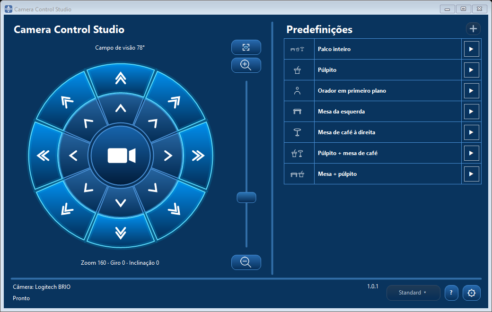
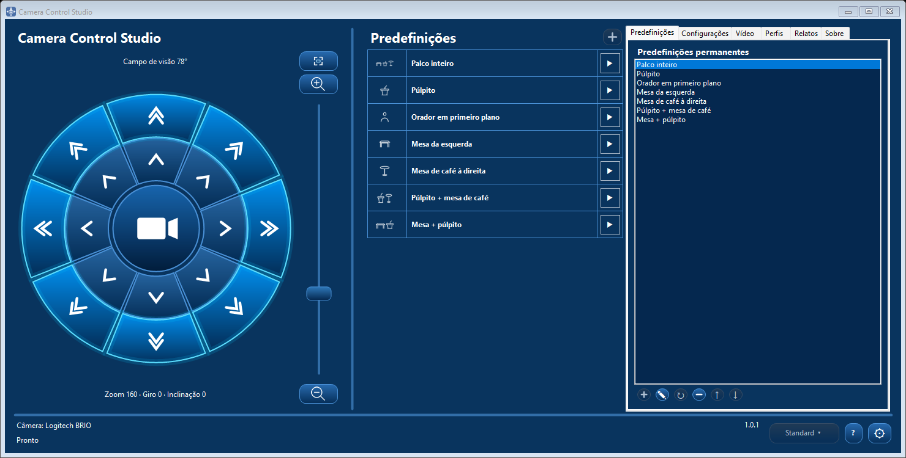
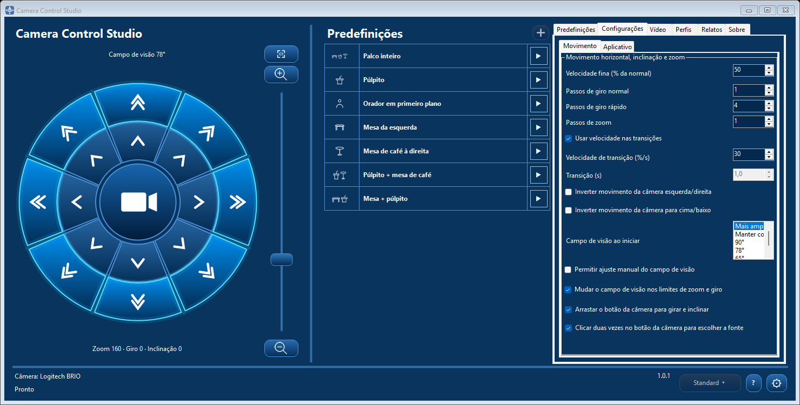
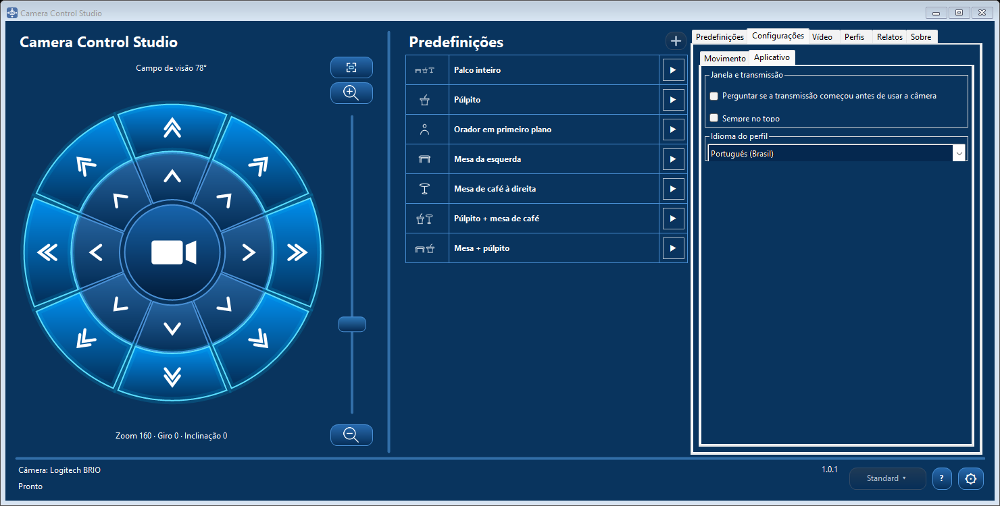

# Uso e configurações

*Guia escrito para Camera Control Studio 1.0.1.*

[Solução de problemas](TROUBLESHOOTING.md)

[Português (Brasil) · Camera Control Studio](../USER-GUIDES.md)

Inicie primeiro a reunião que você vai transmitir, por exemplo, no Zoom. Em seguida, abra o **Camera Control Studio**.

Clique em **?** para abrir a ajuda. Passe o mouse sobre um botão para ver sua função. Cada direção para quando a câmera chega ao limite final.

1. **Ativar uma predefinição**

   Clique em ▶ na linha da predefinição, clique duas vezes no nome ou selecione a linha e pressione Enter.

   | Cor | Significado |
   | --- | --- |
   | Amarelo | A câmera está se movendo até a posição salva. |
   | Verde | O driver informa que a câmera alcançou as coordenadas salvas. |
   | Azul | A predefinição não está marcada como ativa. |

   O verde confirma as coordenadas informadas pelo driver. Confira a imagem na transmissão. Se o driver não confirmar a chegada a tempo, a linha fica azul e uma mensagem aparece na área de status. Os ícones continuam visíveis.

2. **Ajustar o enquadramento**

   **Movimento horizontal**

   Use o anel interno para movimentos normais e o externo para movimentos rápidos. As setas diagonais movem os dois eixos a 45°, com 45% da velocidade do anel em cada eixo. Segure a seta para continuar. Solte para parar.

   

   **Botão da câmera no centro do seletor**

   - **Clique duas vezes para escolher uma câmera.** A lista de câmeras será aberta.
   - **Segure e arraste.** Comece no ícone da câmera. Arraste para os lados para girá-la ou para cima e para baixo para incliná-la. Arraste um pouco para mover devagar, ou mais longe para acelerar até o dobro da velocidade rápida. Solte o botão ou volte com o ponteiro ao ponto de partida para parar.

   Em **Configurações → Movimento**, você pode desativar o arraste ou usar um só clique para escolher a câmera. As duas opções são salvas no perfil ativo.

   **Zoom**

   Use as lupas para aproximar ou afastar. Segure o botão para repetir. O zoom muda enquanto você arrasta o controle deslizante.

   **Restaurar enquadramento completo**

   Clique no botão quadrado com o ícone de moldura acima das lupas. A câmera afasta o zoom até o limite e seleciona o campo de visão mais amplo se tiver esse ajuste. O enquadramento muda. A janela mantém o tamanho.

   **Interromper o movimento horizontal**

   Pressione Esc para interromper um movimento horizontal em andamento.

   > Girar ou inclinar a câmera ou ajustar o zoom manualmente cancela a mudança de posição e remove a cor da predefinição ativa.

   **Teclas de seta**

   Use as teclas de seta quando o seletor de direção estiver em foco. Mantenha Shift pressionada para passos rápidos.

3. **Salvar uma predefinição temporária**

   Clique em **+** acima da lista, digite um nome e salve. A posição atual aparece abaixo das predefinições permanentes. As predefinições temporárias não têm ícone e ficam disponíveis até você fechar o aplicativo. Cada perfil e câmera tem suas próprias predefinições temporárias.

   Para remover uma, selecione a linha e clique em **×** acima da lista. Todas são removidas ao fechar o aplicativo. Para usar uma posição mais tarde, crie-a em **Configurações → Predefinições**. A lista principal não permite editar nem excluir predefinições permanentes.

4. **Fechar o aplicativo**

   Se um controle falhar, leia a mensagem na área de status, na parte inferior. A câmera pode estar indisponível ou não oferecer aquele recurso.

   Feche o aplicativo normalmente. O perfil ativo e o layout da janela são mantidos.

   **Relatar problemas**

   Relate problemas ou recursos que estejam faltando em **Configurações → Relatos**.

5. **Configurações**

   Selecione o perfil na parte inferior. Clique duas vezes no ícone de câmera no centro do seletor de direção para escolher a câmera.

   Para salvar uma posição de forma permanente, abra a engrenagem na parte inferior e escolha **Predefinições → Adicionar predefinição permanente**. Escolha o nome e o ícone e salve.

   

   Nas configurações, ajuste os passos, o tempo de transição e a inversão das direções. **Vídeo** mostra os controles disponíveis do driver. Em **Perfis**, você pode criar ou copiar um perfil. Ative a confirmação de transmissão se o software de captura precisar se conectar primeiro.

   

   

6. Arraste a divisória vertical para ajustar a largura das duas áreas. O painel de configurações inicia fechado. Escolha o idioma em **Configurações → Aplicativo → Idioma do perfil** e reinicie o aplicativo. Passe o mouse sobre um botão pequeno para ver sua dica.

## Campo de visão durante o movimento

**Mudar o campo de visão nos limites de zoom e giro**

A opção vem ativada. Em uma Brio, aperte o botão mais uma vez no limite do zoom para mudar o campo de visão. Ao afastar, ele passa de 65° para 78° e depois para 90°. Ao aproximar, a ordem se inverte. Entre mudanças, o zoom volta a avançar por etapas. No limite do giro, o aplicativo tenta um campo mais amplo e ajusta o zoom para manter o enquadramento. Desative a opção para manter o campo atual.

As predefinições guardam o campo quando o driver consegue lê-lo.

[Instalação e SmartScreen (inglês)](../en/SETUP.md)

<https://github.com/bkristensen/Camera-Ctrl-Pressets-Studio/blob/main/Source/docs/en/SETUP.md>

## Download e suporte

**Download oficial**\
<https://github.com/bkristensen/Camera-Ctrl-Pressets-Studio/releases>\

**Relatar um problema ou sugerir um recurso**\
<https://github.com/bkristensen/Camera-Ctrl-Pressets-Studio/issues?q=is%3Aissue>\

