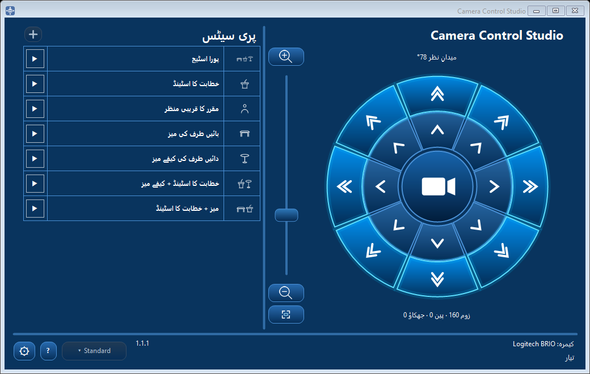
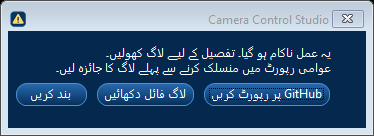

[English](../en/DAILY-USE.md) · [Dansk](../da/DAILY-USE.md) · [Deutsch](../de/DAILY-USE.md) · [ تمام رہنما زبانیں](USER-GUIDES.md)

# روزانہ استعمال

* Camera Control Studio 1.1.1.* کے لیے لکھا گیا

[Troublehooting](TROUBLESHOOTING.md)

زوم جیسی ایپ میں اپنی اسٹریمنگ میٹنگ شروع کریں۔ پھر **Camera Control Studio** کھولیں۔

## جنرل

مدد کے لیے **?** پر کلک کریں۔ اس کا نام اور عمل دیکھنے کے لیے بٹن پر ہوور کریں۔ کیمرہ کی آخری حد تک ایک سمت لاک ہو جاتی ہے۔ [خودکار FOV کیسے کام کرتا ہے](SETUP.md#%D9%85%D9%86%D8%B8%D8%B1-%DA%A9%D8%A7-%D9%85%DB%8C%D8%AF%D8%A7%D9%86-%D9%85%D9%82%D8%B1%D8%B1-%DA%A9%D8%B1%DB%8C%DA%BA)

## 1. ایک پیش سیٹ کو فعال کریں۔

پہلے سے سیٹ لسٹ میں ایک قطار پر ▶ پر کلک کریں یا نام پر ڈبل کلک کریں۔
آپ قطار کو بھی منتخب کر سکتے ہیں اور انٹر دبائیں۔

| رنگ | مطلب |
| --- | --- |
| پیلا | ایپ کیمرے کو پیش سیٹ کی طرف لے جا رہی ہے۔ |
| سبز | کیمرہ ڈرائیور نے اطلاع دی ہے کہ محفوظ کردہ نقاط تک پہنچ گئے ہیں۔ |
| نیلا | پیش سیٹ کو فعال کے طور پر نشان زد نہیں کیا گیا ہے۔ |

سبز کا مطلب ہے ڈرائیور محفوظ شدہ پوزیشن اور FOV کی اطلاع دیتا ہے، اگر محفوظ کیا جائے۔ اپنے سلسلے میں تصویر چیک کریں۔ اگر ڈرائیور وقت پر شاٹ کی تصدیق نہیں کر سکتا تو قطار نیلی ہو جاتی ہے۔ کیا ہوا یہ دیکھنے کے لیے اسٹیٹس کا پیغام پڑھیں۔

## 2. فریمنگ کو ٹھیک بنائیں

### پین

عام چالوں کے لیے اندرونی انگوٹھی اور تیز چالوں کے لیے بیرونی انگوٹھی کا استعمال کریں۔ ہر انگوٹھی میں آٹھ تیر ہوتے ہیں۔ اخترن پین کو حرکت دیتے ہیں اور ایک ساتھ 45° پر جھکتے ہیں، ہر ایک محور پر انگوٹھی کی رفتار کا 45% ہوتا ہے۔ ایک کلک ہر دستیاب محور پر کم از کم ایک ڈرائیور قدم منتقل کرتا ہے۔ چلتے رہنے کے لیے تیر کو پکڑیں۔ اسے روکنے کے لیے چھوڑ دیں۔

### وہیل کے بیچ میں کیمرے کا بٹن

- **کیمرہ چننے کے لیے ڈبل کلک کریں۔** کیمرے کی فہرست کھل جاتی ہے۔
- ** پکڑ کر گھسیٹیں۔ ** کیمرے کے آئیکن پر شروع کریں۔ پین کرنے کے لیے سائیڈ وے یا اوپر اور نیچے جھکاؤ گھسیٹیں۔ دھیمی حرکت کے لیے تھوڑا سا گھسیٹیں یا تیز حرکت کے لیے، تیز رفتار سے دوگنا تک۔ بٹن کو چھوڑ دیں یا پوائنٹر کو واپس وہاں لے جائیں جہاں آپ نے رکنا شروع کیا تھا۔

**ترتیبات → پیننگ** کے تحت، آپ ڈریگنگ کو بند کر سکتے ہیں یا کیمرے کے انتخاب کے لیے ایک کلک پر سوئچ کر سکتے ہیں۔ دونوں اختیارات ایکٹو پروفائل میں محفوظ ہیں۔

### زوم

زوم کرنے کے لیے میگنیفائر بٹن استعمال کریں۔ عمل کو دہرانے کے لیے ایک بٹن کو دبا کر رکھیں۔
جب آپ اسے منتقل کرتے ہیں تو زوم کو ایڈجسٹ کرنے کے لیے سلائیڈر کو گھسیٹیں۔

### مکمل فریم بحال کریں۔

زوم آؤٹ بٹن کے نیچے فریم آئیکن کے ساتھ مربع بٹن پر کلک کریں۔ کیمرا جہاں تک ہو سکے زوم آؤٹ کرتا ہے اور اگر اس ترتیب کو سپورٹ کرتا ہے تو اس کے وسیع ترین فیلڈ آف ویو کو منتخب کرتا ہے۔ اس سے کیمرے کی تصویر بدل جاتی ہے۔ ایپ ونڈو اپنا سائز برقرار رکھتی ہے۔

### پین کرنا بند کرو

جاری پین کو روکنے کے لیے Esc دبائیں۔

> دستی پین، جھکاؤ یا زوم پیش سیٹ پر منتقل ہونے کو منسوخ کرتا ہے اور فعال رنگ کو صاف کرتا ہے۔

### تیر والی چابیاں

جب پہیے پر فوکس ہو تو تیر والے بٹنوں کا استعمال کریں۔ ٹھیک چالوں کے لیے Ctrl یا تیز چالوں کے لیے Shift کو پکڑیں۔

## 3. ایک عارضی پیش سیٹ محفوظ کریں۔

پہلے سے طے شدہ فہرست کے اوپر **+** پر کلک کریں، ایک نام درج کریں اور محفوظ کریں۔ موجودہ پوزیشن مستقل پیش سیٹ کے نیچے ظاہر ہوتی ہے۔
عارضی پیش سیٹوں کا کوئی آئیکن نہیں ہے۔ وہ اس وقت تک قائم رہتے ہیں جب تک کہ آپ ایپ کو بند نہیں کر دیتے اور ہر پروفائل اور کیمرے کے لیے الگ الگ رکھے جاتے ہیں۔

ایک عارضی قطار منتخب کریں اور اسے ہٹانے کے لیے پہلے سے سیٹ فہرست کے اوپر **×** پر کلک کریں۔ ایپ بند ہونے پر تمام عارضی پیش سیٹیں ہٹا دی جاتی ہیں۔
بعد میں پوزیشن استعمال کرنے کے لیے، اسے **ترتیبات → پری سیٹس** کے تحت بنائیں۔ آپ مرکزی فہرست میں مستقل پیش سیٹوں میں ترمیم یا حذف نہیں کر سکتے ہیں۔

## 4. باہر نکلیں۔

اگر کوئی کنٹرول ناکام ہو جاتا ہے، تو نیچے اسٹیٹس ایریا میں پیغام پڑھیں۔ ہو سکتا ہے کیمرہ فیچر کو سپورٹ نہ کرے یا غیر دستیاب ہو۔

ایپ کو عام طور پر بند کریں۔ ایپ فعال پروفائل اور ونڈو لے آؤٹ کو یاد رکھتی ہے۔

## 5. مسائل کی اطلاع دیں۔

اگر **نیا ورژن دستیاب ہے** فوٹر میں ظاہر ہوتا ہے، تو اسے GitHub پر ریلیز کھولنے کے لیے منتخب کریں اور ڈاؤن لوڈز دیکھیں۔

<https://github.com/bkristensen/Camera-Ctrl-Pressets-Studio/releases>

مسئلہ بتانے یا سہولت تجویز کرنے کے لیے **رابطہ اور تعارف → رابطہ** کھولیں۔

[Setup](SETUP.md) کیمرے کی سمت، مستقل پیش سیٹ، تصویر کی ترتیبات، پروفائلز اور حرکت کے مراحل کے لیے دیکھیں۔

## خرابی کا مکالمہ

اگر کسی غیر متوقع خرابی سے کوئی کام رک جائے تو مکالمہ بند کر کے دوبارہ کوشش کریں۔ اگر مکالمہ بتائے کہ ایپ بند ہو جائے گی تو ایپ دوبارہ کھولیں۔

اگر تشخیصی لاگ موجود ہو تو **لاگ فائل دکھائیں** اسے فائل ایکسپلورر میں منتخب کرتا ہے۔ **GitHub پر رپورٹ کریں** سپورٹ ZIP محفوظ کرنے کا اختیار دیتا ہے، پھر GitHub پر خرابی کا ٹیمپلیٹ کھولتا ہے۔ ZIP میں مکالمے کا اسکرین شاٹ، لاگز، پروفائل اور ونڈو کی ترتیبات اور سسٹم کی رپورٹ شامل ہو سکتی ہے۔ ZIP دیکھ لیں اور اسے خود مسودے کے ساتھ منسلک کریں۔
