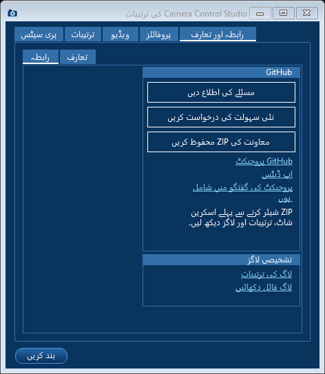

# مسئلے کی اطلاع دیں

* Camera Control Studio 1.1.0.* کے لیے لکھا گیا

1. ترتیبات کھولنے کے لیے نیچے گیئر کے بٹن پر کلک کریں۔ **رابطہ اور تعارف → رابطہ → مسئلے کی اطلاع دیں** منتخب کریں۔
2. نیا ورژن دستیاب ہو تو ڈاؤن لوڈ صفحہ کھولنے کے لیے **ہاں** منتخب کریں۔ اسے انسٹال کریں اور دیکھیں کہ مسئلہ دوبارہ سامنے آتا ہے یا نہیں۔ GitHub کے مسودے پر جانے کے لیے **نہیں** منتخب کریں۔
3. ایپ معاونت کی ZIP محفوظ کرنے کی پیشکش کرے تو **ہاں** منتخب کریں اور جگہ بتائیں۔ ZIP کے بغیر مسودہ کھولنے کے لیے **نہیں** منتخب کریں۔

گائیڈ ویوئر میں بھی یہی GitHub بٹن ہیں۔

## تفصیل لکھیں اور ZIP منسلک کریں

بٹن GitHub کا **Bug report** سانچہ کھولتا ہے۔ بتائیں کہ آپ کو کیا توقع تھی، کیا ہوا اور مسئلہ دوبارہ کیسے پیدا کیا جا سکتا ہے۔ ایپ اور Windows کے ورژن لکھیں۔ ضرورت ہو تو کیمرا اور ریکارڈنگ ایپ بھی بتائیں۔ سرخ ستارے والے تمام حصے پُر کریں۔

پیکیج محفوظ کرنے کے لیے **رابطہ اور تعارف → رابطہ → معاونت کی ZIP محفوظ کریں** اور جگہ منتخب کریں۔ ایپ فائل کا راستہ دکھاتی ہے۔

ZIP میں ایپ کا اسکرین شاٹ، محفوظ شدہ `profiles.json`، ونڈو ترتیب والی `window.json` اور `Logs` میں موجود لاگز ہوتے ہیں۔

شیئر کرنے سے پہلے پروفائل کے نام، کیمرا ID اور فائل کے راستے جیسی ذاتی معلومات ہٹا دیں۔ ZIP یا متعلقہ فائلیں خود مسودے کی تفصیل میں گھسیٹ کر شامل کریں۔

## قسم اور لیبل دیکھیں

سانچہ **Type** میں **Bug** اور **Labels** میں `bug` مانگتا ہے۔ اگر خانے خالی ہیں اور قابلِ ترمیم ہیں تو دائیں جانب سے درست اقدار منتخب کریں۔ اجازت نہ ہو تو مسودہ بھیج دیں۔ منصوبے کا منتظم بعد میں اقدار شامل کر سکتا ہے۔

**Preview** میں تفصیل اور منسلک فائلیں دیکھیں، پھر **Create** منتخب کریں۔
