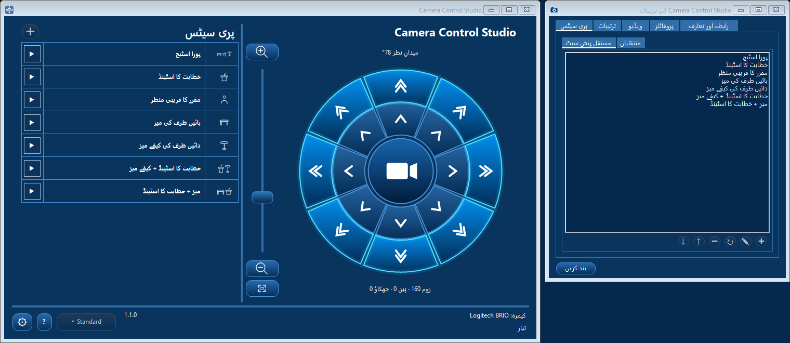
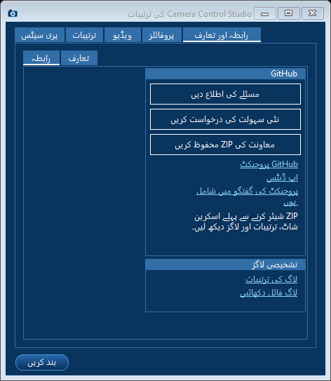
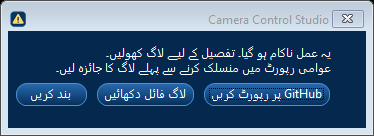

[English](../en/SETUP.md) · [Dansk](../da/SETUP.md) · [Deutsch](../de/SETUP.md) · [ تمام رہنما زبانیں](USER-GUIDES.md)

# ایپلیکیشن ترتیب دیں۔

* Camera Control Studio 1.1.0.* کے لیے لکھا گیا

[Troublehooting](TROUBLESHOOTING.md)

ترتیبات کھولنے کے لیے نیچے گیئر کے بٹن پر کلک کریں۔ ترتیبات الگ ونڈو میں کھلتی ہیں۔ آپ مرکزی ونڈو استعمال کر سکتے ہیں۔

## انسٹال کریں اور ڈاؤن لوڈ کی تصدیق کریں۔

جب **Camera Control Studio** Microsoft Store میں دستیاب ہو تو اسے وہیں سے ڈاؤن لوڈ کریں۔ اسٹور میں ایپ کا نام تلاش کریں۔ Microsoft اسٹور پیکیج پر دستخط کرتا ہے اور اپ ڈیٹس فراہم کرتا ہے۔

اگر ایپ ابھی Microsoft Store میں دستیاب نہیں تو [GitHub ریلیزز](https://github.com/bkristensen/Camera-Ctrl-Pressets-Studio/releases) سے انسٹالر یا پورٹیبل ZIP ڈاؤن لوڈ کریں۔ ایپ کھولنے سے پہلے انسٹالر چلائیں یا پوری ZIP نکالیں۔ اگر ریلیز میں SHA-256 چیک سم دی گئی ہو تو اسے `Get-FileHash -Algorithm SHA256` کے نتیجے سے ملائیں۔

Microsoft Defender SmartScreen ایک نیلی وارننگ دکھا سکتا ہے جب ڈاؤن لوڈ کردہ ایپ یا اس کے ناشر کی ساکھ بہت کم ہو۔ اسے سنجیدگی سے لیں۔ اگر آپ نے متوقع فائل آفیشل ریلیز سے حاصل کی ہے اور ماخذ پر بھروسہ کیا ہے، تو **More info** کو منتخب کریں اور فائل کے نام اور پبلشر کا جائزہ لیں۔ **Run ویسے بھی ** صرف اس صورت میں منتخب کریں جب آپ اس فائل پر بھروسہ کرنے کا انتخاب کرتے ہیں اور ونڈوز آپشن پیش کرتا ہے۔ بصورت دیگر انتباہ بند کریں۔ اپنی تنظیم کی ڈیوائس پالیسی پر عمل کریں۔ [Microsoft SmartScreen رہنمائی](https://learn.microsoft.com/windows/apps/package-and-deploy/smartscreen-reputation)

<https://learn.microsoft.com/windows/apps/package-and-deploy/smartscreen-reputation>

اگر گائیڈ دیکھنے والے کو WebView2 کی ضرورت ہو تو Microsoft سے رن ٹائم ڈاؤن لوڈ کریں۔\
<https://developer.microsoft.com/microsoft-edge/webview2/>

مزید معلومات کے ساتھ  میں دکھایا گیا ہے

 میں دکھائی گئی ہے

مرکزی ونڈو کے نیچے سے پروفائل چنیں۔ عام ترتیب میں کیمرہ منتخب کرنے کے لیے پہیے کے بیچ کے کیمرہ بٹن پر دو بار کلک کریں۔ پروفائل کیمرہ یاد رکھتا ہے۔ کیمرہ نہ ملے تو دوسری ڈیوائس چنیں۔

نیچے حصوں کی ترتیب سیٹنگز کے ٹیبوں جیسی ہے۔ بٹن مدھم ہو تو پہلے فہرست میں کچھ چنیں۔ ویڈیو میں ڈرائیور طے کرتا ہے کہ کون سے کنٹرول دکھیں۔ نتیجہ اپنی کیپچر ایپ میں دیکھیں۔

**بند کریں**. دونوں ونڈوز کا سائز یا جگہ بدلیں یا مرکزی ونڈو کی تقسیم گھسیٹیں۔ پروفائل یہ قدریں یاد رکھتا ہے۔ نیچے بند کریں سے سیٹنگز بند ہوتی ہیں۔ مرکزی ونڈو کھلی رہتی ہے۔

## پری سیٹس

### مستقل پیش سیٹ

پہلے کیمرے کا رخ درست کریں۔ مستقل پری سیٹ دستیاب پین، جھکاؤ اور زوم محفوظ کرتا ہے۔ کیمرہ بتائے تو منظر کا زاویہ بھی محفوظ ہوتا ہے۔ ہر پری سیٹ ایک پروفائل کے ایک کیمرے کے لیے ہے۔

- **+ مستقل پری سیٹ شامل کریں**. موجودہ فریم محفوظ کریں۔ نشان چنیں اور الگ نام دیں۔ نام خالی ہو تو نشان نام تجویز کر سکتا ہے۔ محفوظ کرنے کے لیے نام لکھیں۔ منسوخ کرنے سے فہرست ویسی رہتی ہے۔
- **✎ نام اور آئیکن بدلیں**. منتخب پری سیٹ کا نام یا نشان بدلیں۔ محفوظ فریم وہی رہتا ہے۔
- **↻ موجودہ پوزیشن سے بدلیں**. منتخب پری سیٹ کا فریم کیمرے کی موجودہ پوزیشن سے بدلیں۔ تبدیلی کی تصدیق کریں۔ نام اور نشان وہی رہتے ہیں۔
- **− مستقل پری سیٹ حذف کریں**. تصدیق کے بعد منتخب پری سیٹ حذف کریں۔
- **↑ / ↓ منتخب پیش سیٹ اوپر لے جائیں · منتخب پیش سیٹ نیچے لے جائیں**. پری سیٹ کو دونوں فہرستوں میں ایک قطار اوپر یا نیچے کریں۔ پہلی قطار میں اوپر کا تیر مدھم ہے۔ آخری قطار میں نیچے کا تیر مدھم ہے۔

ترمیم، بدلنے، حذف کرنے یا سرکانے سے پہلے پری سیٹ چنیں۔ شامل کرنے یا بدلنے کے لیے پروفائل لوڈ ہو اور پین، جھکاؤ یا زوم میں سے کوئی ایک قابلِ کنٹرول ہو۔ کیمرہ منقطع ہو تو ایپ اسے جوڑنے کی کوشش کر سکتی ہے۔

### پیش سیٹ ٹرانزیشنز سیٹ کریں۔

- **محفوظ پوزیشن بدلنے کے لیے رفتار استعمال کریں**. بند ہو تو وقت مقرر رہتا ہے۔ آن ہو تو رفتار مقرر ہوتی ہے اور مختصر فاصلہ جلد طے ہوتا ہے۔ حرکت کرنے والے محور ایک ساتھ پہنچتے ہیں۔
- **منتقلی کا دورانیہ (سیکنڈ)**. پری سیٹ بدلنے کا وقت مقرر کریں۔ پہلے سے 1 سیکنڈ ہے۔ رفتار والے موڈ میں خانہ مدھم ہے۔
- **منتقلی کی رفتار (% فی سیکنڈ)**. رفتار کو اس محور کی پوری حد کے فی سیکنڈ فیصد میں مقرر کریں جو حرکت طے کرتا ہے۔ پہلے سے 30% ہے۔ مقررہ وقت کے موڈ میں خانہ مدھم ہے۔

## ترتیبات

### پیننگ

- **باریک رفتار (معمول کا %)**. باریک کنٹرول کے لیے Ctrl دبائے رکھیں اور تیر والی کلید دبائیں۔ پہلے سے رفتار عام رفتار کا 50% ہے۔
- **معمول کے پین کے مراحل**. اندرونی حلقے کے عام تیروں کے قدم مقرر کریں۔ پہلے سے 1 قدم ہے۔
- **تیز پین کے مراحل**. بیرونی حلقے کے تیز تیروں کے قدم مقرر کریں۔ پہلے سے 4 قدم ہیں۔ اس سے کیمرہ بٹن گھسیٹنے کی رفتار بھی بدلتی ہے۔
- **کیمرا کی بائیں/دائیں حرکت الٹ دیں**. کیمرہ غلط طرف مڑے تو دائیں اور بائیں کو بدلیں۔
- **کیمرا کی اوپر/نیچے حرکت الٹ دیں**. اوپر اور نیچے کو بدلیں۔ الٹا لگا کیمرہ ہو تو یہ کام آتا ہے۔ دونوں اختیار کنٹرول کی سمت بدلتے ہیں۔ تصویر کی سمت وہی رہتی ہے۔
- **کیمرہ گھمانے کے لیے کیمرے کا بٹن کھینچیں**. کیمرے کا رخ بدلنے کے لیے پہیے کا درمیانی بٹن گھسیٹیں۔ تیر استعمال کرنے ہوں تو اختیار بند کریں۔
- **ذریعہ چننے کے لیے کیمرے کے بٹن پر ڈبل کلک کریں**. آن ہو تو دو کلک سے کیمروں کی فہرست کھلتی ہے۔ بند ہو تو ایک کلک کافی ہے۔

کیمرہ جوڑنے سے پہلے بھی حرکت کی ترتیب بدل سکتے ہیں۔ ڈرائیور قدم کا سائز، دستیاب سمتیں اور ان کی حد طے کرتا ہے۔

### زوم کے مراحل طے کریں۔

- **زوم کے مراحل**. طے کریں کہ + یا − دبانے سے زوم کتنے قدم بدلے۔ پہلے سے ڈرائیور کا 1 قدم ہے۔ جوڑنے سے پہلے بھی یہ بدل سکتے ہیں۔ اثر کے لیے کیمرے میں زوم ہونا چاہیے۔ سلائیڈر موجودہ زاویے کے اندر زوم چنتا ہے۔

### ایپ

- **کیمرہ استعمال کرنے سے پہلے پوچھیں کہ نشریات شروع ہوئی ہیں یا نہیں**. اگر کیپچر ایپ کو پہلے نشریات شروع کرنی ہوں تو آن کریں۔ اگلے کیمرہ عمل پر تصدیق مانگی جائے گی۔ تیار ہوں تو ہاں چنیں۔ نہیں چننے سے کیمرہ منقطع رہتا ہے۔ دوبارہ آغاز، پروفائل کی تبدیلی یا اس اختیار کو بدلنے کے بعد سوال پھر آتا ہے۔ بند ہونے پر ایپ شروع ہوتے وقت جوڑ سکتی ہے۔
- **ہمیشہ سب سے اوپر رکھیں**. مرکزی ونڈو کو دوسرے پروگراموں کے اوپر رکھیں۔ بند کریں تو دوسری ونڈو اسے ڈھانپ سکتی ہے۔
- **پروفائل کی زبان · خودکار**. 12 میں سے ایک زبان چنیں۔ خودکار اختیار Windows کی زبان استعمال کرتا ہے اگر وہ دستیاب ہو۔ ورنہ انگریزی استعمال ہوتی ہے۔ تبدیلی کے لیے ایپ دوبارہ کھولیں۔ ہر پروفائل اپنا انتخاب رکھتا ہے۔

## ویڈیو

- **تصویر کے کنٹرول لوڈ کریں**. تصویر کے کنٹرول دکھانے کے لیے کیمرہ جوڑیں۔ کیمرہ منقطع ہو تو بٹن دکھتا ہے۔ ڈرائیور کنٹرول نہ دے تو صرف منظر کے زاویے کا ٹیب رہتا ہے۔
- **خودکار**. ڈرائیور دستیاب ٹیب اور سلائیڈر طے کرتا ہے۔ خودکار اختیار کیمرے کو قدر بدلنے دیتا ہے۔ سلائیڈر استعمال کرنے کے لیے اسے بند کریں۔ صرف خودکار کنٹرول ہو تو سلائیڈر مدھم ہے اور خانہ مقفل ہو سکتا ہے۔ صرف دستی کنٹرول میں خانہ چھپا ہوتا ہے۔
- **تصویر کے لیے ڈرائیور کی طے شدہ ترتیبات بحال کریں**. تمام معاون تصویری کنٹرول ڈرائیور کی اصل قدروں پر لوٹائیں۔ بٹن تصویری ٹیبوں پر دکھتا ہے اور منظر کے زاویے پر چھپتا ہے۔ قدریں ہر کیمرے اور پروفائل کے لیے محفوظ ہوتی ہیں۔

### فوکس اور ایکسپوژر

- **گین**. سگنل بڑھا کر تصویر روشن کریں۔ بہت زیادہ قدر سے دانے بڑھ سکتے ہیں۔
- **ایکسپوژر**. طے کریں کہ سینسر کتنی دیر روشنی لے۔ زیادہ وقت سے تصویر روشن ہوتی ہے لیکن حرکت دھندلی ہو سکتی ہے۔
- **فوکس**. صاف دکھنے کا فاصلہ بدلیں۔ کیپچر ایپ میں موضوع کی صفائی دیکھیں۔

### رنگ

- **وائٹ بیلنس**. روشنی کی رنگت درست کریں تاکہ سفید چیز سفید دکھے۔
- **رنگ کی گہرائی**. رنگ گہرے یا ہلکے کریں۔
- **گاما**. درمیانی رنگت کی چمک بدلیں۔
- **رنگ کا شیڈ**. رنگوں کو رنگ کے پہیے پر سرکائیں۔

### روشنی اور تفصیل

- **کنٹراسٹ**. روشن اور تاریک حصوں کا فرق بدلیں۔
- **چمک**. پوری تصویر روشن یا تاریک کریں۔
- **پسِ منظر کی روشنی کی تلافی**. پیچھے تیز روشنی ہو تو سامنے کے موضوع کو روشن کریں۔
- **شارپنس**. کناروں کو زیادہ نمایاں یا نرم کریں۔

### منظر کا میدان مقرر کریں۔

منظر کا زاویہ (FOV) بتاتا ہے کہ فریم میں منظر کا کتنا حصہ آتا ہے۔ بڑا زاویہ زیادہ دکھاتا ہے۔ زوم اسی زاویے میں فریم کا کٹاؤ بدلتا ہے۔

- **آغاز پر میدانِ نظر · سب سے چوڑا دستیاب · موجودہ ترتیب برقرار رکھیں**. سب سے چوڑا زاویہ، موجودہ زاویہ یا ڈرائیور کا دیا ہوا زاویہ چنیں۔ ایپ اس سیشن کے پہلے کنکشن پر اسے لگانے کی کوشش کرتی ہے۔ منسلک کیمرہ کم از کم ایک زاویہ بتائے تو فہرست فعال ہوتی ہے۔
- **میدانِ نظر دستی طور پر بدلنے دیں**. پہیے کے نیچے زاویہ چننے کی فہرست دکھائیں۔ بند ہو تو ایپ پڑھ سکنے والا موجودہ زاویہ دکھاتی ہے۔ دو سے کم زاویے ہوں تو اختیار مدھم ہے۔
- **زوم اور پین کی حد پر میدانِ نظر بدلیں**. زوم کی حد پر پھر دبائیں۔ زوم کم کرتے وقت ایپ چوڑا زاویہ، اور زوم بڑھاتے وقت تنگ زاویہ آزماتی ہے۔ دائیں یا بائیں کی حد پر زیادہ جگہ والا زاویہ آزماتی ہے۔ فریم قریب رکھنے کی کوشش کرتی ہے۔ مزید حرکت ممکن نہ ہو تو پچھلا فریم لوٹاتی ہے۔ دستی انتخاب بند ہو تب بھی کام کرتا ہے۔ دو سے کم زاویے ہوں تو مدھم ہے۔

مثال کے طور پر Brio پر 65° اور کم ترین زوم ہو تو − سے 78° آزمایا جا سکتا ہے۔ نئے زاویے میں زوم کم کرنے کو پھر دبائیں۔ فریم بٹن سب سے چوڑا زاویہ اور کم ترین زوم ایک ساتھ آزماتا ہے۔ دوسری ایپ بھی کیمرہ چلائے تو نتیجہ دیکھیں۔

## پروفائلز

- **+ نیا پروفائل**. اصل قدروں کے ساتھ نیا پروفائل بنائیں اور فعال کریں۔ الگ نام دیں۔
- **⧉ فعال پروفائل کی نقل بنائیں**. فعال پروفائل کی سیٹنگز اور پری سیٹ نقل کریں۔ ایپ نقل پر منتقل ہوتی ہے۔ دوسری قطار چننے سے نقل کا ماخذ نہیں بدلتا۔
- **✎ منتخب پروفائل کا نام بدلیں**. منتخب پروفائل کا نام بدلیں۔ کچھ نہ چنا ہو یا Standard منتخب ہو تو بٹن مدھم ہے۔ نیا اور نقل کے لیے لوڈ شدہ پروفائل چاہیے۔ تینوں نام والے ڈائیلاگ میں تصدیق کے لیے نام لکھیں۔
- **موجودہ پوزیشن اور ترتیب برقرار رکھیں**. پروفائل بدلنے کے لیے اس پر دو بار کلک کریں۔ لے آؤٹ اختیار سے موجودہ جگہ، سائز اور تقسیم ساتھ لائیں۔ بند کرنے پر منتخب پروفائل کا محفوظ لے آؤٹ استعمال ہوتا ہے۔ تبدیلی پر ایپ دوبارہ کھلتی ہے اور عارضی پری سیٹ مٹتے ہیں۔

## رابطہ اور تعارف

### رابطہ

- **مسئلے کی اطلاع دیں**. GitHub پر خرابی کا ٹیمپلیٹ کھولیں۔ نیا ورژن ہو تو ایپ پہلے اسے کھولنے کا اختیار دیتی ہے۔ آگے بڑھیں تو مسودے سے پہلے سپورٹ ZIP کی پیش کش ہوتی ہے۔
- **نئی سہولت کی درخواست کریں**. نئی سہولت کا ٹیمپلیٹ کھولیں۔ نیا ورژن ہو تو پہلے آزمائیں۔ سہولت شاید اس میں ہو۔
- **معاونت کی ZIP محفوظ کریں**. اسکرین شاٹ، دستیاب لاگ، پروفائل اور ونڈو لے آؤٹ ایک ZIP میں محفوظ کریں۔ نجی معلومات دیکھ لیں۔ GitHub مسودے میں فائل خود لگائیں۔ کام کے دوران تینوں بٹن عارضی طور پر مدھم رہتے ہیں۔
- **GitHub پروجیکٹ · GitHub ریلیزیں · پروجیکٹ کی گفتگو میں شامل ہوں**. تین GitHub لنک سورس کوڈ، ریلیز کے ڈاؤن لوڈ یا مباحثے کھولتے ہیں۔

[مسئلے کی اطلاع دیں](Report%20a%20bug.md) · [نئی سہولت کی درخواست کریں](Request%20a%20feature.md)

### تشخیصی لاگز

- **لاگ کی ترتیبات**. لاگ کی سیٹنگز کھولیں۔ یہ تمام پروفائلوں پر لاگو ہیں۔ محفوظ کرنے سے تبدیلی لاگو ہوتی ہے۔ منسوخ کرنے سے پرانی قدریں رہتی ہیں۔
- **فولڈر منتخب کریں · خودکار**. فولڈر چنیں یا خودکار رکھیں۔ راستے کے خانے میں لکھ نہیں سکتے۔ خودکار صورت میں ایپ کا فولڈر استعمال ہوتا ہے۔ ضرورت پر `%LOCALAPPDATA%\CamPressets\Logs` استعمال ہوتا ہے۔
- **فی فائل زیادہ سے زیادہ سائز (MiB)**. طے کریں کہ نئی لاگ فائل کب شروع ہو۔ پہلے سے 1 MiB فی فائل ہے۔
- **لاگ فائلوں کی حد (موجودہ سمیت)**. موجودہ فائل سمیت رکھنے والی فائلوں کی تعداد چنیں۔ پہلے سے 2 ہیں۔
- **لاگ فائل دکھائیں**. فائل ایکسپلورر میں تازہ لاگ منتخب کریں۔ لاگ نہ ہو تو ایپ بتاتی ہے۔

### تعارف

- **مجھے ایک کپ کافی پلائیں**. انسٹال شدہ ورژن اور ڈویلپر کا نام دیکھیں۔ پورا بلڈ آئی ڈی دیکھنے کو ماؤس ورژن پر رکھیں۔ تعاون کا لنک ڈویلپر کا صفحہ کھولتا ہے۔
- **رہنما کھولیں**. اس ٹیب سے گائیڈ کھولیں۔ مرکزی ونڈو کا مدد بٹن بھی گائیڈ کھولتا ہے۔

بیک اپ کے لیے ایپ بند کریں اور `%LOCALAPPDATA%\CamPressets` نقل کریں۔ عارضی پری سیٹ موجودہ سیشن تک رہتے ہیں۔

[روزمرہ استعمال](DAILY-USE.md)

## خرابی کا مکالمہ

اگر کسی غیر متوقع خرابی سے کوئی کام رک جائے تو مکالمہ بند کر کے دوبارہ کوشش کریں۔ اگر مکالمہ بتائے کہ ایپ بند ہو جائے گی تو ایپ دوبارہ کھولیں۔

اگر تشخیصی لاگ موجود ہو تو **لاگ فائل دکھائیں** اسے فائل ایکسپلورر میں منتخب کرتا ہے۔ **GitHub پر رپورٹ کریں** سپورٹ ZIP محفوظ کرنے کا اختیار دیتا ہے، پھر GitHub پر خرابی کا ٹیمپلیٹ کھولتا ہے۔ ZIP میں مکالمے کا اسکرین شاٹ، لاگز، پروفائل اور ونڈو کی ترتیبات اور سسٹم کی رپورٹ شامل ہو سکتی ہے۔ ZIP دیکھ لیں اور اسے خود مسودے کے ساتھ منسلک کریں۔
