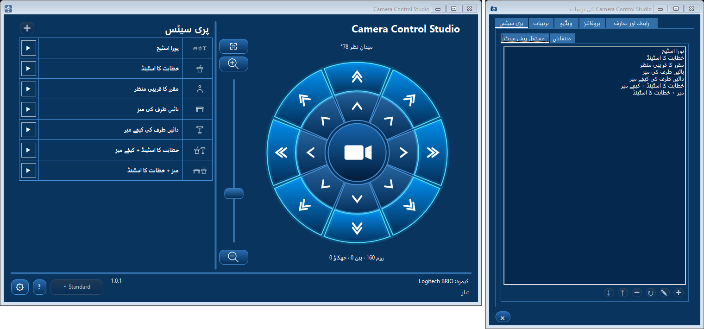
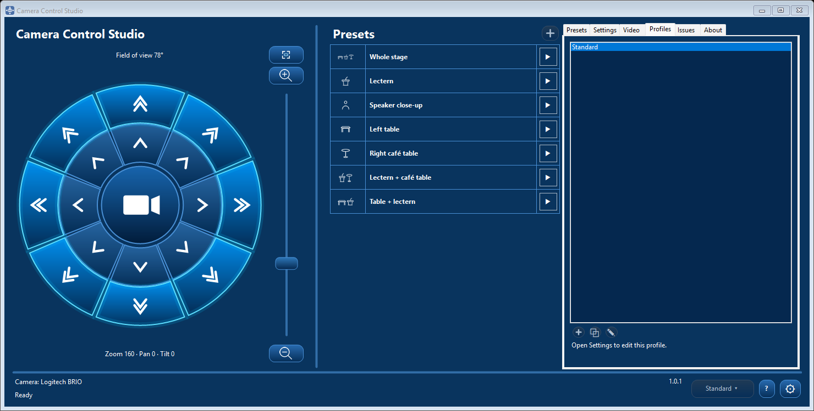
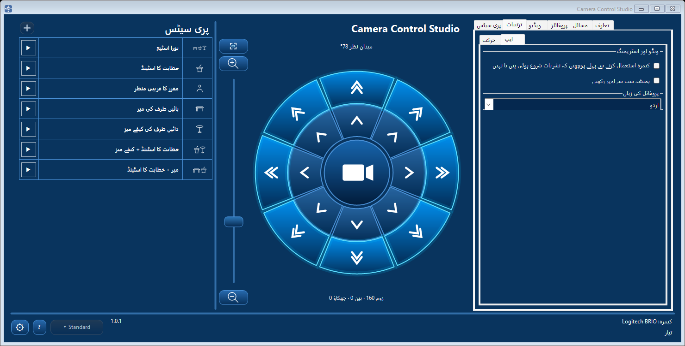
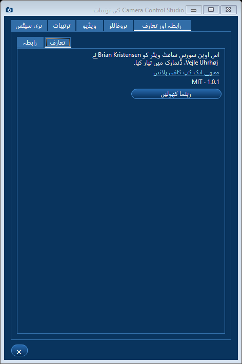
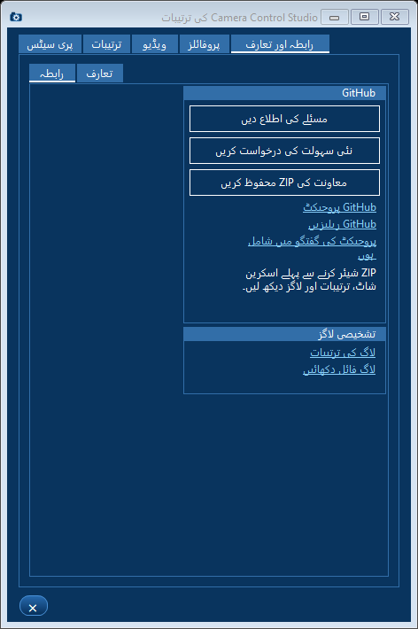

[English](../en/SETUP.md) · [Dansk](../da/SETUP.md) · [Deutsch](../de/SETUP.md) · [ تمام رہنما زبانیں](USER-GUIDES.md)

# ایپلیکیشن ترتیب دیں۔

* Camera Control Studio 1.0.1.* کے لیے لکھا گیا

[Troublehooting](TROUBLESHOOTING.md)

ترتیبات کھولنے کے لیے نیچے گیئر کے بٹن پر کلک کریں۔ ترتیبات الگ ونڈو میں کھلتی ہیں۔ آپ مرکزی ونڈو استعمال کر سکتے ہیں۔

## انسٹال کریں اور ڈاؤن لوڈ کی تصدیق کریں۔

انسٹالر یا پورٹیبل ZIP پروجیکٹ کے [GitHub ریلیزز](https://github.com/bkristensen/Camera-Ctrl-Pressets-Studio/releases) سے ڈاؤن لوڈ کریں۔ ایپ لانچ کرنے سے پہلے انسٹالر چلائیں یا پورا ZIP نکالیں۔ اگر SHA-256 چیکسم شائع ہوا ہے، تو اپنے ڈاؤن لوڈ کے لیے اس کا `Get-FileHash -Algorithm SHA256` سے موازنہ کریں۔

**Official ڈاؤن لوڈ**\
<https://github.com/bkristensen/Camera-Ctrl-Pressets-Studio/releases>\

Microsoft Defender SmartScreen ایک نیلی وارننگ دکھا سکتا ہے جب ڈاؤن لوڈ کردہ ایپ یا اس کے ناشر کی ساکھ بہت کم ہو۔ اسے سنجیدگی سے لیں۔ اگر آپ نے متوقع فائل آفیشل ریلیز سے حاصل کی ہے اور ماخذ پر بھروسہ کیا ہے، تو **More info** کو منتخب کریں اور فائل کے نام اور پبلشر کا جائزہ لیں۔ **Run ویسے بھی ** صرف اس صورت میں منتخب کریں جب آپ اس فائل پر بھروسہ کرنے کا انتخاب کرتے ہیں اور ونڈوز آپشن پیش کرتا ہے۔ بصورت دیگر انتباہ بند کریں۔ اپنی تنظیم کی ڈیوائس پالیسی پر عمل کریں۔ [Microsoft SmartScreen رہنمائی](https://learn.microsoft.com/windows/apps/package-and-deploy/smartscreen-reputation)

<https://learn.microsoft.com/windows/apps/package-and-deploy/smartscreen-reputation>

اگر گائیڈ دیکھنے والے کو WebView2 کی ضرورت ہو تو Microsoft سے رن ٹائم ڈاؤن لوڈ کریں۔\
<https://developer.microsoft.com/microsoft-edge/webview2/>

مزید معلومات کے ساتھ  میں دکھایا گیا ہے

 میں دکھائی گئی ہے

## 1. ایک پروفائل اور کیمرہ منتخب کریں۔

پروفائل منتخب کرنے کے لیے فوٹر میں پروفائل چننے والا استعمال کریں۔ ایک بنانے کے لیے، **ترتیبات → پروفائلز** کھولیں۔ ڈیفالٹ سیٹنگز کے لیے **New** یا فعال پروفائل کی کاپی کے لیے **Copy** کا انتخاب کریں۔ اسے کسی شخص یا سیٹ اپ کے نام پر رکھیں۔ نئے پروفائلز فعال ہو جاتے ہیں۔ **پروفائلز** میں، ایک پروفائل منتخب کریں اور اس کا نام تبدیل کرنے کے لیے **✎** پر کلک کریں۔ معیاری پروفائل کا ایک مقررہ نام ہے۔

کیمرہ منتخب کرنے کے لیے سمت پہیے کے بیچ میں کیمرے کی علامت پر ڈبل کلک کریں۔ پروگرام اسے یاد کرتا ہے۔ اگر وہ کیمرہ غائب ہے تو دوسرا ذریعہ منتخب کریں۔ پوزیشنز پروفائل کے اندر کیمرے سے تعلق رکھتی ہیں۔

## 2. فیصلہ کریں کہ کیمرہ کنٹرول کب شروع ہو سکتا ہے۔

**ترتیبات → ایپ** کے تحت، **کیمرہ استعمال کرنے سے پہلے پوچھیں کہ نشریات شروع ہوئی ہیں یا نہیں** کو فعال کریں اگر آپ کا کیپچر پروگرام پہلے شروع ہونا چاہیے۔ یہ آپشن بطور ڈیفالٹ آف ہے۔

آپشن کے فعال ہونے کے ساتھ، پہلا کیمرہ ایکشن پوچھتا ہے کہ آیا سٹریمنگ شروع ہو گئی ہے۔ **Yes** صرف اس وقت منتخب کریں جب اس کے پاس ہو۔ کیمرے کا کنٹرول منقطع رکھنے کے لیے **No** کا انتخاب کریں۔ ہاں کے بعد، مزید کارروائیاں اس وقت تک دوبارہ نہیں پوچھیں گی جب تک کہ آپ پروفائل تبدیل نہیں کرتے، اس آپشن کو تبدیل نہیں کرتے یا ایپ کو دوبارہ شروع کرتے ہیں۔ ایپ آپ کے لیے اسٹریمنگ سیشن کا پتہ نہیں لگاتی اور نہ ہی شروع کرتی ہے۔

اگر آپ کو پہلے استعمال پر اس آرڈر کی ضرورت ہے تو اپنے اگلے سیشن سے پہلے آپشن سیٹ کریں۔ ڈیفالٹ ایپ کو اسٹارٹ اپ پر منسلک ہونے دیتا ہے۔

## 3. حرکت اور زوم سیٹ کریں۔

پین اور جھکاؤ کے مراحل طے کرنے کے لیے **ترتیبات → پیننگ** کھولیں، سمتوں کو ریورس کریں، اور منتخب کریں کہ کیمرہ بٹن کیسے کام کرتا ہے۔ چھوٹے قدموں سے شروع کریں۔ اپنے کیپچر پروگرام میں نتیجہ کی جانچ کریں۔

| ترتیب | یہ کیا بدلتا ہے۔ | طے شدہ |
| --- | --- | --- |
| ٹھیک رفتار (% نارمل) | Ctrl اور ایک تیر والے بٹن کو پکڑتے ہوئے ریٹ کریں۔ | 50% |
| عام پین کے اقدامات | درمیانی تیر کی انگوٹھی | 1 |
| تیز پین کے اقدامات | بیرونی تیر کی انگوٹھی | 4 |

ایک قدم کا مطلب ہے ایک قدم کیمرہ ڈرائیور کے ذریعہ تعاون یافتہ۔ یہ ایک مقررہ فاصلہ یا فیصد نہیں ہے۔ ڈرائیور حرکت اور نرمی کو محدود کرتا ہے۔

الٹے کیمرہ کے لیے، **کیمرا کی اوپر/نیچے حرکت الٹ دیں** کو فعال کریں اور اوپر کی جانچ کریں۔ **کیمرا کی بائیں/دائیں حرکت الٹ دیں** کو صرف اس صورت میں فعال کریں جب بائیں جانب غلط طریقے سے آگے بڑھیں۔ یہ ترتیبات کنٹرولز کو تبدیل کرتی ہیں۔ وہ ویڈیو کو نہیں گھماتے۔

### زوم کے مراحل طے کریں۔

یہ منتخب کرنے کے لیے **ترتیبات → زوم** کھولیں کہ پلس اور مائنس بٹن ایک قدم میں کتنی دور منتقل ہوتے ہیں۔ پہلے سے طے شدہ ایک ڈرائیور مرحلہ ہے۔ [ زوم ٹیب](../images/screenshots/settings-tabs/en/zoom.png) دیکھیں۔

### پیش سیٹ ٹرانزیشنز سیٹ کریں۔

یہ منتخب کرنے کے لیے **پری سیٹس → منتقلیاں** کھولیں کہ کیمرہ محفوظ کردہ پوزیشنوں کے درمیان کیسے چلتا ہے۔ [ ٹرانزیشنز ٹیب](../images/screenshots/settings-tabs/en/transitions.png) دیکھیں۔

| ترتیب | یہ کیا بدلتا ہے۔ | طے شدہ |
| --- | --- | --- |
| پیش سیٹ ٹرانزیشن کے لیے رفتار کا استعمال کریں۔ | سفر کے فاصلے کو دورانیہ کا تعین کرنے دیں۔ | آف |
| منتقلی کی رفتار (%/s) | کنٹرولنگ محور کی رینج فی سیکنڈ کے فیصد کے طور پر کروز کی شرح | 30% |
| منتقلی (سیکنڈ) | مقررہ مدت کے موڈ میں ہر پیش سیٹ تبدیلی کا وقت | 1.0 |

رفتار پر مبنی ٹرانزیشن کے ساتھ، ایک مختصر حرکت میں لمبے سے کم وقت لگتا ہے۔ ایپ تیز اور بریک کرتی ہے، اور تمام متحرک محور ایک ہی پیش رفت کا اشتراک کرتے ہیں تاکہ وہ ایک ساتھ ہدف تک پہنچ سکیں۔

### منظر کا میدان مقرر کریں۔

**ویڈیو → میدانِ نظر** کھولیں۔ **آغاز پر میدانِ نظر** کے تحت، **سب سے چوڑا دستیاب**، کیمرہ ڈرائیور کے ذریعہ رپورٹ کردہ ایک زاویہ، یا موجودہ منظر کو برقرار رکھنے کے لیے **موجودہ ترتیب برقرار رکھیں** کا انتخاب کریں۔ ایپ پہلی بار منسلک ہونے پر اس انتخاب کو استعمال کرتی ہے۔ سمت پہیے کے نیچے رپورٹ کردہ زاویوں میں سے انتخاب کرنے کے لیے **میدانِ نظر دستی طور پر بدلنے دیں** کو آن کریں۔ اگر ڈرائیور کسی قابل انتخاب زاویے کی اطلاع نہیں دیتا ہے، تو FOV کنٹرولز غیر فعال ہیں۔ اگر کیمرہ سپورٹ کرتا ہے تو آپ اب بھی زوم استعمال کر سکتے ہیں۔ [ دیکھیں فیلڈ آف ویو ٹیب](../images/screenshots/settings-tabs/en/field-of-view.png)۔

**زوم اور پین کی حد پر میدانِ نظر بدلیں** بطور ڈیفالٹ آن ہے۔ آپ اسے چھپے ہوئے دستی چنندہ کے ساتھ استعمال کر سکتے ہیں۔ یہ اس وقت کام کرتا ہے جب ڈرائیور FOV کو سپورٹ کرتا ہے۔

- **Zoom out:** Brio پر کم از کم زوم 65° پر سیٹ ہونے پر، 78° پر سوئچ کرنے کے لیے دوبارہ زوم آؤٹ کو دبائیں۔ وہ پریس FOV کو تبدیل کرتا ہے اور شاٹ کو قریب رکھنے کے لیے زوم کو ایڈجسٹ کرتا ہے۔ اگلی پریس عام طور پر زوم آؤٹ ہو جاتی ہے۔ وہی اقدامات آپ کو 78° سے 90° تک لے جاتے ہیں۔ بٹن 90° اور کم از کم زوم پر رک جاتا ہے۔
- **Zoom in:** زیادہ سے زیادہ زوم پر، ایک تنگ FOV کی طرف بڑھنے کے لیے دوبارہ دبائیں۔ اگر ڈرائیور 90°، 78° اور 65° کی اطلاع دیتا ہے، تو ایپ انہیں اسی ترتیب میں استعمال کرتی ہے۔ بٹن تنگ ترین دستیاب زاویہ اور زیادہ سے زیادہ زوم پر رک جاتا ہے۔
- **Pan بائیں یا دائیں:** کنارے پر، ایپ پہلے وسیع تر منظر کی کوشش کرتی ہے۔ یہ فصل کو قریب رکھنے کے لیے زوم کو ایڈجسٹ کرتا ہے۔ اگر زوم اس کی اجازت دیتا ہے تو یہ ایک تنگ نظر کو بھی آزما سکتا ہے۔ اگر کوئی نظارہ اسے مزید آگے نہیں جانے دیتا ہے، تو یہ پچھلے شاٹ کو بحال کرتا ہے۔ ڈرائیور کنٹرول کرتا ہے کہ میچ کتنا قریب ہے۔

چوڑے FOV اور کم از کم زوم پر سیدھے جانے کے لیے فریم کی علامت کے ساتھ مربع بٹن کا استعمال کریں۔ سلائیڈر اب بھی موجودہ FOV کے اندر زوم سیٹ کرتا ہے۔ زوم اور پین کو موجودہ منظر میں رکھنے کے لیے خودکار FOV کو آف کریں۔

پری سیٹ پین، جھکاؤ، زوم اور ڈرائیور کے ذریعہ رپورٹ کردہ FOV کو محفوظ کرتے ہیں۔ پرانے پیش سیٹ موجودہ FOV کو برقرار رکھتے ہیں۔ لائیو امیج چیک کریں اگر زوم، لوجیٹیک بریو کنٹرول، یا کوئی اور ایپ فصل کو کنٹرول کرتی ہے۔ [Brio اور زوم ٹیسٹ کے مراحل](VALIDATION.md#%D8%A8%D8%B1%DB%8C%D9%88-%D9%81%DB%8C%D9%84%DA%88-%D8%A2%D9%81-%D9%88%DB%8C%D9%88-%D8%A7%D9%88%D8%B1-%D8%B2%D9%88%D9%85)

## 4. تصویر کو ایڈجسٹ کریں اور مستقل پوزیشن محفوظ کریں۔

 میں فوکس اور ایکسپوژر کنٹرولز

[ویڈیو کنٹرول لوڈ کرنے سے پہلے](../images/screenshots/settings-tabs/en/video.png) · [رنگ](../images/screenshots/1.0.1/en/video-colour.png) · [روشنی اور تفصیل](../images/screenshots/1.0.1/en/video-light-detail.png)

سیٹنگ پین میں **ویڈیو** کھولیں، پھر ضرورت پڑنے پر امیج کنٹرول لوڈ کریں۔ ایک گروپ کا انتخاب کریں جیسے **فوکس اور ایکسپوژر**، **رنگ**، یا **روشنی اور تفصیل**۔ صرف ڈرائیور کے سامنے آنے والے کنٹرولز ظاہر ہوتے ہیں۔ دستیاب ہونے پر چمک، کنٹراسٹ، رنگ سنترپتی، فوکس یا سفید توازن کو ایڈجسٹ کریں۔ دستی ایڈجسٹمنٹ سے پہلے خودکار موڈ کو آف کریں۔ تصویری قدریں فی کیمرہ اور پروفائل محفوظ کی جاتی ہیں۔ ری سیٹ بٹن ڈرائیور کے ڈیفالٹس کو بحال کرتا ہے۔

پہلے کیمرے کو حرکت دیں۔ سیٹنگ پین میں **پری سیٹس** کھولیں۔ مستقل پیش سیٹ شامل کرنے کے لیے **+** پر کلک کریں۔ سب سے اوپر ایک آئیکن منتخب کریں، نام چیک کریں، پھر محفوظ کریں۔ اگر نام خالی اور غیر استعمال شدہ ہے، تو آئیکن کا انتخاب اس کے نام کی تجویز کرتا ہے۔ مشترکہ علامتیں اپنے مضامین کو بائیں سے دائیں دکھاتی ہیں۔

**مستقل پیش سیٹ** کے تحت، ایک پوزیشن منتخب کریں۔ اس کے عمل کے لیے علامت پر ہوور کریں۔ اس کے نام اور علامت میں ترمیم کرنے کے لیے **✎**، موجودہ کیمرے کی پوزیشن کو اس کی جگہ پر محفوظ کرنے کے لیے **↻**، اور اسے حذف کرنے کے لیے **−** استعمال کریں۔ دونوں فہرستوں میں ترتیب کو تبدیل کرنے کے لیے **↑** اور **↓** استعمال کریں۔ مستقل پوزیشنیں بولڈ میں مرکزی فہرست میں سب سے اوپر رہتی ہیں۔

مین لسٹ میں مستقل قطار کو منتخب کرنے سے سیٹنگز میں اس پیش سیٹ کو بھی منتخب کیا جاتا ہے۔ ایک نیا محفوظ کردہ پیش سیٹ سیٹنگز میں منتخب کیا جاتا ہے۔

## 5. ترتیب اور زبان سیٹ کریں۔

کیمرہ کنٹرولز اور پیش سیٹ فہرست کے درمیان تقسیم کرنے والے کو گھسیٹیں۔ آپ کا پروفائل تقسیم کار کی جگہ محفوظ کرتا ہے۔ ابتدائی سائز 900 × 500 ہے، اور کم از کم 670 × 450 ہے۔ ترتیبات بند ہونا شروع ہوتی ہیں۔ جب آپ انہیں لانچ کے بعد پہلی بار کھولتے ہیں، تو پہلا ٹیب منتخب ہوتا ہے۔ اگر کچھ فیلڈز ونڈو کے نیچے ہیں تو **پیننگ** یا **ایپ** میں نیچے سکرول کریں۔ آپ کا پروفائل دونوں ونڈوز کا سائز اور جگہ محفوظ کرتا ہے۔

فوٹر میں پروفائل کا انتخاب کرتے وقت، اس پروفائل کے لے آؤٹ کو بحال کرنے کے لیے **موجودہ پوزیشن اور ترتیب برقرار رکھیں** کو غیر نشان زد چھوڑ دیں۔ موجودہ ترتیب کو منتخب پروفائل میں لے جانے کے لیے اسے چیک کریں۔ آپ جو پروفائل چھوڑتے ہیں اس میں انتخاب یاد رکھا جاتا ہے۔ لے آؤٹ لے آؤٹ کو منزل کے پروفائل میں محفوظ کیا جاتا ہے۔

**ترتیبات → ایپ → پروفائل کی زبان** کے تحت ایک زبان کا انتخاب کریں، پھر اسے لاگو کرنے کے لیے دوبارہ شروع کریں۔ **خودکار** ونڈوز ڈسپلے لینگویج استعمال کرتا ہے اگر سپورٹ ہو اور دوسری صورت میں انگریزی۔ پروفائلز کو تبدیل کرنا منتخب پروفائل کی زبان کے ساتھ ایپلیکیشن کو دوبارہ شروع کرتا ہے۔ عارضی پری سیٹ دوبارہ شروع ہونے پر ختم ہو جاتے ہیں۔

## 6. ورژن اور پروجیکٹ کی معلومات

ورژن اور منصوبے کے لنک دیکھنے کے لیے **رابطہ اور تعارف → تعارف** کھولیں۔ مکمل بلڈ ID دیکھنے کے لیے پوائنٹر ورژن پر رکھیں۔ مسئلہ کسی خاص بلڈ میں ہو تو اس کی ID لکھیں۔

## 7. تشخیصی لاگ اور ایشو رپورٹنگ

لاگ فولڈر، فائل کا زیادہ سے زیادہ سائز اور موجودہ فائل سمیت تعداد کے لیے **رابطہ اور تعارف → رابطہ** کھولیں۔ ایپ عموماً اپنا فولڈر استعمال کرتی ہے، ورنہ `%LOCALAPPDATA%\CamPressets\Logs` استعمال کرتی ہے۔

درست GitHub مسودے کے لیے **مسئلے کی اطلاع دیں** یا **نئی سہولت کی درخواست کریں** منتخب کریں۔ مسئلہ رپورٹ کرتے وقت ایپ معاونت کی ZIP پیش کرتی ہے۔ اسے دیکھ کر خود مسودے میں شامل کریں۔ [مسئلہ رپورٹ کریں یا اس کی پیروی کریں](ISSUES.md)

**کسی بگ کی اطلاع دیں یا کوئی خصوصیت تجویز کریں۔**\
<https://github.com/bkristensen/Camera-Ctrl-Pressets-Studio/issues?q=is%3Aissue>\

اگلا: [روزانہ ](DAILY-USE.md) استعمال کریں۔ بیک اپ کے لیے، ایپ بند کریں اور `%LOCALAPPDATA%\CamPressets` کاپی کریں۔ عارضی پوزیشنیں بیک اپ کا حصہ نہیں ہیں۔
