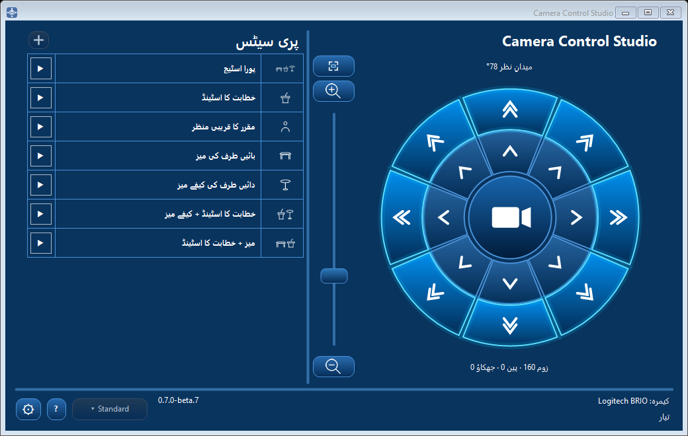
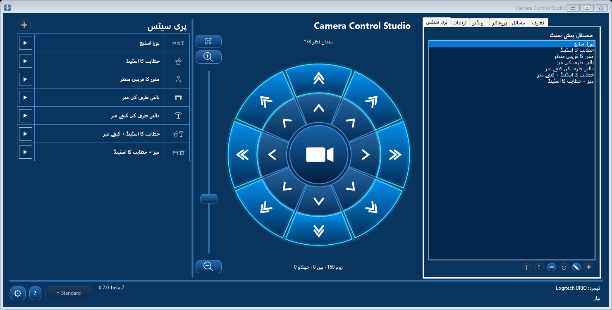
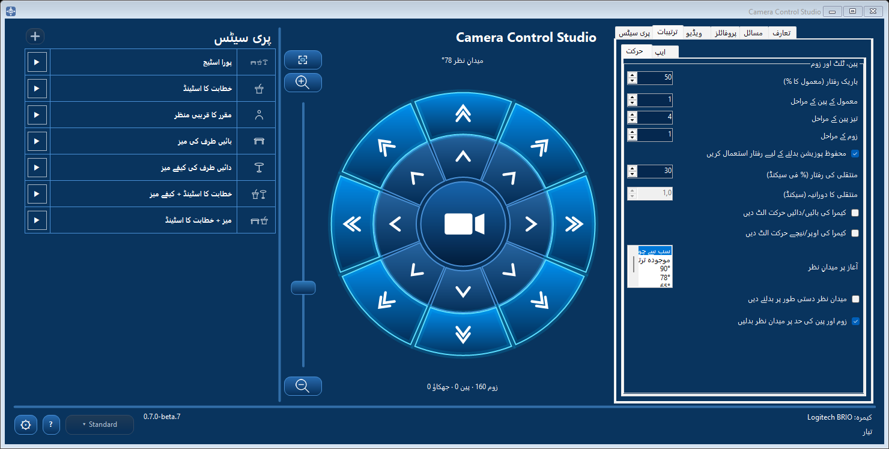
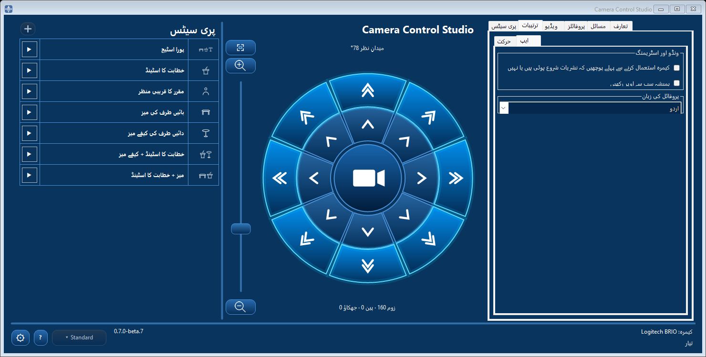

# استعمال اور ترتیبات

[اردو · Camera Control Studio](../USER-GUIDES.md)

پہلے Zoom جیسی ایپ میں وہ میٹنگ شروع کریں جسے آپ نشر کرنا چاہتے ہیں۔ پھر **Camera Control Studio** کھولیں۔

مدد کے لیے **?** دبائیں۔ کسی بٹن کا کام دیکھنے کے لیے اس پر ماؤس رکھیں۔ ہر سمت کی حرکت کیمرے کی آخری حد پر رک جاتی ہے۔

1. **پری سیٹ فعال کریں**

   پری سیٹ کی قطار میں ▶ دبائیں، نام پر دو بار کلک کریں، یا قطار منتخب کر کے Enter دبائیں۔

   | رنگ | مطلب |
   | --- | --- |
   | پیلا | کیمرہ محفوظ پوزیشن کی طرف جا رہا ہے۔ |
   | سبز | کیمرے کے ڈرائیور نے محفوظ مختصات تک پہنچنے کی اطلاع دی ہے۔ |
   | نیلا | پری سیٹ فعال کے طور پر نشان زد نہیں ہے۔ |

   سبز رنگ ڈرائیور کے بتائے ہوئے مختصات کی تصدیق کرتا ہے۔ اصل تصویر اپنی نشریات میں دیکھیں۔ اگر ڈرائیور وقت پر پوزیشن تک پہنچنے کی اطلاع نہ دے، تو قطار نیلی ہو جاتی ہے اور اسٹیٹس والے حصے میں پیغام دکھائی دیتا ہے۔ آئیکن مسلسل دکھائی دیتے ہیں۔

2. **فریم درست کریں**

   **افقی گردش**

   معمول کی حرکت کے لیے اندرونی حلقہ اور تیز حرکت کے لیے بیرونی حلقہ استعمال کریں۔ ترچھے تیر کیمرے کو 45° کی سمت میں گھماتے ہیں۔ ہر محور پر حلقے کی رفتار کا 45% لگتا ہے۔ حرکت جاری رکھنے کے لیے تیر دبائے رکھیں۔ رکنے کے لیے چھوڑ دیں۔

   ذریعہ چننے کے لیے کیمرے کے بٹن پر کلک کریں۔ کیمرا گھمانے کے لیے بٹن دبا کر مطلوبہ سمت میں کھینچیں۔ جتنا دور کھینچیں گے، رفتار اتنی بڑھے گی، تیز رفتار سے زیادہ سے زیادہ دو گنا تک۔ رکنے کے لیے بٹن چھوڑ دیں۔

   **زوم**

   عدسے والے بٹن سے زوم اِن یا آؤٹ کریں۔ دہرانے کے لیے بٹن دبا کر رکھیں۔ سلائیڈر کھینچتے ہوئے زوم بدلتا ہے۔

   **افقی گردش روکیں**

   جاری افقی گردش روکنے کے لیے Esc دبائیں۔

   > کیمرے کو دستی طور پر گھمانے، جھکانے یا زوم کرنے سے پری سیٹ کی طرف حرکت رک جاتی ہے اور فعال پری سیٹ کا رنگ ہٹ جاتا ہے۔

   **تیر والی کلیدیں**

   جب سمت کا پہیہ فوکس میں ہو تو تیر والی کلیدیں استعمال کریں۔ تیز قدموں کے لیے Shift دبا کر رکھیں۔

3. **عارضی پری سیٹ محفوظ کریں**

   فہرست کے اوپر **+** دبائیں، نام لکھیں اور محفوظ کریں۔ موجودہ پوزیشن مستقل پری سیٹس کے نیچے دکھائی دیتی ہے۔ عارضی پری سیٹ کا کوئی آئیکن نہیں ہوتا۔ یہ ایپ بند ہونے تک ہر پروفائل اور کیمرے کے لیے الگ رکھے جاتے ہیں۔

   عارضی پری سیٹ ہٹانے کے لیے اس کی قطار منتخب کر کے فہرست کے اوپر **×** دبائیں۔ ایپ بند ہونے پر تمام عارضی پری سیٹس ختم ہو جاتے ہیں۔ پوزیشن بعد میں استعمال کرنے کے لیے **ترتیبات → پری سیٹس** میں مستقل پری سیٹ بنائیں۔ مرکزی فہرست سے مستقل پری سیٹس تبدیل یا حذف نہیں کیے جا سکتے۔

4. **ایپ بند کریں**

   اگر کوئی کنٹرول کام نہ کرے تو نیچے اسٹیٹس والے حصے کا پیغام پڑھیں۔ ممکن ہے کیمرہ اس سہولت کو سپورٹ نہ کرتا ہو یا دستیاب نہ ہو۔

   ایپ معمول کے مطابق بند کریں۔ فعال پروفائل اور ونڈو کی ترتیب یاد رکھی جاتی ہے۔

   **مسائل کی اطلاع دیں**

   کسی خرابی یا درکار فیچر کی اطلاع **ترتیبات → مسائل** میں دیں۔

5. **ترتیبات**

   ونڈو کے نیچے سے پروفائل منتخب کریں۔ کیمرہ منتخب کرنے کے لیے سمت کے پہیے کے درمیان موجود کیمرے کے آئیکن پر کلک کریں۔

   مستقل پری سیٹ کے لیے نیچے گیئر کھولیں اور **پری سیٹس → مستقل پری سیٹ شامل کریں** منتخب کریں۔ نام اور آئیکن منتخب کر کے محفوظ کریں۔

   

   ترتیبات میں مراحل، منتقلی کا دورانیہ اور سمت کی تبدیلی مقرر کریں۔ **ویڈیو** کے ٹیب میں ڈرائیور کے فراہم کردہ کنٹرول ہیں۔ **پروفائلز** میں نیا پروفائل بنائیں یا موجودہ پروفائل کی نقل بنائیں۔ اگر کیپچر سافٹ ویئر کو پہلے جوڑنا ہو تو نشریات کی تصدیق کا اختیار فعال کریں۔

   

   

6. دونوں حصوں کی چوڑائی بدلنے کے لیے عمودی تقسیم کار کو کھینچیں۔ ایپ شروع ہوتے وقت ترتیبات کا پینل بند رہتا ہے۔ **ترتیبات → ایپ → پروفائل کی زبان** میں زبان منتخب کریں اور ایپ دوبارہ شروع کریں۔ چھوٹے بٹن پر ماؤس لانے سے اس کا کام دکھائی دیتا ہے۔

## کیمرے کی حرکت کے دوران میدانِ نظر

**زوم اور پین کی حد پر میدانِ نظر بدلیں**

یہ آپشن پہلے سے فعال ہے۔ Brio میں زوم کی حد پر ایک بار اور دبائیں۔ زوم آؤٹ پر میدانِ نظر 65° سے 78° اور پھر 90° ہوتا ہے۔ زوم اِن پر ترتیب الٹ ہوتی ہے۔ ہر تبدیلی کے بعد زوم معمول کے قدموں پر واپس آتا ہے۔ پین کی حد پر ایپ زیادہ چوڑا منظر آزماتی ہے اور فریم کو قریب رکھنے کے لیے زوم بدلتی ہے۔ موجودہ میدانِ نظر رکھنے کے لیے آپشن بند کریں۔

فریم کے نشان والا مربع بٹن سب سے چوڑا منظر اور کم سے کم زوم منتخب کرتا ہے۔ ڈرائیور منظر پڑھ سکے تو پری سیٹ اسے محفوظ کرتا ہے۔

[تنصیب اور SmartScreen (انگریزی)](../en/SETUP.md)
