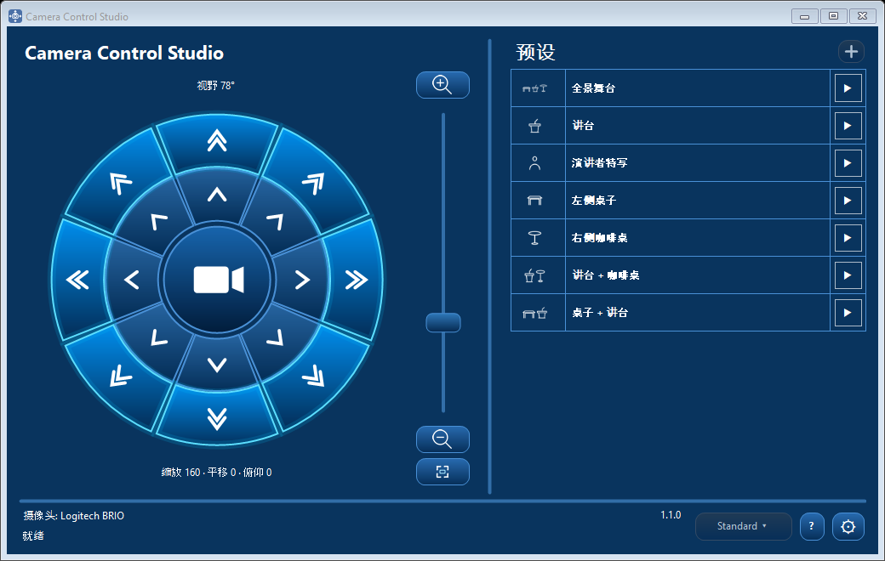
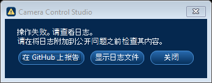

[English](../en/DAILY-USE.md) · [Dansk](../da/DAILY-USE.md) · [Deutsch](../de/DAILY-USE.md) · [所有引导语言](USER-GUIDES.md)

# 日常使用

*为Camera Control Studio 1.1.0.*编写

[故障排除](TROUBLESHOOTING.md)

在 Zoom 等应用程序中开始流媒体会议。然后打开**Camera Control Studio**。

## 一般

单击 **?** 寻求帮助。将鼠标悬停在按钮上可查看其名称和操作。方向锁定在相机可以到达的最后一个限制处。 [自动FOV的工作原理](SETUP.md#%E8%AE%BE%E7%BD%AE%E8%A7%86%E9%87%8E)

## 1. 激活预设

单击预设列表中的一行上的 ▶ 或双击名称。
您还可以选择该行并按 Enter 键。

| 颜色 | 含义 |
| --- | --- |
| 黄色 | 该应用程序正在将相机移向预设位置。 |
| 绿色 | 相机驱动程序报告已到达保存的坐标。 |
| 蓝色 | 预设未标记为活动状态。 |

绿色表示驱动程序报告已保存的位置和 FOV（如果已保存）。检查信息流中的图片。如果驾驶员无法及时确认拍摄，该行会变成蓝色。阅读状态消息以了解发生了什么。

## 2. 微调框架

### 潘

使用内环进行正常移动，使用外环进行快速移动。每个环有八个箭头。对角线以 45° 的角度一起移动平移和倾斜，每个轴上的环速度为 45%。单击一次，每个可用轴至少移动一个驱动器步。按住箭头继续移动。松开它即可停止。

### 相机按钮位于滚轮中央

- **双击选择摄像头。** 摄像机列表打开。
- **按住并拖动。** 在相机图标上启动。横向拖动可平移，上下拖动可倾斜。拖动一点可实现慢速移动，拖动得更远可实现更快的移动，最高速度可达两倍。松开按钮或将指针移回您开始停止的位置。

在**设置 → 平移**下，您可以关闭拖动或切换为单击以选择摄像机。两个选项均保存在活动配置文件中。

### 变焦

使用放大镜按钮进行缩放。按住按钮可重复该操作。
拖动滑块可在移动时调整缩放比例。

### 恢复全画幅

单击放大镜按钮上方带有框架图标的方形按钮。相机会尽可能缩小并选择最宽的视野（如果支持该设置）。这会改变相机图片。应用程序窗口保持其大小。

### 停止平移

按 Esc 停止正在进行的平移。

> 手动平移、倾斜或缩放会取消移动到预设并清除活动颜色。

### 方向键

当滚轮具有焦点时使用箭头键。按住 Ctrl 进行精细移动，按住 Shift 进行快速移动。

## 3. 保存临时预设

单击预设列表上方的**+**，输入名称并保存。当前位置显示在永久预设下方。
临时预设没有图标。它们会一直持续到您关闭应用程序为止，并且为每个配置文件和相机单独保存。

选择临时行，单击预设列表上方的“**×**”将其删除。应用程序关闭时，所有临时预设都会被删除。
要稍后使用某个位置，请在 **设置 → 预设** 下创建它。您无法编辑或删除主列表中的永久预设。

## 4. 退出

如果控件失败，请阅读底部状态区域中的消息。相机可能不支持该功能或可能不可用。

正常关闭应用程序。该应用程序会记住活动的配置文件和窗口布局。

## 5. 报告问题

如果页脚中出现 **有新版本可用**，请选择它以打开 GitHub 上的版本并查看下载。

<https://github.com/bkristensen/Camera-Ctrl-Pressets-Studio/releases>

在 **联系与关于 → 联系** 报告问题或请求功能。

有关摄像机方向、永久预设、图像设置、配置文件和移动步骤，请参阅 [Setup](SETUP.md)。

## 错误对话框

如果意外错误中断了操作，请关闭对话框并重试。如果对话框提示应用将关闭，请重新打开应用。

如果有诊断日志，点击 **显示日志文件** 会在文件资源管理器中选中它。点击 **在 GitHub 上报告** 后，应用会询问是否保存支持 ZIP，然后打开 GitHub 的错误报告模板。ZIP 可能包含对话框截图、日志、配置文件和窗口设置，以及系统报告。请先检查 ZIP，再自行将它附加到草稿。
