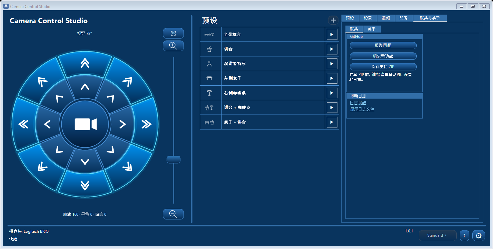

# 请求新功能

1. 打开设置面板。选择 **联系与关于 → 联系 → 请求新功能**。
2. 如果有更新版本，请选**是**打开下载页面。安装后，检查新版是否已有这个功能。选择**否**可继续打开 GitHub 草稿。
3. 在 GitHub 的 **Feature request** 模板中说明要完成的任务、功能会带来的帮助，以及怎样判断功能可以正常使用。 填写所有带红色星号的部分。

## 附上示例

选择 **联系与关于 → 联系 → 保存支持 ZIP**，然后指定保存位置。应用会显示文件路径。

ZIP 包含应用截图、已保存的 `profiles.json`、记录窗口布局的 `window.json` 和 `Logs` 中可用的日志。

分享前请检查 ZIP，去掉配置名称、摄像头 ID 和文件路径等隐私信息。将 ZIP 或相关文件拖入草稿描述区。附件需要手动添加。

## 检查类型和标签

模板请求将 **Type** 设为 **Feature**，将 **Labels** 设为 `enhancement`。如果缺少这些值且可编辑，请在右侧栏选择。没有编辑权限时，可以先提交草稿，维护者可稍后补充。

在 **Preview** 中检查说明和附件，然后选择 **Create**。
