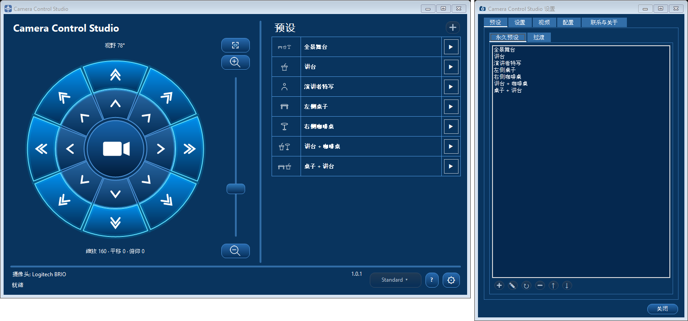

[English](../en/SETUP.md) · [Dansk](../da/SETUP.md) · [Deutsch](../de/SETUP.md) · [所有引导语言](USER-GUIDES.md)

# 设置应用程序

*为Camera Control Studio 1.0.1.*编写

[故障排除](TROUBLESHOOTING.md)

点击底部的齿轮按钮打开设置。 设置在独立窗口中打开。你可以继续使用主窗口。

## 安装并验证下载

下载安装程序或便携式 ZIP 从项目的 [GitHub 发布](https://github.com/bkristensen/Camera-Ctrl-Pressets-Studio/releases)。运行安装程序或解压整个安装程序 ZIP 在启动应用程序之前。如果一个 SHA-256 校验和已发布，将其与 `Get-FileHash -Algorithm SHA256` 供您下载。

**官方下载**\
<https://github.com/bkristensen/Camera-Ctrl-Pressets-Studio/releases>\

当下载的应用程序或其发布者几乎没有建立声誉时，Microsoft Defender SmartScreen 可以显示蓝色警告。认真对待。如果您从官方版本获得了预期的文件并信任来源，请选择“**更多信息**”并查看文件名和发布者。仅当您选择信任该文件并且 Windows 提供了该选项时，才选择 ** 无论如何运行 **。否则关闭警告。遵循您组织的设备政策。 [Microsoft SmartScreen 指导](https://learn.microsoft.com/windows/apps/package-and-deploy/smartscreen-reputation)

<https://learn.microsoft.com/windows/apps/package-and-deploy/smartscreen-reputation>

如果指南查看器需要 WebView2，请从 Microsoft 下载运行时。\
<https://developer.microsoft.com/microsoft-edge/webview2/>

先选择要用的配置文件。选择入口在主窗口底部。默认情况下，双击方向盘中央的相机按钮可选择相机。配置文件会记住相机。找不到这台相机时，请选择另一台。

下文按设置窗口的选项卡顺序介绍。按钮变灰时，通常要先选择一项。视频选项由相机驱动程序提供。请在采集软件中查看效果。

**关闭**. 可移动两个窗口并调整大小，也可拖动主窗口的分隔线。配置文件会记住这些位置和大小。点击底部的关闭可关闭设置，主窗口仍保持打开。

## 预设

### 永久预设

先对准相机。永久预设会记录相机支持的平移、俯仰和缩放值。相机能报告视野时，也会保存视野。预设属于一个配置文件中的一台相机。

- **+ 添加永久预设**. 将当前构图保存为新预设。选一个图标，并输入唯一的名称。名称为空时，选图标可自动填入建议名称。有名称才能保存。取消会保留原列表。
- **✎ 编辑名称和图标**. 修改所选预设的名称或图标。已保存的构图保持不变。
- **↻ 替换为当前位置**. 用相机当前的构图替换所选预设。确认后生效。名称和图标保持不变。
- **− 删除永久预设**. 确认后删除所选预设。
- **↑ / ↓ 向上移动所选预设 · 向下移动所选预设**. 在两个列表中将预设上移或下移一行。第一行的上箭头为灰色。最后一行的下箭头为灰色。

先选预设，才能编辑、替换、删除或移动。添加和替换需要已加载的配置文件。相机的平移、俯仰和缩放至少有一项可控。相机尚未连接时，应用可尝试连接。

### 设置预设过渡

- **按速度切换预设位置**. 关闭时使用固定时间。打开后按速度移动，短距离会更快完成。参与移动的各轴同时到达目标。
- **过渡时间（秒）**. 设置一次切换所用的时间。默认 1 秒。速度模式下，此项为灰色。
- **切换速度（%/秒）**. 每秒移动量按决定此次移动的轴的全程百分比计算。默认 30%。固定时间模式下，此项为灰色。

## 设置

### 平移

- **微调速度（常速的百分比）**. 按住 Ctrl 再按方向键可微调。默认速度为普通速度的 50%。
- **正常转动步数**. 设置内圈普通箭头每次移动的步数。默认 1 步。
- **快速转动步数**. 设置外圈快速箭头每次移动的步数。默认 4 步。也会影响拖动相机按钮的速度。
- **反转摄像头左右转动**. 交换左右。如果相机向反方向移动，请试试此项。
- **反转摄像头上下转动**. 交换上下。如果相机倒着安装，请试试此项。这两项改变控制方向，画面方向保持不变。
- **拖动摄像头按钮可转动和倾斜**. 拖动方向盘中央的按钮来对准相机。关闭后可用箭头控制。
- **双击摄像头按钮选择视频源**. 打开时，双击打开相机列表。关闭时，单击即可打开。

连接前可以修改移动设置。每步的距离、可用方向和移动范围由驱动程序决定。

### 设置缩放步长

- **缩放步数**. 设置每次按 + 或 − 的缩放步数。默认 1 个驱动步长。此项可提前设置，相机支持缩放时才生效。滑块用于在当前视野内选择缩放值。

### 应用程序

- **使用摄像头前询问是否已开始直播**. 如果采集软件必须先开始直播，请开启此项。下次操作相机时，应用会询问。直播准备好后选是。选否会保持断开。重启、切换配置文件或修改此项后会再问。关闭此项允许应用启动时连接。
- **始终置顶**. 让主窗口保持在其他应用上方。关闭后，其他窗口可以覆盖它。
- **配置文件语言 · 自动**. 选择 12 种语言中的一种。自动优先使用受支持的 Windows 显示语言，否则使用英语。重启后生效。每个配置文件单独保存语言。

## 视频

- **加载图像设置**. 连接相机并加载图像设置。相机断开时显示此按钮。如果驱动程序未提供图像设置，连接后只会保留视野选项卡。
- **自动**. 驱动程序决定显示哪些选项卡和滑块。自动模式由相机调整数值。取消自动后可用滑块调节。如果驱动只支持自动，滑块为灰色，自动框可能锁定。如果驱动只支持手动，自动框会隐藏。
- **将图像设置恢复为驱动程序默认值**. 将所有受支持的图像设置恢复到驱动程序的默认值。按钮出现在图像选项卡，视野选项卡中隐藏。图像值按相机和配置文件保存。

### 对焦与曝光

- **增益**. 增强信号，让画面更亮。增益太高会增加噪点。
- **曝光**. 控制传感器收光的时间。曝光越长，图像越亮，但运动物体可能变模糊。
- **对焦**. 选择清晰成像的距离。在采集软件中检查主体是否清楚。

### 颜色

- **白平衡**. 去掉灯光造成的偏色，让白色看起来是白色。
- **饱和度**. 让颜色更鲜艳或更淡。
- **伽马**. 调亮或调暗中间色调。
- **色相**. 改变颜色在色轮上的位置。

### 光线与细节

- **对比度**. 调整亮处和暗处的差别。
- **亮度**. 让整个画面更亮或更暗。
- **逆光补偿**. 主体背后有强光时，提高主体亮度。
- **锐度**. 让轮廓更明显或更柔和。

### 设置视野

视野（FOV）表示画面能容纳多少场景。角度越大，显示越多。缩放会在当前视野内改变裁切范围。

- **启动时的视野 · 最宽可用视野 · 保持不变**. 选择最广角、保留当前角度，或选择驱动程序报告的具体角度。应用会在本次会话第一次连接时尝试应用。已连接的相机至少报告一个角度后，列表才可用。
- **允许手动更改视野**. 在方向盘下方显示角度选择器。关闭后，如果应用能读取角度，就显示当前角度。驱动程序提供的角度少于两个时，此项为灰色。
- **在缩放和平移到达极限时切换视野**. 到达缩放极限后再按一次。缩小时尝试更广的角度，放大时尝试更窄的角度。水平平移到边缘时，会试用可能留出空间的其他角度。应用尽量保留构图。如果仍无法移动，会恢复原构图。关闭手动选择也能使用。角度少于两个时，此项为灰色。

例如，Brio 在 65° 和最小缩放时，再按缩小可尝试切到 78°。再按一次可在新角度继续缩小。主窗口的画框按钮会尝试同时选择最广角和最小缩放。如果别的软件也控制相机，请检查画面。

## 配置

- **+ 新建配置**. 使用默认设置新建配置文件并激活。输入唯一的名称。
- **⧉ 复制当前配置**. 复制当前配置文件的设置和预设，再切换到副本。选中其他行也会复制当前配置文件。
- **✎ 重命名所选配置**. 重命名选中的配置文件。未选择或选中 Standard 时，按钮为灰色。新建与复制需要先加载配置文件。三个命名对话框都必须先输入名称，才能确认。
- **保留当前位置和布局**. 双击配置文件打开切换对话框。打开布局选项可把当前窗口位置、大小和分隔线带到新文件。关闭时使用目标配置文件已有的布局。切换会重启应用并清除临时预设。

## 联系与关于

### 联系

- **报告问题**. 打开 GitHub 错误报告模板。如有新版本，应用先询问是否打开。若继续报告，应用会在打开草稿前询问是否保存支持 ZIP。
- **请求新功能**. 打开 GitHub 功能请求模板。如有新版本，请先试用。所需功能可能已经加入。
- **保存支持 ZIP**. 将截图、可用日志、配置文件数据和窗口布局保存在一个 ZIP 中。先检查隐私信息，再自行在 GitHub 草稿中添加附件。操作进行时，三个按钮会暂时变灰。
- **GitHub 项目 · GitHub 发布 · 参与项目讨论**. 三个 GitHub 链接分别打开项目源代码、版本下载和项目讨论。

[报告问题](Report%20a%20bug.md) · [请求新功能](Request%20a%20feature.md)

### 诊断日志

- **日志设置**. 打开日志设置。更改对所有配置文件生效。保存会应用更改，取消会保留原设置。
- **选择文件夹 · 自动**. 选择文件夹，或使用自动模式。路径为只读。自动使用应用程序文件夹。无法使用时改用 `%LOCALAPPDATA%\CamPressets\Logs`。
- **每个文件的最大大小 (MiB)**. 设定何时新建日志文件。默认每个文件 1 MiB。
- **日志文件上限（含当前日志）**. 设定保留的文件数，包括正在写入的文件。默认 2 个。
- **显示日志文件**. 在文件资源管理器中选中最新日志。没有日志时，应用会提示。

### 关于

- **请我喝杯咖啡**. 查看已安装版本和开发者姓名。将鼠标停在版本号上可查看完整构建 ID。支持链接会打开开发者的支持页面。
- **打开指南**. 在此选项卡打开指南。主窗口的帮助按钮也可打开。

要备份，请关闭应用并复制 `%LOCALAPPDATA%\CamPressets`。临时预设仅保留到本次会话结束。

[日常使用](DAILY-USE.md)
