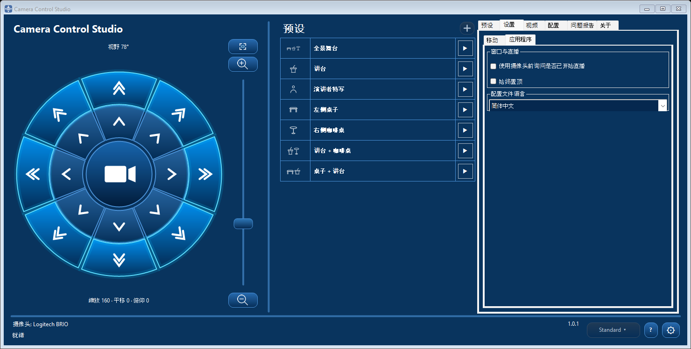
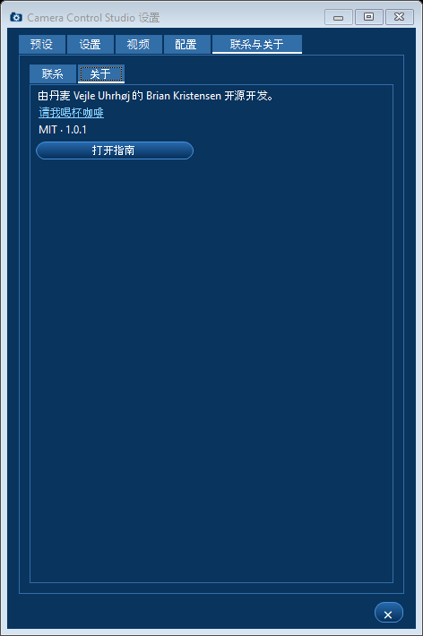
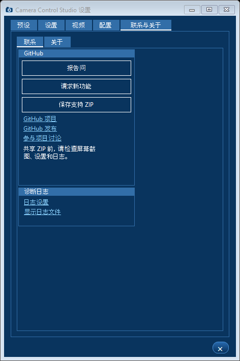

[English](../en/SETUP.md) · [Dansk](../da/SETUP.md) · [Deutsch](../de/SETUP.md) · [所有引导语言](USER-GUIDES.md)

# 设置应用程序

*为Camera Control Studio 1.0.1.*编写

[故障排除](TROUBLESHOOTING.md)

点击底部的齿轮按钮打开设置。 设置在独立窗口中打开。你可以继续使用主窗口。

## 安装并验证下载

下载安装程序或便携式 ZIP 从项目的 [GitHub 发布](https://github.com/bkristensen/Camera-Ctrl-Pressets-Studio/releases)。运行安装程序或解压整个安装程序 ZIP 在启动应用程序之前。如果一个 SHA-256 校验和已发布，将其与 `Get-FileHash -Algorithm SHA256` 供您下载。

**官方下载**\
<https://github.com/bkristensen/Camera-Ctrl-Pressets-Studio/releases>\

当下载的应用程序或其发布者几乎没有建立声誉时，Microsoft Defender SmartScreen 可以显示蓝色警告。认真对待。如果您从官方版本获得了预期的文件并信任来源，请选择“**更多信息**”并查看文件名和发布者。仅当您选择信任该文件并且 Windows 提供了该选项时，才选择 ** 无论如何运行 **。否则关闭警告。遵循您组织的设备政策。 [Microsoft SmartScreen 指导](https://learn.microsoft.com/windows/apps/package-and-deploy/smartscreen-reputation)

<https://learn.microsoft.com/windows/apps/package-and-deploy/smartscreen-reputation>

如果指南查看器需要 WebView2，请从 Microsoft 下载运行时。\
<https://developer.microsoft.com/microsoft-edge/webview2/>

## 1. 选择配置文件和相机

使用页脚中的配置文件选择器来选择配置文件。要创建一个，请打开 **设置 → 配置**。选择 **New** 作为默认设置，或选择 **Copy** 作为活动配置文件的副本。以人名或设置命名。新的配置文件变得活跃。在**配置**中，选择一个配置文件，然后单击**✎**对其进行重命名。标准配置文件有固定名称。

双击方向轮中央的摄像机符号可选择摄像机。程序会记住它。如果该摄像头丢失，请选择其他来源。位置属于配置文件内的相机。

## 2. 决定何时开始相机控制

如果您的捕获程序必须首先启动，请在 **设置 → 应用程序** 下启用 **使用摄像头前询问是否已开始直播**。该选项默认关闭。

启用该选项后，第一个摄像头动作会询问流媒体是否已开始。仅当有时才选择 **Yes**。选择 **No** 以保持相机控制断开。在“是”之后，在您更改配置文件、更改此选项或重新启动应用程序之前，不会再次询问进一步的操作。该应用程序不会为您检测或启动流会话。

如果您在首次使用时需要此顺序，请在下次会话之前设置该选项。默认情况下允许应用程序在启动时连接。

## 3. 设置移动和缩放

打开 **设置 → 平移** 设置平移和倾斜步骤、反转方向以及选择相机按钮的工作方式。从小步骤开始。在您的捕获程序中测试结果。

| 设置 | 它改变了什么 | 默认 |
| --- | --- | --- |
| 精细速度（正常速度的%） | 按住 Ctrl 和箭头键时进行评分 | 50% |
| 正常平移步骤 | 中箭头环 | 1 |
| 快速平移步骤 | 外箭头环 | 4 |

一步是指相机驱动支持的一步。它不是固定的距离或百分比。驾驶员限制了运动和平稳性。

对于倒置摄像头，启用 **反转摄像头上下转动** 并测试 Up。仅当向左移动方向错误时才启用 **反转摄像头左右转动**。这些设置会更改控件。他们不旋转视频。

### 设置缩放步长

打开**设置 → 缩放**可以选择加号和减号按钮一步移动的距离。默认为一个驱动程序步骤。 [请参见“缩放”选项卡](../images/screenshots/settings-tabs/en/zoom.png)。

### 设置预设过渡

打开 **预设 → 过渡** 选择相机如何在保存的位置之间移动。 [请参见“转换”选项卡](../images/screenshots/settings-tabs/en/transitions.png)。

| 设置 | 它改变了什么 | 默认 |
| --- | --- | --- |
| 使用预设过渡速度 | 让行驶距离决定持续时间 | 关闭 |
| 转换速度 (%/s) | 巡航速率占控制轴每秒范围的百分比 | 30% |
| 过渡（秒） | 固定持续时间模式下每次预设更改的时间 | 1.0 |

通过基于速度的转换，短距离移动比长距离移动花费的时间更少。该应用程序加速和制动，所有移动轴共享相同的进度，以便它们可以一起到达目标。

### 设置视野

打开**视频 → 视野**。在 **启动时的视野** 下，选择 **最宽可用视野**（摄像头驱动程序报告的角度）或 **保持不变** 以保持当前视图。应用程序在第一次连接时使用此选择。打开 **允许手动更改视野** 以在方向轮下方报告的角度中进行选择。如果驾驶员报告没有可选择的角度，则 FOV 控件将被禁用。如果相机支持，您仍然可以使用变焦。 [请参见视野选项卡](../images/screenshots/settings-tabs/en/field-of-view.png)。

**在缩放和平移到达极限时切换视野** 默认开启。您可以在隐藏手动选择器的情况下使用它。当驱动程序支持 FOV 时有效。

- **缩小：** Brio 上的最小变焦设置为 65° 时，再次按缩小可切换到 78°。按此按钮可更改 FOV 并调整变焦以保持近距离拍摄。下一次按将正常缩小。同样的步骤可将您从 78° 带到 90°。该按钮停止在 90° 和最小变焦处。
- **放大：** 在最大变焦时，再次按下可移向较窄的 FOV。如果驾驶员报告 90°、78° 和 65°，应用程序将按该顺序使用它们。该按钮停止在最窄的可用角度和最大变焦处。
- **向左或向右平移：** 在边缘，应用程序首先尝试更宽的视图。它调整缩放以保持作物接近。如果缩放允许，它还可以尝试更窄的视图。如果没有视图可以让它平移得更远，它就会恢复上一个镜头。车手控制比赛的激烈程度。

使用带有框架符号的方形按钮直接转到最宽的 FOV 和最小变焦。滑块仍然在当前 FOV 内设置缩放。关闭自动 FOV 以使缩放和平移保持在当前视图内。

预设保存平移、倾斜、变焦和驱动程序报告的 FOV。较旧的预设保留当前的 ​​FOV。检查实时图像是否由 Zoom、Logitech Brio Control 或其他应用程序控制裁剪。 [Brio和Zoom测试步骤](VALIDATION.md#brio-%E8%A7%86%E9%87%8E%E5%92%8C%E5%8F%98%E7%84%A6)

## 4. 调整图像并保存永久位置

[加载视频控件之前](../images/screenshots/settings-tabs/en/video.png)·[颜色](../images/screenshots/1.0.1/en/video-colour.png)·[光线和细节](../images/screenshots/1.0.1/en/video-light-detail.png)

在设置窗格中打开 **视频**，然后根据需要加载图像控件。选择一个组，例如 **对焦与曝光**、**颜色** 或 **光线与细节**。仅显示驱动程序公开的控件。调整亮度、对比度、色彩饱和度、焦点或白平衡（如果有）。手动调整前关闭自动模式。图像值按相机和配置文件保存。重置按钮可恢复驱动程序的默认设置。

先移动相机。在设置窗格中打开 **预设**。单击“**+**”添加永久预设。选择顶部的图标，检查名称，然后保存。如果名称为空且未使用，则选择一个图标会建议其名称。组合符号从左到右显示其主题。

在 **永久预设** 下，选择一个位置。将鼠标悬停在符号上即可了解其操作。使用 **✎** 编辑其名称和符号，使用 **↻** 将当前相机位置保存在其位置，使用 **−** 将其删除。使用 **↑** 和 **↓** 更改两个列表中的顺序。永久职位以粗体显示在主列表的顶部。

在主列表中选择永久行也会选择“设置”中的预设。在“设置”中选择新保存的预设。

## 5. 设置布局和语言

拖动摄像机控件和预设列表之间的分隔线。 配置文件会保存分隔线的位置。 初始尺寸为 900 × 500，最小尺寸为 670 × 450。 设置开始关闭。 当您在启动后首次打开它们时，会选择第一个选项卡。 如果某些字段位于窗口下方，则在 **平移** 或 **应用程序** 中向下滚动。 配置文件会保存两个窗口的位置和大小。

在页脚中选择配置文件时，不要选中 **保留当前位置和布局** 以恢复该配置文件的布局。选中它以将当前布局带入所选配置文件中。您留下的个人资料中会记住您的选择；携带的布局保存在目标配置文件中。

在**设置 → 应用程序 → 配置文件语言**下选择一种语言，然后重新启动即可应用。如果支持，**自动** 使用 Windows 显示语言，否则使用英语。切换配置文件会使用所选配置文件的语言重新启动应用程序。临时预设在重新启动时结束。

## 6.版本和项目信息

打开 **联系与关于 → 关于** 查看版本和项目链接。将指针移到版本号上可查看完整的构建 ID。如果问题只出现在某个构建，请注明该 ID。

## 7. 诊断日志和问题报告

打开 **联系与关于 → 联系** 选择日志文件夹、最大文件大小和保留数量（含当前日志）。默认使用应用目录，无法使用时写入 `%LOCALAPPDATA%\CamPressets\Logs`。

选择 **报告问题** 或 **请求新功能** 打开对应的 GitHub 草稿。报告问题时，应用会询问是否保存支持 ZIP。请检查内容，并手动附到草稿中。 [报告或关注问题](ISSUES.md)

**报告错误或建议功能**\
<https://github.com/bkristensen/Camera-Ctrl-Pressets-Studio/issues?q=is%3Aissue>\

下一篇：[日常用](DAILY-USE.md)如需备份，请关闭应用程序并复制 `%LOCALAPPDATA%\CamPressets`。临时职位不属于后备职位。
