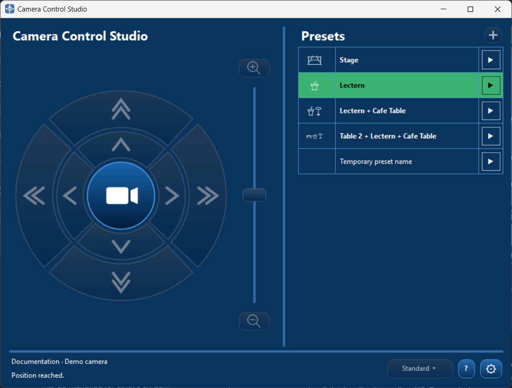

# 使用与设置

[简体中文 · Camera Control Studio](../USER-GUIDES.md)

先在 Zoom 等应用中开始要直播的会议，然后打开 **Camera Control Studio**。

点击窗口底部的 **?** 查看使用和设置帮助。将鼠标悬停在小按钮上可查看其功能。摄像头到达移动范围的极限时，相应方向的控件会停用。

1. **激活预设**

   在预设列表中点击对应行的 ▶，双击预设名称，或选中该行后按 Enter。

   | 颜色 | 含义 |
   | --- | --- |
   | 黄色 | 摄像头正在移向预设位置。 |
   | 绿色 | 摄像头驱动程序报告已到达保存的坐标。 |
   | 蓝色 | 该预设未标记为活动状态。 |

   绿色确认的是驱动程序报告的坐标。请在直播中检查实际画面。如果驱动程序未能及时确认到达，列表行会变为蓝色，状态区会显示提示。图标始终可见。

2. **微调取景**

   **水平转动**

   使用内圈微调，中圈常速移动，外圈快速移动。按住箭头可持续移动，松开即可停止。

   **缩放**

   点击放大镜按钮缩放。按住按钮可连续缩放。拖动滑块并松开可直接设置缩放。

   **停止水平转动**

   按 Esc 可停止正在进行的水平转动。

   > 手动水平转动、垂直倾斜或缩放会中断预设切换，并清除活动预设的颜色标记。

   **方向键**

   方向控制轮获得焦点后，可使用键盘方向键。按住 Shift 可按快速步长移动。

3. **保存临时预设**

   点击预设列表上方的 **+**，输入名称后保存。当前位置会显示在永久预设下方。临时预设没有图标，仅保留到应用关闭，并按配置和摄像头分别保存。

   要删除临时预设，选中对应行并点击列表上方的 **×**。关闭应用时会清除所有临时预设。若要以后使用某个位置，请在 **设置 → 预设** 中创建永久预设。主列表无法编辑或删除永久预设。

4. **退出应用**

   如果某项控制失败，请查看窗口底部状态区的提示。摄像头可能不支持该功能或当前不可用。

   正常关闭应用即可。应用会记住当前配置和窗口布局。

   **报告问题**

   如遇到故障或希望补充功能，请前往 **设置 → 问题报告**。

5. **设置**

   在窗口底部选择配置。点击方向控制轮中央的摄像头图标来选择摄像头。

   要长期保存某个位置，请点击底部的齿轮，再选择 **预设 → 添加永久预设**，设置名称和图标后保存。

   

   在设置面板中，可调整正常和快速步长、过渡时间以及摄像头方向。**视频**选项卡显示驱动程序支持的控件。**配置**选项卡可创建和复制配置。如果采集软件必须先连接，请开启使用摄像头前询问是否已开始直播的选项。

   

   

6. 拖动竖直分隔线可以调整两个区域的宽度。设置面板在每次启动时都会关闭。在**设置 → 应用程序 → 配置文件语言**中选择语言，然后重启应用。将鼠标移到小按钮上即可查看提示。
